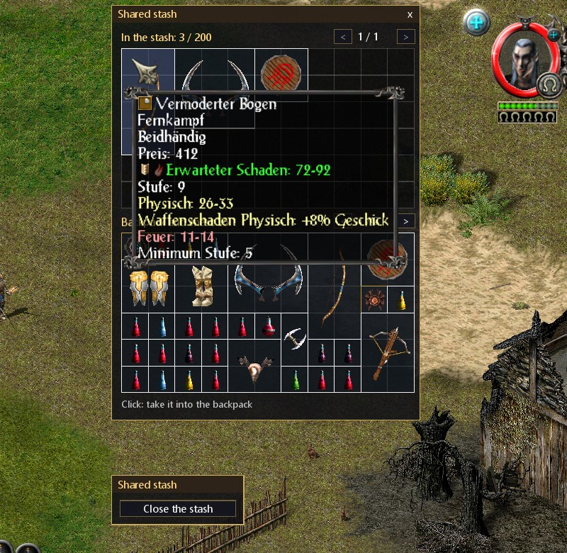
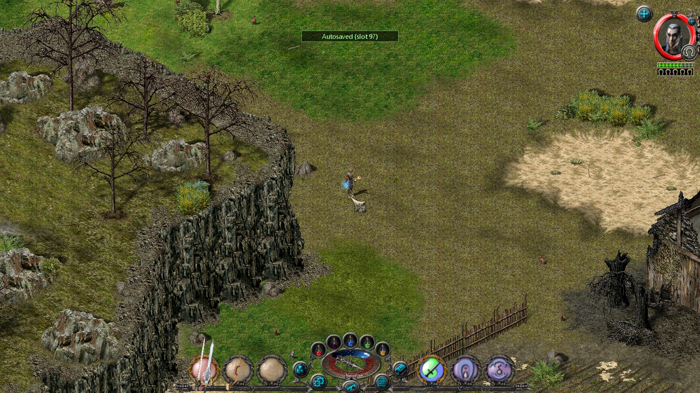
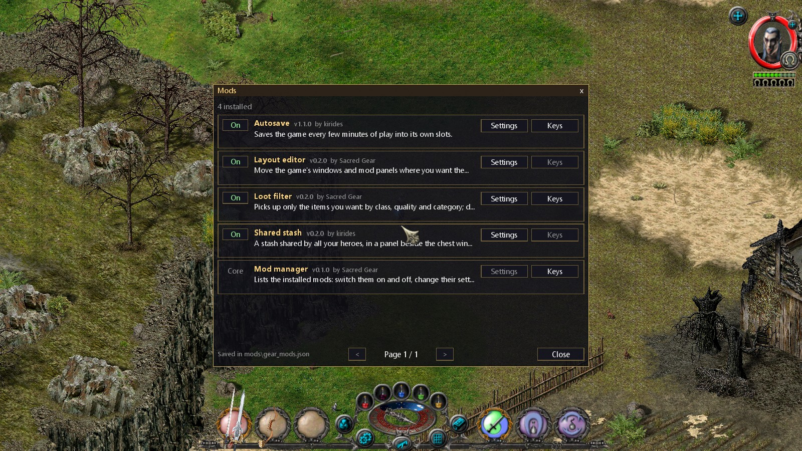
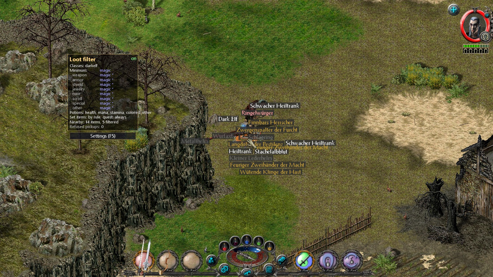
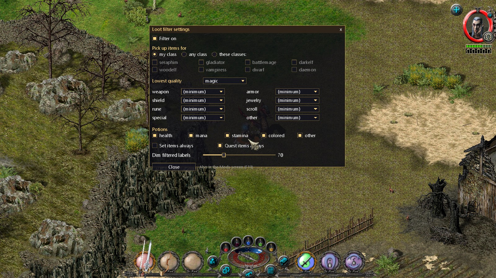
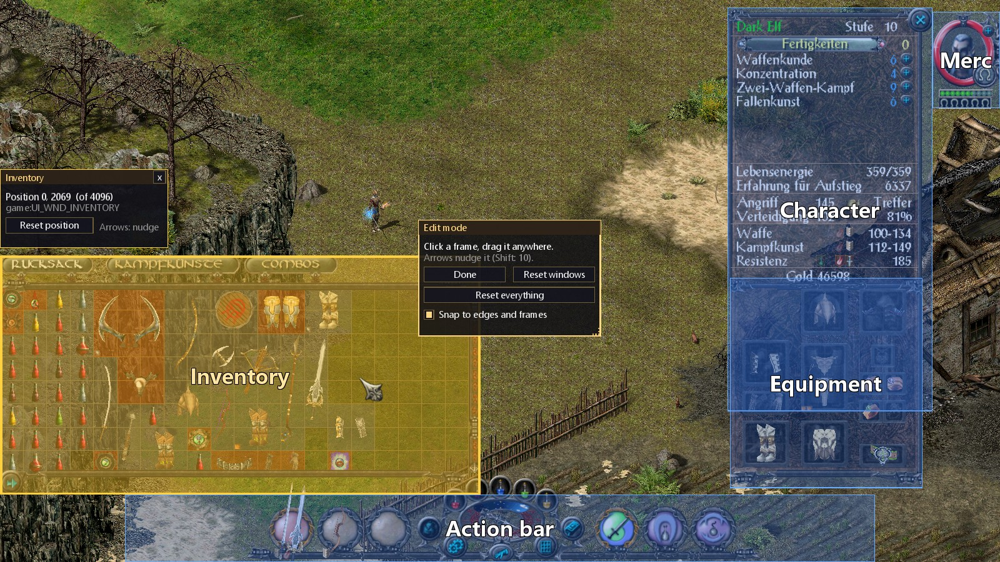

# Sacred Gear mods

**More Sacred Gold, from small Lua scripts.** These are mods for [Sacred Gear](https://github.com/kirides/sacred-bild/blob/main/docs/Gear.md),
the mod kit of [SacredBild](https://github.com/kirides/sacred-bild) for the GOG / Steam Sacred Gold (also the German
build). A mod is a folder you copy into the game's `mods` folder; you switch it on or off in game.

## For players

### What you get

**Shared stash**: one stash for all your heroes. Open the game's chest window, press the **Shared stash** button
beside it, and put an item in with one hero and take it out with another, with its random properties and runes intact.
The stash shows the items' real icons and the game's own tooltips, and it works in LAN games too.

**Autosave**: saves the game every few minutes of play (5 by default, set it in the Mods screen) into its own slots
97 to 99, oldest first, so a crash or a bad fight costs minutes, not an hour. **F6** saves right now, and a short note
confirms each save. Your own saves and the quicksave are never touched.

Both are set in the **Mod manager** (**F11**, or the *Mods* button under the escape menu): switch each mod on or off,
change its settings and re-bind its keys.

### More mods, in the sacred-bild repository

These ship with Sacred Gear's examples in [sacred-bild](https://github.com/kirides/sacred-bild#for-players), whose
README describes them as well. Copy their folders (`gear/examples/lootfilter`, `layout`, `realms`) to `mods` the same
way.

**Loot filter** (settings with **F5**): your hero picks up only what is worth it: items for its class, above a quality
you choose, per category and per potion type. Filtered items' labels are dimmed so the good drops stand out, and while
you hold **Alt** an overlay shows the active rules.

**Layout editor**, like the edit mode of an MMO: hold **Alt** (the game shows its labels) and click *Edit layout* at
the top left. Every game window and mod panel gets an overlay; click one and drag it anywhere, it snaps to screen edges
and to other windows, and your layout is remembered. This includes the shared stash's button.

**Realm picker**: chooses the server of the game's online play (Closed / Open Internet) from a page in the Mods
screen, so a private realm can be used without editing `Settings.cfg`. See
[Realms](https://github.com/kirides/sacred-bild/blob/main/docs/Gear.md#realms).

### Sacred ReBorn

The mod for Sacred ReBorn lives in a repository of its own:
[sacred-gear-reborn-decomp](https://github.com/kirides/sacred-gear-reborn-decomp).

### Install

1. Install [SacredBild and Sacred Gear](https://github.com/kirides/sacred-bild#install): extract a release zip into
   the game folder. `SacredGear.dll` next to the game loads with SacredBild.
2. Copy the folders you want from `src` to the game's `mods` folder: `src\autosave` becomes `mods\autosave`,
   `src\shared-stash` becomes `mods\shared-stash`. Leave `autosave_selftest` out; it is a test.
3. Start the game and press **F11**: the mods are listed, each can be switched on or off.

Details, settings, controller use and limits: [Install](docs/Install.md), [Autosave](docs/Autosave.md),
[Shared stash](docs/SharedStash.md), [Controller](docs/Controller.md).

---

## Technical overview

> **AI disclosure:** like SacredBild, these mods are developed with an AI coding assistant (Anthropic's Claude), at the
> maintainer's direction; the maintainer decides what goes in and tests the changes in the game.

Each mod is a folder in `src`: `mod.lua` is the manifest (id, version, settings, keys), `main.lua` the code, in Lua
(LuaJIT) on Sacred Gear's API ([GearApi](https://github.com/kirides/sacred-bild/blob/main/docs/GearApi.md)).

| Folder | |
|---|---|
| `src/autosave` | Periodic autosave. [README](src/autosave/README.md) |
| `src/autosave_selftest` | Automation self test of the autosave mod |
| `src/shared-stash` | The shared stash, built on `gear.inv`; includes its self tests. [README](src/shared-stash/README.md) |
| `tools/readme-shots` | Takes this README's screenshots in a copy of the game folder ([how](docs/Screenshots.md)) |

Editor support: `.luarc.json` points LuaLS at `../sacred-bild/gear/meta` (check both repositories out side by side).
The self tests run the real game without a player (`-gear-auto`); see each mod's README and the
[automation](https://github.com/kirides/sacred-bild/blob/main/docs/Gear.md#automation) docs.

## Documentation

| Document | Contents |
|---|---|
| [Install](docs/Install.md) | Installing Sacred Gear and the mods, the Mods screen, updating |
| [Autosave](docs/Autosave.md) | Timer, slots, settings, loading an autosave |
| [Shared stash](docs/SharedStash.md) | Using the stash, LAN, limits, the file, savegame caveats |
| [Controller](docs/Controller.md) | Using the mods with a gamepad |
| [Screenshots](docs/Screenshots.md) | Re-taking the README's screenshots |
