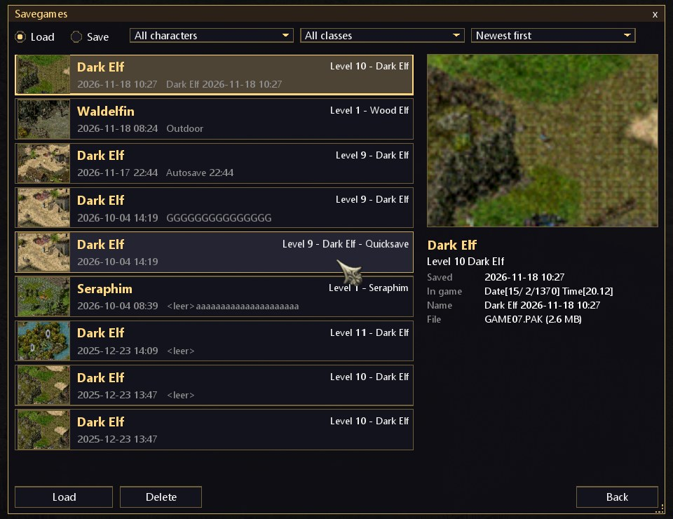
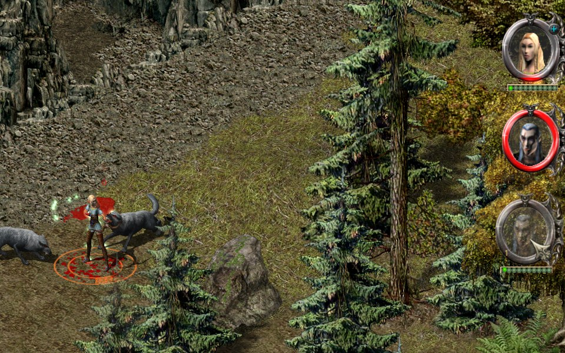
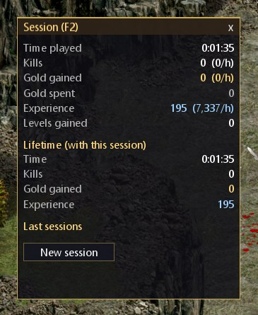
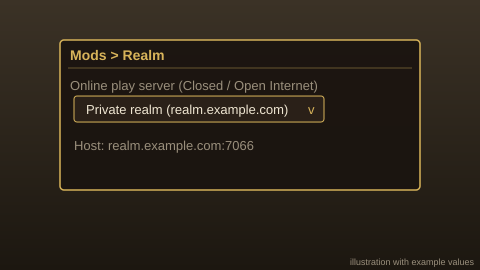
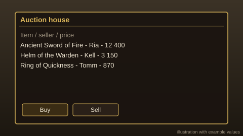
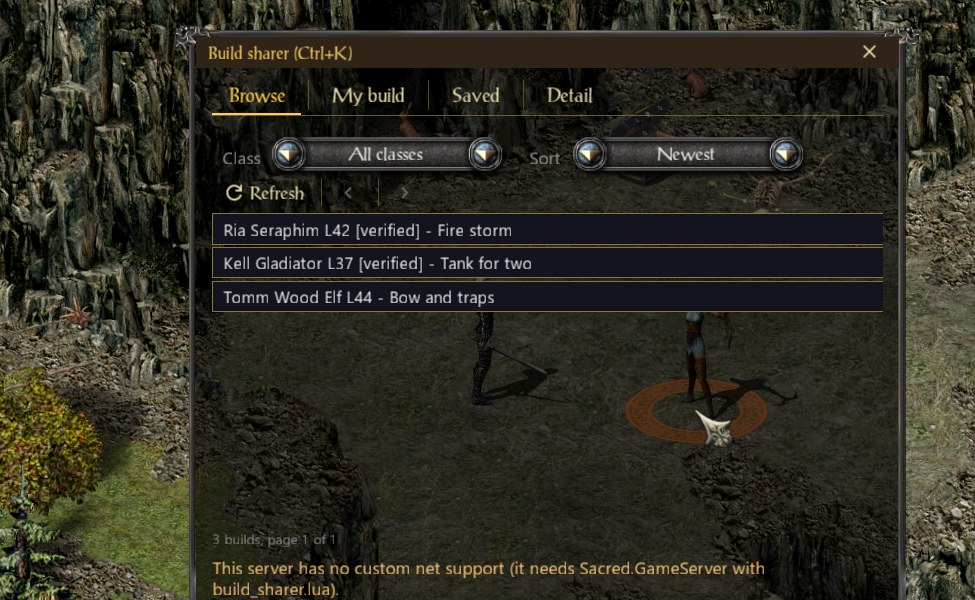
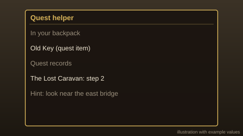
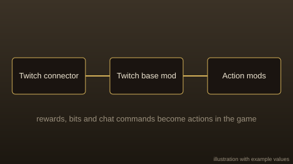
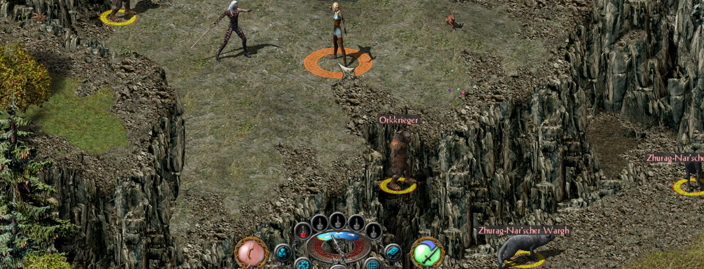

# Sacred Gear mods

**More Sacred Gold, from small Lua scripts.** These are mods for [Sacred Gear](https://github.com/kirides/sacred-bild/blob/main/docs/Gear.md),
the mod kit of [SacredBild](https://github.com/kirides/sacred-bild) for the GOG / Steam Sacred Gold (also the German
build). A mod is a folder you copy into the game's `mods` folder; you switch it on or off in game.

## For players

### What you get

Click a name for the mod's page: how to use it, its settings and keys, and notes for anyone who wants to tinker with it.
Pictures marked as illustrations (`.svg`) show example values; they will be replaced with screenshots from the game.

| Mod | Preview | What it does |
|---|---|---|
| [**Autosave**](docs/Autosave.md) |  | Saves the game every few minutes into its own slots. F6 saves right now. |
| [**Shared stash**](docs/SharedStash.md) |  | One stash for all your heroes, next to the chest window. Works in LAN games too. |
| [**Better SaveLoad**](src/better-saveload/README.md) |  | A clearer savegame screen with the Save tab first. |
| [**Enhanced Chat**](docs/mods/enhanced-chat.md) |  | A chat window with scrollback, tabs for global, private and system messages, a player filter and item names in their rarity colour. |
| [**Key bindings**](docs/mods/key-bindings.md) |  | Choose the keys and mouse buttons of the game's actions (two per action), and quick cast combat arts with one press. |
| [**Drop tuning**](docs/DropTuning.md) |  | More or fewer drops, better rarity odds, creatures drop the gear you could otherwise only disarm from them, optional fair random numbers. |
| [**Loot filter**](docs/mods/lootfilter.md) |  | Picks up only the items you want and dims the rest on the ground. F5. |
| [**Loot log**](docs/mods/lootlog.md) |  | A list of what dropped and what you picked up. F3. |
| [**Companions**](docs/mods/companions.md) |  | A party of heroes in single player: recruit companions of any class with their own gear, skills and experience, play any of them (click a portrait, PageDown), the others follow and fight with their combat arts, spells and combos. Home. |
| [**Item comparison**](docs/mods/item-compare.md) |  | Hover an item and see, in green and red, what it changes compared with what your hero (or a companion) wears in that slot. Works with the controller's cursor too. |
| [**Damage meter**](docs/mods/damagemeter.md) |  | Damage and DPS, for you and your party. Ctrl+D. |
| [**Session tracker**](docs/mods/sessiontracker.md) |  | Time played, kills, gold and experience, with rates per hour. F2. |
| [**Region counter**](docs/mods/region-counter.md) | | The kills a region needs before its Region Boss quest: set your own number, and keep the count when you leave the region or quit. |
| [**Layout editor**](docs/mods/layout.md) |  | Move the game's windows and mod panels where you want them. Hold Alt. |
| [**Realm picker**](docs/mods/realms.md) |  | Choose the online play server for Closed and Open Internet. |
| [**Auction house**](src/auction-house/README.md) |  | Buy and sell items between players. Needs a multiplayer game (useless in single player). |
| [**World events**](src/world-events/README.md) |  | A progress bar for the server's world event. |
| [**Sector tools**](src/sector-tools/README.md) |  | For server admins: sector and grid cell, recording areas. Not in the release zip. |
| [**Achievements**](docs/mods/achievements.md) |  | Messages for achievements and the daily login reward. Needs a server script. |
| [**Bounty board**](docs/mods/bounty.md) |  | Bounties to hunt, with progress and rewards. Works alone in single player (make your own bounties and automatic triggers, e.g. for streams), shows the server's board in network games. Ctrl+J. Also [daily and weekly quests](docs/mods/bounty.md#daily-and-weekly-quests) with a streak bonus (Ctrl+Shift+D). |
| [**Build sharer**](docs/mods/buildsharer.md) |  | Publish your build and browse the builds of others. Ctrl+K. Needs a server script. |
| [**Quest helper**](docs/mods/questhelper.md) |  | Quest items and the server's quest records with hints. Ctrl+U. Needs a server script. |
| [**Server feed**](docs/mods/serverfeed.md) |  | Rare finds and hero deaths on screen. Needs a server script. |
| [**Twitch Integration**](docs/mods/twitch_integration.md) |  | Turns rewards, bits and chat into actions in your game. Base mod. |
| [**Twitch Integration: actions**](docs/mods/twi_sacred.md) |  | Viewers spawn monsters, give gold, heal or teleport your hero. |

Each mod is switched on or off in the **Mod manager** (**F11**, or the *Mods* button under the escape menu), where you also change its settings and keys.

### Sacred ReBorn

The mod for Sacred ReBorn lives in a repository of its own:
[sacred-gear-reborn-decomp](https://github.com/kirides/sacred-gear-reborn-decomp).

### Install

1. Install [SacredBild and Sacred Gear](https://github.com/kirides/sacred-bild#install): extract a release zip into
   the game folder. `SacredGear.dll` next to the game loads with SacredBild.
2. Copy the folders you want from `src` to the game's `mods` folder: `src\autosave` becomes `mods\autosave`,
   `src\shared-stash` becomes `mods\shared-stash`. Leave the `*_selftest` folders out; they are tests.
3. Start the game and press **F11**: the mods are listed, each can be switched on or off.

Details, settings, controller use and limits: [Install](docs/Install.md), [Autosave](docs/Autosave.md),
[Shared stash](docs/SharedStash.md), [Controller](docs/Controller.md).

---

## Technical overview

> **AI disclosure:** like SacredBild, these mods are developed with an AI coding assistant (Anthropic's Claude), at the
> maintainer's direction; the maintainer decides what goes in and tests the changes in the game.

Each mod is a folder in `src`: `mod.lua` is the manifest (id, version, settings, keys), `main.lua` the code, in Lua
(LuaJIT) on Sacred Gear's API ([GearApi](https://github.com/kirides/sacred-bild/blob/main/docs/GearApi.md)).

| Folder | |
|---|---|
| `src/autosave` | Periodic autosave. [README](src/autosave/README.md) |
| `src/autosave_selftest` | Automation self test of the autosave mod |
| `src/better-saveload` | The savegame screen on Gear's replaced windows. [README](src/better-saveload/README.md) |
| `src/better-saveload_selftest` | Automation self test of Better SaveLoad |
| `src/enhanced-chat` | A chat window with scrollback, tabs and rarity colours, on `gear.chat`. [Doc](docs/mods/enhanced-chat.md) |
| `src/enhanced-chat_selftest` | Automation self test of Enhanced Chat |
| `src/drop-tuning` | Drop chance, rarity weights and drop random numbers on `gear.drops`. [Doc](docs/DropTuning.md) |
| `src/drop-tuning_selftest` | Automation self test of the drop-tuning mod |
| `src/world-events` | A movable progress bar for the game server's world event (needs the remake server's `world_events.lua`). [README](src/world-events/README.md) |
| `src/world-events_selftest` | Automation self test of the world-events mod |
| `src/sector-tools` | For server admins: the sector id and grid cell you stand in, boundaries on the ground, recording areas by walking, copy-to-clipboard of the config line for the server's `world_events.lua`. [README](src/sector-tools/README.md) |
| `src/sector-tools_selftest` | Automation self test of the sector-tools mod |
| `src/achievements`, `buildsharer`, `questhelper`, `serverfeed` | Clients of the SacredEngineRemake server mods. [Doc](docs/ServerMods.md) |
| `src/bounty`, `src/bounty_selftest`, `src/quests_selftest` | Bounty board and daily / weekly quests: own board and quests in single player, the server's in network games, and the self tests. [Doc](docs/mods/bounty.md); logic tests `tests/bounty_hooks_test.lua`, `tests/bounty_board_test.lua`, `tests/quests_test.lua` |
| `server-scripts/daily_quests.lua` | The game server's half of the daily and weekly quests (copy it into the server's `scripts` folder) |
| `src/lootfilter` | Loot filter: pick up by class, quality and category, dim the rest |
| `src/layout` | Layout editor: move the game's windows and mod panels |
| `src/realms` | Realm picker for the online play server |
| `src/twitch_integration`, `src/twi_sacred` | Twitch Integration: the connector's pipe and the actions (monsters, gold, heal, teleport) |
| `src/sessiontracker`, `src/lootlog`, `src/damagemeter` | Session mods. [Doc](docs/SessionMods.md); logic test `tests/session_mods_test.lua` |
| `src/item-compare`, `src/item-compare_selftest` | Item comparison tooltips and its self test. [Doc](docs/mods/item-compare.md) |
| `src/region-counter` | Region Boss kill counters on `gear.data.regions`. [Doc](docs/mods/region-counter.md); logic test `tests/region_counter_test.lua` |
| `tests/modmock` | Smoke tests of buildsharer and questhelper without the game ([how](tests/modmock/README.md)) |
| `src/shared-stash` | The shared stash, built on `gear.inv`; includes its self tests. [README](src/shared-stash/README.md) |
| `tools/readme-shots` | Takes this README's screenshots in a copy of the game folder ([how](docs/Screenshots.md)) |

Editor support: `.luarc.json` points LuaLS at `../sacred-bild/gear/meta` (check both repositories out side by side).
The self tests run the real game without a player (`-gear-auto`); see each mod's README and the
[automation](https://github.com/kirides/sacred-bild/blob/main/docs/Gear.md#automation) docs.

## Documentation

| Document | Contents |
|---|---|
| [Install](docs/Install.md) | Installing Sacred Gear and the mods, the Mods screen, updating |
| [Autosave](docs/Autosave.md) | Timer, slots, settings, loading an autosave |
| [Drop tuning](docs/DropTuning.md) | Drop chance, rarity weights, carried gear, the generator; the self test |
| [Shared stash](docs/SharedStash.md) | Using the stash, LAN, limits, the file, savegame caveats |
| [Server mods](docs/ServerMods.md) | The five clients of the remake server's scripts: install, hotkeys, settings |
| [Mod events](docs/ModEvents.md) | Events mods publish for other mods (bounty, quests, world events) and how to subscribe |
| [Session mods](docs/SessionMods.md) | Session tracker, loot log, damage meter |
| [Hotkeys](docs/Hotkeys.md) | Install, default keys and the clashes between mods |
| [Controller](docs/Controller.md) | Using the mods with a gamepad |
| [Screenshots](docs/Screenshots.md) | Re-taking the README's screenshots |
| [Names and IDs](docs/NamesAndIds.md) | Mods save ids and show localized names; migrating saved names |
