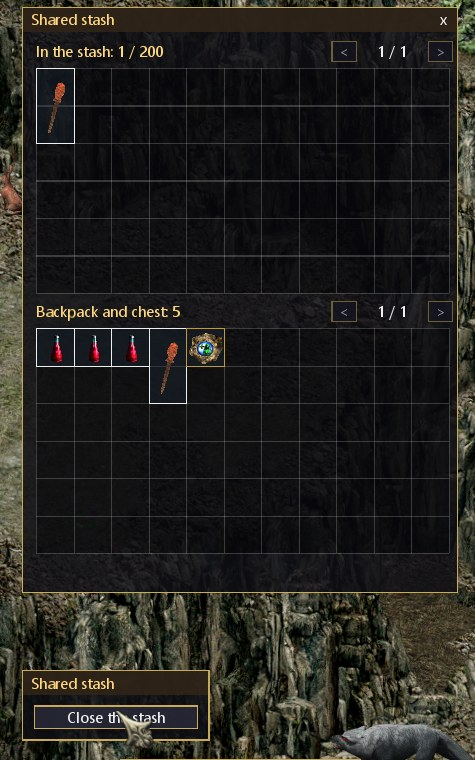

# Sacred Gear mods

**More Sacred Gold, from small Lua scripts.** These are mods for [Sacred Gear](https://github.com/kirides/sacred-bild/blob/main/docs/Gear.md),
the mod kit of [SacredBild](https://github.com/kirides/sacred-bild) for the GOG / Steam Sacred Gold (also the German
build). A mod is a folder you copy into the game's `mods` folder; you switch it on or off in game.

## For players

### What you get

**Shared stash**: one stash for all your heroes. Open the game's chest window, press the **Shared stash** button
beside it, and put an item in with one hero and take it out with another, with its random properties and runes intact.
The stash shows the items' real icons and the game's own tooltips, and it works in LAN games too.

**Autosave**: saves the game every few minutes of play (5 by default, set it in the Mods screen) into its own slots
97 to 99, oldest first, so a crash or a bad fight costs minutes, not an hour. **F6** saves right now, and a short note
confirms each save. Your own saves and the quicksave are never touched.

**Drop tuning**: more or fewer drops, a tilt of the rarity odds (the best items, set and unique items) and an optional fair random generator for drops,
all from sliders on its page of the Mods screen. Off by default in effect: every setting starts at "as the game has it".

Each of them is set in the **Mod manager** (**F11**, or the *Mods* button under the escape menu): switch each mod on or off,
change its settings and re-bind its keys.

### Also for Sacred Gear, in the sacred-bild repository

The mod manager, the **loot filter** (class, quality and category rules, dimmed labels, **F5**), the **layout editor**
(move every window and mod panel, **Alt** + *Edit layout*) and the **realm picker** (a private online play server) are
part of [sacred-bild](https://github.com/kirides/sacred-bild#what-you-get-from-sacred-gear-sacredgeardll), with
screenshots there. The loot filter, layout editor and realm picker are its examples (`gear/examples/lootfilter`,
`layout`, `realms`): copy them to `mods` like the mods here. See also
[Realms](https://github.com/kirides/sacred-bild/blob/main/docs/Gear.md#realms).

### Sacred ReBorn

The mod for Sacred ReBorn lives in a repository of its own:
[sacred-gear-reborn-decomp](https://github.com/kirides/sacred-gear-reborn-decomp).

### Install

1. Install [SacredBild and Sacred Gear](https://github.com/kirides/sacred-bild#install): extract a release zip into
   the game folder. `SacredGear.dll` next to the game loads with SacredBild.
2. Copy the folders you want from `src` to the game's `mods` folder: `src\autosave` becomes `mods\autosave`,
   `src\shared-stash` becomes `mods\shared-stash`. Leave the `*_selftest` folders out; they are tests.
3. Start the game and press **F11**: the mods are listed, each can be switched on or off.

Details, settings, controller use and limits: [Install](docs/Install.md), [Autosave](docs/Autosave.md),
[Shared stash](docs/SharedStash.md), [Controller](docs/Controller.md).

---

## Technical overview

> **AI disclosure:** like SacredBild, these mods are developed with an AI coding assistant (Anthropic's Claude), at the
> maintainer's direction; the maintainer decides what goes in and tests the changes in the game.

Each mod is a folder in `src`: `mod.lua` is the manifest (id, version, settings, keys), `main.lua` the code, in Lua
(LuaJIT) on Sacred Gear's API ([GearApi](https://github.com/kirides/sacred-bild/blob/main/docs/GearApi.md)).

| Folder | |
|---|---|
| `src/autosave` | Periodic autosave. [README](src/autosave/README.md) |
| `src/autosave_selftest` | Automation self test of the autosave mod |
| `src/drop-tuning` | Drop chance, rarity weights and drop random numbers on `gear.drops`. [Doc](docs/DropTuning.md) |
| `src/drop-tuning_selftest` | Automation self test of the drop-tuning mod |
| `src/world-events` | A movable progress bar for the game server's world event (needs the remake server's `world_events.lua`). [README](src/world-events/README.md) |
| `src/world-events_selftest` | Automation self test of the world-events mod |
| `src/shared-stash` | The shared stash, built on `gear.inv`; includes its self tests. [README](src/shared-stash/README.md) |
| `tools/readme-shots` | Takes this README's screenshots in a copy of the game folder ([how](docs/Screenshots.md)) |

Editor support: `.luarc.json` points LuaLS at `../sacred-bild/gear/meta` (check both repositories out side by side).
The self tests run the real game without a player (`-gear-auto`); see each mod's README and the
[automation](https://github.com/kirides/sacred-bild/blob/main/docs/Gear.md#automation) docs.

## Documentation

| Document | Contents |
|---|---|
| [Install](docs/Install.md) | Installing Sacred Gear and the mods, the Mods screen, updating |
| [Autosave](docs/Autosave.md) | Timer, slots, settings, loading an autosave |
| [Drop tuning](docs/DropTuning.md) | Drop chance, rarity weights, the generator; the self test |
| [Shared stash](docs/SharedStash.md) | Using the stash, LAN, limits, the file, savegame caveats |
| [Controller](docs/Controller.md) | Using the mods with a gamepad |
| [Screenshots](docs/Screenshots.md) | Re-taking the README's screenshots |
