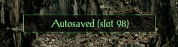

# Autosave

Saves a single player game every few minutes of play into slots of its own. It is separate from Sacred Gold's own
"Auto-Save" option, which saves at important points.

## Use

Nothing to do: after [installing](Install.md) it counts the time you actually play and saves when the time is up. A
note ("Autosaved (slot 98)") shows for four seconds below the top of the screen. **F6** saves at once.

- The timer runs only while you play: not in menus, loading screens, cinematics, the escape menu, or with an
  inventory / map / trade window open.
- When the time is up it waits for the first moment the game can save (alive, no trade, chest or blacksmith window, no
  cinematic) and asks again every two seconds. A refused save is retried after 10, 30, 60 and then every 120 seconds;
  `SacredGear.log` says why (`[autosave] ...`).
- Single player only.

## Slots

Autosaves rotate through `GAME97`, `GAME98` and `GAME99`, oldest first, so the two previous ones survive. The quicksave
(F9) and your manual saves are never written. They are normal savegames: they appear in the game's load window named
"Autosave HH:MM"; load the newest. If it is damaged (the game crashed while writing), take the one before. To keep one
for good, copy `Save\GAME97.PAK` to a free number.

## Settings (F11, Autosave, *Settings*)

| Setting | Default | |
|---|---|---|
| Autosave on | on | |
| Minutes of play between autosaves | 5 | 1 to 60 |
| Show a note after each autosave | on | |
| Savegame slots | `97, 98, 99` | up to 8 numbers from 1 to 32766; keep them away from the numbers of your manual saves |
| Savegame name | `Autosave %H:%M` | the name in the savegame list |
| Key *Autosave now* | `F6` | re-bind on the *Keys* page |

The *More* page shows the time to the next autosave and the last slot written, with a **Save now** button.

## Controller

The Mods screen works with a pad (**LT + LB** opens the mod menu, which lists *Autosave now*; the settings are D-pad
stops). Autosave needs no input of its own. See [Controller](Controller.md).

## For other mods

`gear.emit('autosave.configure', {...})` and `gear.emit('autosave.query', out)`; see the
[mod's README](../src/autosave/README.md), which also describes the self test.

## Development

- **Files:** `src/autosave/mod.lua` (settings, key) and `main.lua` (about 320 lines: the timer, the slot rotation 97 to 99, the note, the mod page). Self test: `src/autosave_selftest` (run it only in a copy of the game folder, it overwrites the autosave slots).
- **Depends on:** `gear.game.save` (the actual save), `gear.time`, `gear.settings`, `gear.mods.page`, `gear.ui`, `gear.keys`. Other mods can talk to it with the `autosave.configure` and `autosave.query` events ([README](../src/autosave/README.md)).
- **API reference:** [GearApi](https://github.com/kirides/sacred-bild/blob/main/docs/GearApi.md).
