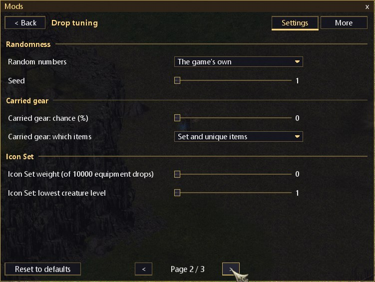

# Drop tuning



Makes creature drops more or less frequent, tilts the rarity of what they drop, lets creatures drop the gear you could otherwise only take with the
Disarming skill and, if you like, swaps the game's random numbers for a fair generator. Switched on, with every setting at its default, it changes nothing. It is built on `gear.drops` of Sacred Gear (what the engine does and what
each setting touches: [Gear drops](https://github.com/kirides/sacred-bild/blob/main/docs/GearDrops.md)).

Install it like the other mods (copy `src\drop-tuning` to the game's `mods` folder, **F11**, switch it on). It binds no keys; its settings are on its page
of the Mods screen (mouse or controller), and the **More** tab shows the game's rarity table next to the weights now in force.

| Setting | Meaning |
|---|---|
| Drop chance | A multiplier of the chance of every random drop attempt of creatures (2 = twice as many drops, 0 = none). Items a creature is set to drop (quest items, authored lists) are not touched. |
| Effect of magic find | How strongly the rarity bonus (magic find and the creature's own bonus) widens the odds of rarer equipment. |
| Set and unique drops | The two rows of the rarity table that hand the roll to the set / unique selection. |
| Qualities 1 to 4 / 5 to 9 / 10 to 14 | Multipliers of the weights of those equipment qualities (14 is the best). Setting the top group to 0 removes the best items; plain items are what is left over. The weights are read as a running sum against a roll of 1 to 10000, so large multipliers push the commoner qualities out of reach (see the Gear drops page). |
| Icon Set weight | The six pieces of the Icon Set (Dragon, Dark Elf, Royal and Seraphim statue, Grail, Shell; the Flaming Feet set bonus) are level 1 set items; the game's set drops are rare and shared with about 65 other sets, so they are hardly ever seen at higher levels (roughly 0.01% of equipment drops or less). This is the number out of 10000 random equipment drops of a creature that become one of them instead (10 = 0.1%, one in a thousand; 0 = off). The **More** tab shows the percentage and "one in N" at your hero's level. Also *lowest creature level* and *extra weight per level*. Creature loot only, not chests, shops or quest rewards. Flaming Feet makes Split clone more and Fadalmar's Counsel cast more fireballs, does little damage and can cause lag in multiplayer. |
| X-MAS set weight | The game has six X-MAS sets, one per class (Seraphim, Gladiator, Battle Mage, Dark Elf, Wood Elf, Vampiress; 3 to 5 pieces: sword, shield, helmet, the Seraphim also body armour and belt), sets 33 to 38 of `sets.bin`. Nothing in `Sacred.exe` checks the date for them (the only `GetSystemTime` / `GetLocalTime` calls stamp savegames and item creation dates, sync network clocks, or seed the random generator), so there is nothing to "allow all year": the items simply are not dropped by anything. In a test with the set weight raised to overwhelming, 823 set drops of a creature held 44 different set items and **no X-MAS piece**, so the game's own odds are about nil (the *Special* rows of the rarity table cannot raise them). This is the number out of 10000 random equipment drops of a creature that become a piece of **your hero's class's** X-MAS set instead (10 = 0.1%, one in a thousand; 0 = off, the default). Also *lowest creature level* and *extra weight per level*. The **More** tab shows the percentage and "one in N" at your hero's level. Creature loot only. Heroes of the Dwarf and Daemon classes have no X-MAS set. |
| Carried gear: chance | Some creatures carry a unique or set item (Khrag's armor and helm, the X-MAS sword, the shields of the ice elves, Bahamut's Breastplate ...) that only the Disarming skill takes from them. This is the chance, in percent, that every such item drops when the creature dies, so a hero without the skill can get them too. 0 = off, the game as it is (the default). Each item is rolled once per creature, and the drop is a new item of the same type lying at the corpse, as disarming gives it: the item's own fixed level and lowest tier, not the creature's level. Single player only (the game server cannot create the items). |
| Carried gear: which items | *Set and unique items* (the default; what can be disarmed) or *All equipment* the creature carries, which includes the plain weapons and armour of orcs, goblins and the like. |
| Random numbers | The game's own; a fair generator (no modulo bias: the game's rarity roll favours the first part of its range, which makes every rarer drop about 22% more likely than the table says); or the fair generator with a seed, which repeats the same numbers every run. |

Other mods can steer it: `gear.emit('drop-tuning.configure', {chance = 2, high = 0, rng = 'fair', icon_weight = 10, xmas_weight = 10, carry_chance = 100})` sets those settings.

## Self test

`src\drop-tuning_selftest` is an automation run of the mod in a copy of the game folder (the loot rolls leave items in the world):

```
Sacred.exe -gear-auto -gear-load=1 -gear-instance=droptuning -gear-mods=drop-tuning,drop-tuning_selftest
```

It checks that the defaults leave the rarity table and the generator alone, that the settings change the table, the drop rate (twice the chance: 160 against 85
equipment drops in 400 rolls in the last run) and the generator, that the Icon Set weight turns picks into pieces, that creatures that carry items drop them (not with the *Set and unique items* filter for plain gear, not at chance 0, all of them once at 100% and lying at the creature) and that the defaults bring everything back and that the X-MAS weight turns picks into pieces of the hero's class (type, class and set flag of every piece checked; nothing at weight 0 or below the lowest level) (25 checks). The carried-gear check runs the engine's loot function on an orc that holds weapons, so it needs Sacred Gear with `creature:carried()` and the `drops.roll` event's `id`; no real kill and no real disarmable creature (Khrag's priestess ...) is in that savegame.

## Development

- **Files:** `src/drop-tuning/mod.lua` (settings) and `main.lua` (about 170 lines). Self test: `src/drop-tuning_selftest`.
- **Carried gear:** a creature keeps its items in the 19 equipment words at +0x1A4 of its object, as heroes do (`creature:carried()`, new in Sacred Gear; `creature:equipment()` is for heroes only). The mod listens to `drops.roll` (its event now carries the object `id`) only while the chance is above 0, reads what the dying creature carries, rolls each item once and creates the drop with `gear.world.spawn(type, ...)` a moment later. Not verified in the game: which creatures hold which special items; the test only uses plain gear.
- **Depends on:** `gear.drops` (hooks into the game's loot functions: drop chance, rarity weights, the random numbers), `gear.world.object(id):carried()`, `gear.world.spawn`, `gear.mods.page`, `gear.settings`, `gear.ui`. Settings that are at "as the game has it" leave the game untouched.
- **API reference:** [GearDrops](https://github.com/kirides/sacred-bild/blob/main/docs/GearDrops.md), [GearApi](https://github.com/kirides/sacred-bild/blob/main/docs/GearApi.md).
