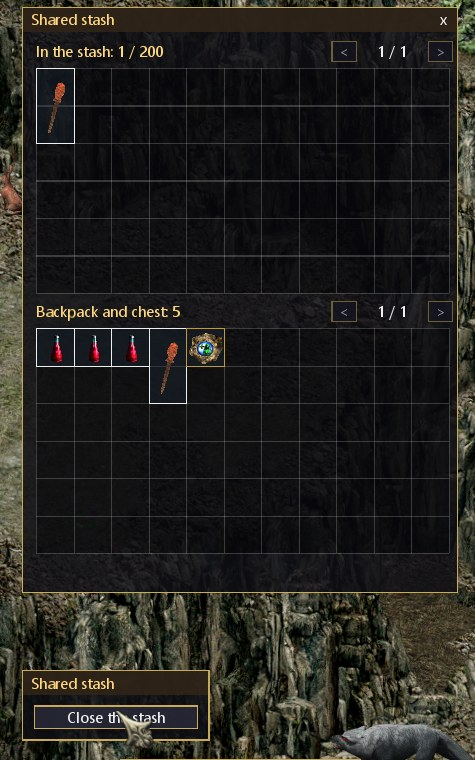
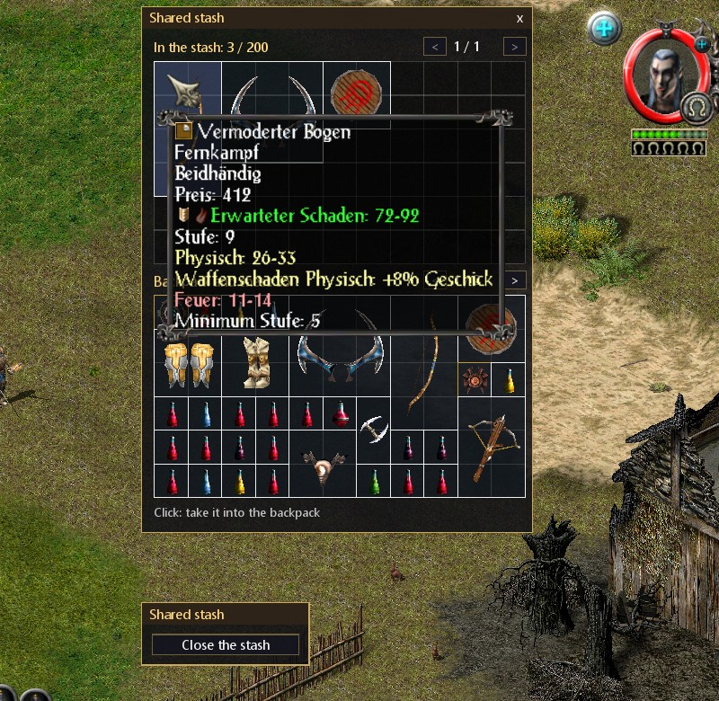

# Shared stash

One stash for all your heroes of one player (issue [kirides/sacred-bild#9](https://github.com/kirides/sacred-bild/issues/9)).

## Use

1. Walk to a chest and open it (the game's personal chest window).
2. A **Shared stash** button appears beside it. Click it.
3. The panel has two parts: **In the stash** (top) and **Backpack and chest** (bottom). Click an item below to put it
   in the stash; click one above to take it into the backpack (into the chest if the backpack has no room). Both grids
   have pages (< >).
4. Rest the cursor on an icon for the game's own tooltip.

The stash is only available **while the chest window is open**: the panel closes when the chest window closes
(walking away, Esc, a menu, a dead hero), and a deposit or a withdrawal is refused unless the chest is open right then.
There is no hotkey. Items that cannot move (quest items, gold) are greyed out.

The button is a small panel of its own: move it in the layout editor (hold Alt, *Edit layout*; the button is shown
greyed out there so it can be placed without a chest). Its place is kept in `mods\gear_layout.json`.

## LAN games

It works in LAN games, with the same icons and tooltips (the mod is tested hosting a LAN game). The stash file is on
your PC, so each player uses their own; what you put in or take out is announced to the game like any other inventory
change.

## Settings (F11, Shared stash, *Settings*)

| Setting | Default | |
|---|---|---|
| Items the stash holds | 200 | 10 to 200; the file is limited to 1 MB |
| Also move special items | off | horse gear and the like; quest items and gold never move |

## Controller

The panel is a mod window: with a pad it switches to the cursor as the game's windows do (left stick moves it, **A**
clicks, **B** closes). See [Controller](Controller.md).

## The file and your savegames

Everything is in `mods\shared-stash\stash.json` (`stash.bak.json` is the version before the last write). **Do not
delete it when you update the mod**: it is your stash. A file the mod cannot read switches the stash off with a message
instead of overwriting anything.

The stash lives outside any savegame, so the mod cannot see which one is loaded. The rule of thumb: **move items,
then save**, and do not load an older savegame afterwards to get an item back.

- Loading an older save after a *withdrawal*: that save lacks the item and the stash gave it up, so it is gone.
- Loading an older save after a *deposit*: both the save and the stash have the item (a duplicate the mod cannot
  prevent).

There is no "undo" list on purpose: it could be used to duplicate items. The exact order of steps is in the
[mod's README](../src/shared-stash/README.md).

## Development

- **Files:** `src/shared-stash/mod.lua`; `main.lua` (the button and window beside the chest); `stash.lua` (the stash file and item data); `transfer.lua` (moving items between backpack and stash); `kind.lua` (single player, LAN or network game: where the stash lives); `remote.lua` (the stash on a server); `selftest.lua` (self tests, run only with `-gear-auto`). About 1 600 lines together.
- **Depends on:** `gear.inv` (reading and building items, with their random properties and runes), `gear.mp` (kind of game), `gear.save` / `gear.read` (`stash.json`), `gear.ui` (item icons and the game's tooltips), `gear.auto` for the self tests and screenshots.
- **Test it:** [README](../src/shared-stash/README.md#self-test) (runs in a copy of the game folder).
- **API reference:** [GearApi](https://github.com/kirides/sacred-bild/blob/main/docs/GearApi.md).
