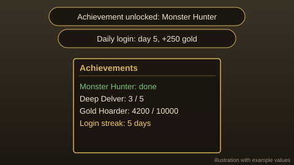

# Achievements and login streak

*Illustration with example values.*

Pops up a short message at the top of the screen when you unlock an achievement or collect your daily login reward, and has a panel that lists all achievements with your progress.

## What you need

Sacred Gear and the mod itself in your `mods` folder (see [Install](../Install.md)). It also needs a SacredEngineRemake game server (`Sacred.GameServer`) running the script `achievements.lua`. On any other server the mod just shows that the server has nothing for it.

## How to use it

Play as usual. A message appears whenever something is unlocked. Press **F7** to open the list of achievements and your progress.

## Keys

| Key | What it does |
|---|---|
| **F7** | Open or close the achievements panel. |

You can change every key in the Mods screen (**F11**, then the mod's *Keys* page).

## Settings

Open the Mods screen with **F11** and pick the mod.

| Setting | What it does |
|---|---|
| Show toasts | Turns the messages on or off. |
| Toast time (seconds) | How long a message stays on screen (2 to 15). |

## Development

- **Files:** `src/achievements/mod.lua` (manifest: settings, key, panel position) and `main.lua` (about 170 lines: the panel, the toasts and the server messages).
- **Depends on:** the Gear API ([GearApi](https://github.com/kirides/sacred-bild/blob/main/docs/GearApi.md)): `gear.net` (a channel to the game server), `gear.ui` (panel and toasts), `gear.keys`, `gear.settings`.
- **Server side:** `scripts-examples/achievements.lua` of the SacredEngineRemake game server. The protocol is described in [GearServerMods](https://github.com/kirides/sacred-bild/blob/main/docs/GearServerMods.md).
- **Test it:** there is no game-free test; start a local server with the script and the game with the mod. The panel's default place is in `config.panel_x` / `panel_y` of `mod.lua` (1024x768 layout; players move it with the layout editor).
- **Known clash:** F7 is also used by damagemeter, serverfeed and buildsharer ([Hotkeys](../Hotkeys.md)).
