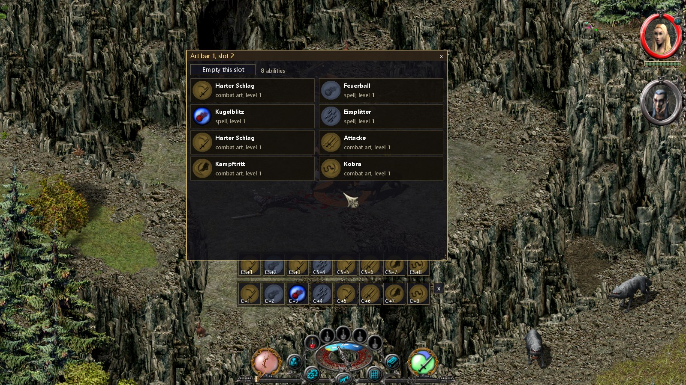

# Art bars

More combat arts at hand than the game's skill bar holds. The mod adds **extra bars of slots** (1 to 3 bars of 4 to 12 slots) for
your hero's combat arts, spells and combos, including the copies and chains of [Custom classes](custom-classes.md). A slot is used
with a key, a click or the controller, and shows the art's icon and its regeneration.

## What the game's own windows do (and why this mod exists)

The game's Combat Arts window (Inventory, *Kampfkünste*) is a fixed layout per class: one icon position per art id of the class,
grey until the hero has read the rune, in colour once known. Arts that are not in that layout have no place in it: **copies and
chains made with the editor do not appear there**, so they cannot be dragged to the game's skill slots. (The two known arts of a
Gladiator are in colour there, the copies of them are missing.) The art bars do not use the game's slots: they use the game's own
ability order, so the regeneration, the mana and the animations are the game's.

## What you need

Sacred Gear with `gear.world.cursor`, the mod, a single player game (the game's ability order for party heroes is single player
only). Works for every hero you play, also the companions (each hero has their own slots, kept in the savegame).

## How to use it

1. Press the small **e** button next to the first bar (or **Ctrl+E**, or *Art bars: edit the slots* in the controller's mod menu), click a
   slot, and choose an ability in the picker (cards with the icon, the name and the level). *Empty this slot* clears it. Press **e** again to
   leave edit mode.
2. Use a slot with its key: bar 1 **Ctrl+1 to Ctrl+8**, bar 2 **Ctrl+Shift+1 to Ctrl+Shift+8** (change them, and bind the other slots, on the
   mod's *Keys* page, F11). A click on a slot uses it too, and so does the controller (*Art bar N, slot M* in the mod menu, **LT + LB**;
   the slots are also D-pad stops).
3. The regeneration shows as a dark veil and the seconds on the slot, from the game's own timer.

**Aiming:** a key press aims with the mouse: the hostile creature under the cursor, else the nearest enemy to your hero (arts that need a
creature); the spot under the cursor (arts aimed at a place or a direction); the hero itself (self and area arts). A click on a slot or the
controller has no cursor in the world: it uses the nearest enemy and its spot.

**One bar with pages:** the setting shows one bar at a time; **Ctrl+PageDown / Ctrl+PageUp** switch between three pages, and the slot
keys of bar 1 use the page shown.

The bars are normal Gear panels: hold **Alt** (the layout editor) to move them.

## Settings

| Setting | What it does |
|---|---|
| Bars | 1 to 3 extra bars. |
| Slots per bar | 4 to 12. |
| One bar with pages | One bar at a time with page keys. |
| Slot size | 32 to 64. |
| Show the keys on the slots | The key labels in the corner of each slot. |
| Show empty slots | Empty slots show a +. |
| Log what the keys do | What each key press asked the game for. |

## Limits

- Single player. In a network game the game's ability order for party heroes is not available.
- The mod issues the order for the hero you play with the game's own ability order: arts that need a weapon or are not allowed for the hero
  are refused by the game as with the skill slot, and nothing happens.
- A slot holds an ability by id; if the hero no longer knows it (a class was left) the slot is dimmed and does nothing.
- The game's skill bar is unchanged.

## Development

- **Files:** `src/art-bars/mod.lua` (manifest; the keys are generated), `main.lua` (slots per hero, using abilities, the bars, the picker).
- **Depends on:** `creature:order_ability`, `gear.world.cursor` (the object and the world point under the mouse, sacred-bild),
  `gear.classes.art_icon`, `gear.data.abilities` (the target mode), `gear.store.game`, `gear.keys`, `gear.ui` panels.
- **Events for tests:** `art-bars.set` (bar, slot, ability), `art-bars.use` (bar, slot), `art-bars.pick`, `art-bars.edit`.
- **Self test:** `src/art-bars_selftest` (`Sacred.exe -gear-auto -gear-load=N -gear-mods=art-bars,custom-classes,art-bars_selftest`, a single
  player savegame with enemies nearby, in a copy of the game folder): the hero learns more abilities than the game's bar shows, two bars are
  filled, a slot is used and the regeneration starts, the world cursor works, a copy of the Custom classes mod runs from a slot, the picker opens.
