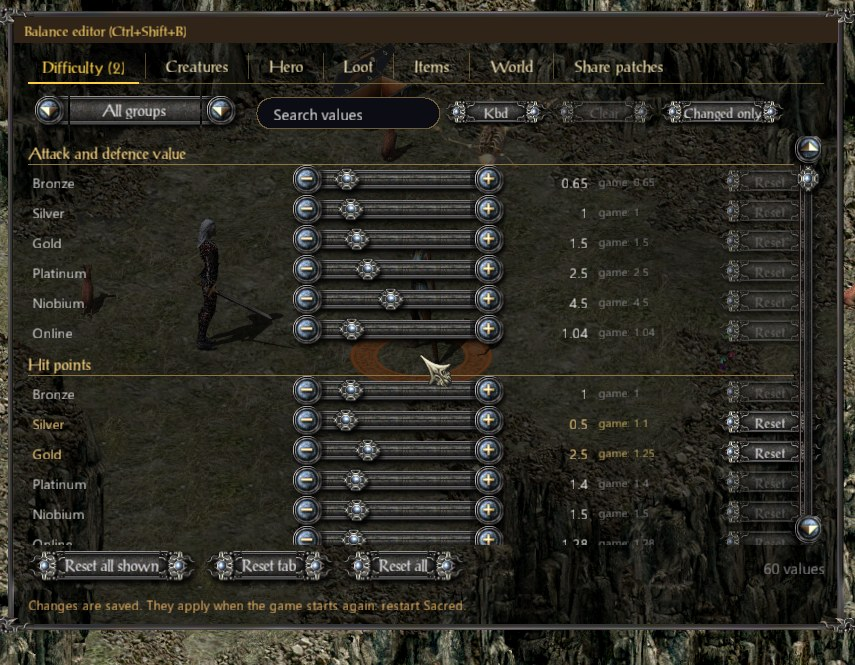

# Balance editor



Edits the game's `bin\balance.bin` from inside the game: the multipliers of the difficulty levels, creature health by level, passive skill curves, loot chances, item prices, movement speed and more (320 values in six tabs). Next to every slider you see the game's own value; what you changed is gold and has a **Reset** button.

## How it works, and what it never does

The mod ships an overlay rule (`overlay.txt`: `bin\balance.bin = patch:balance.lua`). Sacred Gear then serves the game its own file with your changes applied (a copy in the mod's `cache` folder). The game's `balance.bin` is never written. Switch the mod off, or delete its folder, and the game reads its own file again.

- **Changes apply when the game starts.** The game reads `balance.bin` once, at its start. The editor saves at once and says "restart Sacred" until you have.
- **LAN and hosted games.** Sacred Gear starts the game server with the same overlay, so a game you host uses your values. Everyone who joins needs the same patch, or the game refuses the connection (the client checks its `balance.bin` against the server's).
- **Only Sacred Gold's file.** The patch is made for the 24328 byte `balance.bin` of Sacred Gold. A file of another size (Underworld, other mods) is served unchanged.
- Your values live in `edits.json` and `balance.lua` in the mod's folder.

## Using it

**Ctrl+Shift+B** (rebind it in the Mods screen) or the controller's mod menu entry *Balance editor* opens it in the game (the screen is also set up to draw in the menus; that was not tested). Tabs: Difficulty, Creatures, Hero, Loot, Items, World, Share patches. The tab label shows how many values you changed there.

- **Group**: the drop-down narrows a tab to one group of values (for example *Hit points*).
- **Search** looks in every tab (names, groups and the help text); **Kbd** opens an on-screen keyboard for the controller. **Changed only** lists what you changed.
- **Sliders**: mouse, the arrow orbs, or the controller (nudging the slider; not tested with a real pad). Hover a name for what the value does and what is known of it.
- **Reset** (per value), **Reset group / all shown**, **Reset tab**, **Reset all** (asks twice).

What each value means comes from the game's code as documented by the SacredEngineRemake project and from SacredMagician's tables; a help text says where the effect was not measured in play.

## Balance patches (share your values)

The **Share patches** tab exports what you changed and imports other people's.

A balance patch is a JSON file: `{"format": "sacred-balance-patch", "version": 1, "name": ..., "changes": [{"id": "diff.hp.gold", "value": 1.5}, ...]}`. It is plain data and nothing in it is ever run.

- **Export** writes `export.json` in the mod's folder and copies the text to the clipboard.
- **Import clipboard** / **Import file** (`import.json` in the mod's folder, for players without a keyboard) read a patch and show a preview first: how many values change (current > new), which are already as in the patch, which are rejected (not a number, not a whole number where one is needed, outside the value's range, listed twice) and which this editor does not know. Nothing changes until you press **Apply**; **Undo import** takes the last import back.
- Files over 200 KB, with more than 1000 entries, of another format or a newer version are refused.

## Self test

```
Sacred.exe -gear-auto -gear-load=10 -gear-instance=balance -gear-mods=sacred-theme,balance-editor,balance-editor_selftest
```

in a copy of the game folder (it writes the mod's `balance.lua`). Run it twice: the second run also checks that the game read the patch at its start (12 checks). `luajit tests/balance_editor_test.lua "<game>\bin\balance.bin"` checks the catalog against a real file: every value's offset and kind, the patch bytes, and the import rules.

## Development

`catalog.lua` lists the values (`off` is the byte offset in the file's global block, which starts after a 4 byte length), `defaults.lua` holds the game's values (made by `tools/balance_defaults.lua` from a vanilla file), `core.lua` builds the patch and checks imports, `main.lua` and `ui/` are the screen. Adding a value is one `add{...}` in the catalog; run the tool again and the test.
