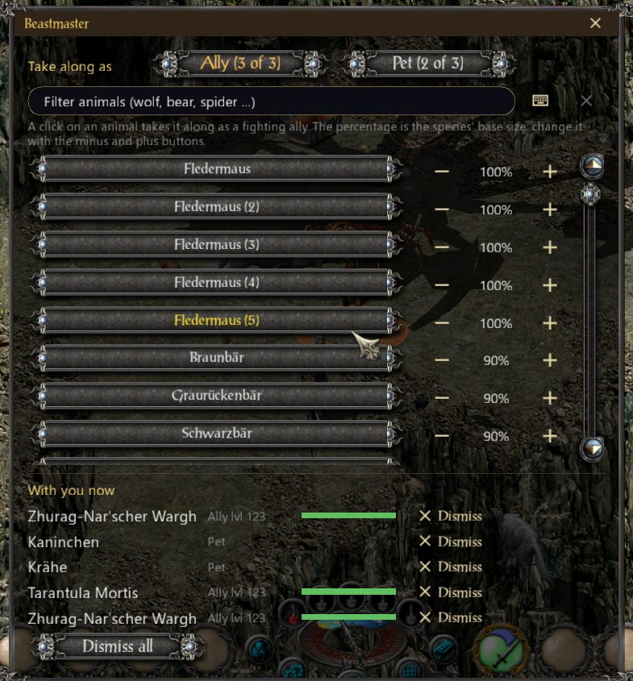
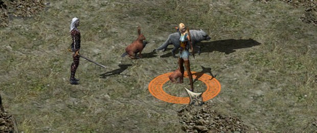
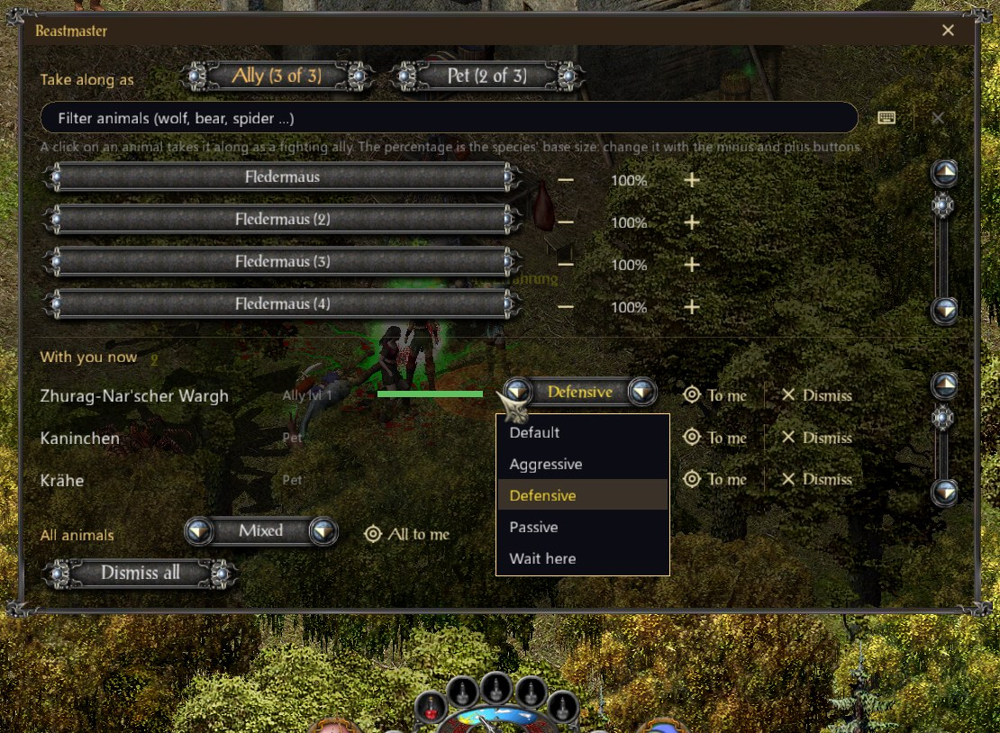

# Beastmaster

Animals that travel with your hero, in two roles. One mod, because both share the same spawning, following, savegame storage and window. Every animal of the game is on the list (122 species: wolves, bears, boars, deer, horses, cows, pigs, sheep, chickens, birds, bats, snakes, spiders, scorpions, crabs, lizards, insects, worms ...).

- **Allies** follow you in a half circle behind, attack the enemy nearest to you, and have the **level of the hero you play** (the engine derives their health and damage from their type and level, as for the creatures it places, so they grow with you; *Ally level* scales it, *Ally damage* multiplies their bites). They are drawn at the species' base size times a growth factor that **steps up every 18 levels until level 216** (75% at level 1 to 125% at level 216 by default: 12 steps of about 4%).
- **Pets** follow you around, are drawn larger (130% of the base size by default), cannot be clicked or targeted (not by the mouse, the hover cursor or the controller's aim) and take no damage. They do nothing else (they can be told to wait).

## What you need

Sacred Gear with the speed buffs (`gear.buffs` `speeds`), `creature:gait` (running), `creature:set_level`, `creature:set_pet`, `creature:copy_allegiance` and `creature:order_move` on any creature, and SacredBild with the pets module (draw scale of the model and its shadow, pick filter). Single player only.

## How to use it

Press **Ctrl+B** (or open the controller's mod menu) for the Beastmaster window. Choose *Ally* or *Pet*, type in the **filter row** (a forgiving search over the names: words in any order, a beginning is enough, one typo is forgiven; the keyboard button opens an on-screen keyboard for the controller), then pick an animal from the list to take it along; *Dismiss* sends one away. Next to each species the **base size** is changed with - and + (5% a step, kept for all games): big monsters such as spiders, scorpions and crabs start much smaller than their wild kind, so they fit beside a hero. The animals belong to the savegame. The Mods screen (**F11**) has the limits (allies and pets at most), ally strength, pet size, follow distance and how far allies fight from you.

The window uses the shared theme (`sacred-theme`, required); every button is a stop for the controller (A presses).

## Orders

Under *With you now* every animal has an **orders** drop-down, the same idea as a companion's behaviour in the Party window:

- **Aggressive**: an ally fights the enemy nearest to you within *Fight enemies within* (default for allies).
- **Defensive**: an ally only fights what comes close to you (8 tiles at most).
- **Passive**: only follows, never attacks.
- **Wait here**: stays where it stands, however far you go (also when you leave for another level), fights what comes within 6 tiles of that spot and walks back to it afterwards. **To me** (or *All to me*) calls it to your side, where it goes on waiting.
- A **pet** cannot fight: its choices are *Follow* and *Wait here*.

*Default* uses the *Default orders* setting of the Mods screen. *All animals* gives every animal the same orders at once (a pet takes what it can). The orders belong to the savegame with the animal.

## Pace

A creature that is ordered to move *walks*, and the hero runs about 2.5 times as fast, so animals fell far behind. When an animal is more than about two follow distances behind, Beastmaster follows its move order with Gear's `creature:gait(2)`: the run animation the game's creatures use when they chase an enemy (measured on a wolf: 133 units a second walking, 335 running). An animal that is slower than the hero also gets a movement speed buff of its own (`beastmaster:pace`). Some species have no run animation (cows, bulls ...): the run gait makes them walk at walking pace, so the mod measures how much ground each species really covers per point of movement speed while it follows a run order, and gives it the speed that matches the hero's ground speed (about 2.28 units a second per point of the hero's speed). The measurement is learned in the first seconds of a session and not saved. A shared speed buff or a faster animal keeps what it has. The Mods screen has *Animals run to keep up with the hero* to switch both off. Needs a Sacred Gear with `creature:gait`; without it the animals walk as before.

## Party buffs

The buffs a companion shares with the heroes (Steinhaut, Wieselflink, Sturm und Drang ... see the Companions mod) are shared with your animals too: the Companions mod announces each one (`companions.buff`, `companions.buff_end`), Beastmaster gives it to the animals at the same strength (times *Allies get* / *Pets get*, default 100%) and takes it away when the companion's own ends. An **ally gets all of it** (damage bonuses, attack factor, resistances, regeneration, attack, cast and movement speed ...; measured on a spawned wolf: +40 damage took its bite from 8 to 55, attack factor 3 from 8 to 25), a **pet only the movement speed** (Wieselflink and the like: Gear's `speeds` / `speed_factors` `move_speed`, applied past the engine's cap; measured on a spawned creature: move speed 131 to 431 made it walk 181 to 328 units in 1.5 s). An animal taken along while a buff runs gets it at once. Switch it off with *Companions' shared buffs also help the animals*. Only the buffs the Companions mod shares arrive; Beastmaster accepts any other mod's `companions.buff` event too.

## Species

The game has no fox or dove creature types. `species.lua` is the list: a creature type id, the model family (WOLF.GRN covers Silberwolf, Grauwolf, Panzerwolf ...) and the default base scale (spiders 0.3 to 0.7, scorpion 0.5, crabs 0.4 to 0.5, lizards 0.6 and so on; a wolf 1.0). The names come from the game, in your language. The default sizes are set by eye: adjust them in the window.

## Development

- **Files:** `src/beastmaster/mod.lua` (manifest, settings, keys), `core.lua` (growth steps, limits, orders: logic without the game), `species.lua` (the animal list with model families and default base sizes), `main.lua` (spawning, following, orders, buffs, the savegame store), `window.lua` and `ui/beasts.rml` / `beasts.rcss` (the window, on the shared theme: the orders drop-down uses its `.dd`, `.dd-list`, `.dd-pop` and `.dd-origin` classes).
- **Depends on:** Sacred Gear (`gear.buffs`, `creature:set_level`, `set_pet`, `copy_allegiance`, `order_move`), SacredBild's pets module, `sacred-theme`; optional: Companions (shared buffs, `companions.buff` events).
- **Test it:** `luajit tests/beastmaster_test.lua` runs the logic outside the game. `src/beastmaster_selftest` (`Sacred.exe -gear-auto -gear-instance=beasts -gear-load=10 -gear-mods=sacred-theme,beastmaster,beastmaster_selftest`, in a copy of the game folder) takes an ally and two pets along and checks following, fighting, the orders (an ally told to wait stays put with the hero 3600 units away; *To me*), the shared buffs, growth with the hero's level and the filter row; `src/beastmaster_buffs_selftest` covers the buffs alone. The pictures on this page come from the first one ([Screenshots](../Screenshots.md)).

- Pets are `creature:set_pet{scale, untargetable}` plus `set_modifiers{taken = 0}`. SacredBild scales the model about the object's render position (object +0x7C / +0x80) with a matrix applied before the draw, so the shadow grows with it.
- Allies are spawned plain, join the hero's side with `copy_allegiance` (enemies fight them), get `set_level(hero level * Ally level %)` and are ordered with `order_attack` / `order_move` every few tenths of a second. Measured: a level 1 wolf bites for about 8.5 with 65 health, a level 50 one for about 84 with 1990 health, so the damage grows steeply with the level.
- Growth: `core.stage(level)` is one step per 18 levels up to 12 at level 216; `core.growth` runs linearly from *Ally size at level 1* to *at level 216*.
