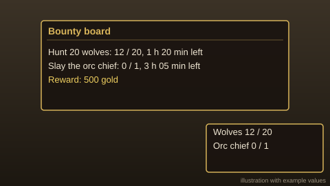

# Bounty board

*Illustration with example values.*

Shows the bounties of the server: what to hunt, how far you are, how much time is left and what you get. A small tracker at the top right keeps your open bounties in view while you play.

## What you need

Sacred Gear and the mod itself in your `mods` folder (see [Install](../Install.md)). It also needs a SacredEngineRemake game server (`Sacred.GameServer`) running the script `bounty_board.lua`. On any other server the mod just shows that the server has nothing for it.

## How to use it

Press **F8** to open the bounty board. The tracker at the top right shows your open bounties; switch it off in the settings if you do not want it.

## Keys

| Key | What it does |
|---|---|
| **F8** | Open or close the bounty board. (F8 is also the game's own quick load.) |

You can change every key in the Mods screen (**F11**, then the mod's *Keys* page).

## Settings

Open the Mods screen with **F11** and pick the mod.

| Setting | What it does |
|---|---|
| Tracker | Shows or hides the small progress list at the top right. |

## Development

- **Files:** `src/bounty/mod.lua` (manifest, tracker position, refresh time) and `main.lua` (about 150 lines).
- **Depends on:** `gear.net` (channel to the server), `gear.ui`, `gear.keys`, `gear.settings`, `gear.every` for the refresh.
- **Server side:** `scripts-examples/bounty_board.lua`. The server also pushes every change, `config.refresh` (60 s) is only the fallback.
- **Test it:** run a local server with the script, then the game. Protocol: [GearServerMods](https://github.com/kirides/sacred-bild/blob/main/docs/GearServerMods.md).
