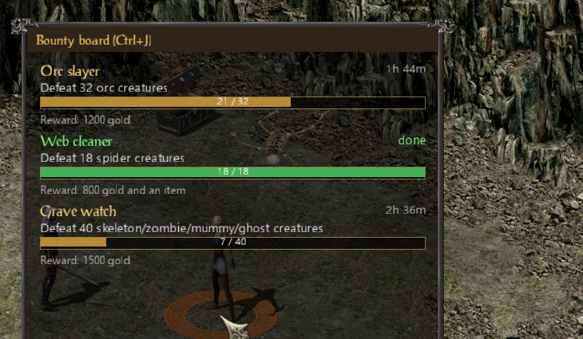
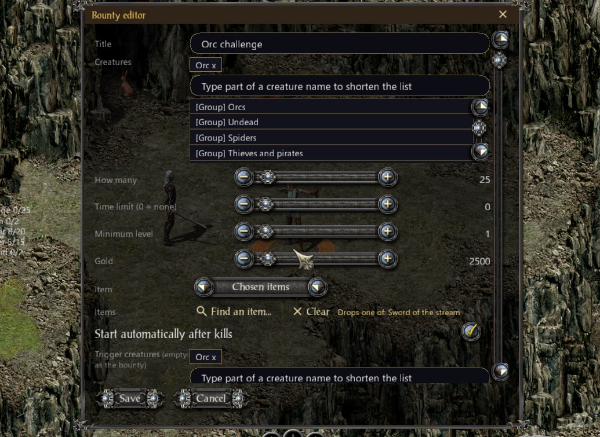

# Bounty board

Bounties to hunt: what to kill, how far you are, how much time is left and what you get. Works **on its own in single
player** and shows the server's board in network games. A small tracker at the top right keeps your open bounties in view
while you play.

## What you need

Sacred Gear and the mod itself in your `mods` folder (see [Install](../Install.md)). Nothing else for single player.

In a network game the mod shows the board of the server. That needs a SacredEngineRemake game server (`Sacred.GameServer`)
running the script `bounty_board.lua`; on any other server the mod says it has no bounty board.

## How to use it

Press **Ctrl+J** to open the bounty board. The tracker at the top right shows your open bounties; switch it off in the
settings if you do not want it. Move the panel, the tracker and the messages with the [layout editor](layout.md) (hold **Alt**). With a
controller, **LT + LB** opens the mod menu, where *Open the bounty board* is a button.

### Single player

The board belongs to your hero: three bounties at a time ("Defeat 32 orc creatures"), drawn from orcs, undead, spiders,
thieves and pirates, wolves/bears/boars, trolls and ogres, demons and golems, and dragons. The strong ones only come up
once your hero has the level for them.

- **Counting:** a monster that dies after you hit one of its kind counts. Monsters only a pet or a trap killed, and
  monsters you never hit, do not.
- **Time:** a bounty runs for about three hours of play. The time only runs while you play (not in the menu, not while the
  game is closed). When it ends, a new one is posted; a finished one stays on the board, marked done, until its time is up.
- **Reward:** gold goes straight into your purse; some bounties add an item that drops at your feet. The game's own loot
  roll makes it, from a horse that appears next to you for a moment as the "creature" it drops from and is removed again
  (`creature:remove()`, needs a Sacred Gear with it). Gold grows with your hero's level.
- **Saved per hero:** the board is saved in the mod's folder (`board_<hero>.json`), so it is still there after loading.
  It is not tamper-proof: single player, your game.
- **Network games** use the server's board. The own board is for single player only.

### Your own bounties (the editor)

Press **Ctrl+Shift+J** or the *Editor...* button of the board to open the bounty editor. Make challenges of your own, for
example for a stream:

- **New bounty:** a title, the creatures, how many, a time limit (0: none), a minimum level and the reward.
- **Creatures:** no names to know or type. *Add a creature...* is a dropdown (it scrolls; the arrow keys and D-pad work)
  with groups (Orcs, Undead, Dragons...) first and then every creature the game has, read from its own data; the *Filter*
  box beside it shortens the list. A chosen creature is a button: click it to remove it. No creature means any monster. The
  trigger has the same picker.
- **Search is forgiving:** both lookups use Sacred Gear's `gear.lookup` (kinds `creature` and `item`): several words in any order,
  case and accents ignored (`flugel` finds Flügel), one typo forgiven (`scwert` finds Schwert), best matches first. *Find an
  item...* opens its picker window (type, then click, or Up/Down and Enter; it stays open so you can add several, *Done* closes).
- **Rewards:** gold, and one item: a *random item*, a *random item for your class* (the game rolls until your class can use
  it), or *chosen items*: search an item by its name **in your game's language** (the name the tooltip shows; the internal name matches too), press *Add*, and one of the chosen types drops.
  Random items have a quality tier (Good, Rare, Best).
- **Start and Stop:** the list shows every bounty with its state. *Start* puts it on your board (next to the others);
  *Stop* takes it off. A finished one can be started again.
- **Start automatically:** tick *Start automatically after kills*, pick the creatures, how many kills start it ("10 orcs
  start Orc slayer") and a cooldown in minutes. It does not start while it is running, and not again before the cooldown is
  over (play time).
- **Only your own:** switch off the setting *Pool bounties* to get only the bounties you made.
- The bounties are kept in `custom.json` in the mod's folder, the same for all heroes; you can edit the file and press
  *Reload file*. Typing needs the keyboard; with a controller start and stop bounties from the editor's buttons.

## Keys

| Key | What it does |
|---|---|
| **Ctrl+J** | Open or close the bounty board. |
| **Ctrl+Shift+J** | Open or close the bounty editor (single player). |

You can change every key in the Mods screen (**F11**, then the mod's *Keys* page).

## Settings

Open the Mods screen with **F11** and pick the mod.

| Setting | What it does |
|---|---|
| Own board in single player | On: the mod posts, counts and pays the bounties itself. Off: no board without a server. |
| Pool bounties | On: the board also draws bounties from the built-in list. Off: only your own bounties. |
| Tracker | Shows or hides the small progress list at the top right. |

## Development

- **Files:** `src/bounty/mod.lua` (manifest, tracker position, refresh time), `main.lua` (panel, tracker, toasts, the
  server board, the glue), `localboard.lua` (single player board: pool, posting, progress, expiry, saving; pure Lua, no
  `gear` calls), `localgame.lua` (kills and rewards: the parts that touch the game), `customs.lua` (the player's bounties in `custom.json`), `editor.lua` (the editor panel with the creature picker) and `creatures.lua` (the creature dropdown: groups and Gear's creature lookup; the words of every monster type name of `gear.data.object_types`, plus groups).
- **Two sources, one panel:** `main.lua` shows a payload of the form `{ v = 1, bounties = {{ id, title, text, target, n,
  done, left, reward, claims, level }} }`. In a network game it comes from the server's `bounty:state` channel
  (`gear.net`), otherwise from `localboard.Board:payload()` (`gear.mp.active()` decides, checked once a second).
- **The pool** is `M.POOL` in `localboard.lua`: `names` are words of the creature's type name (`ORC_WARRIOR.GRN` has `orc`
  and `warrior`; whole words, so `SORCERESS` is no orc), `target = {min, max}`, `gold` for a level 10 hero (see `gold_for`),
  `min_level`, `item` (a tier 1 to 3 that sets the rarity bonus). Only monsters count (object kind 3).
- **Kills:** the `kill` event does not fire in single player, so `localgame.lua` watches the monsters around the hero
  (`gear.world.creatures_near` every 0.25 s) and counts one that vanished or is dead when the `damage` event saw a hit of
  the hero's creature type on its type within 8 s, or when `drops.roll` named the hero (object id 1) as the killer.
- **Rewards:** `creature:add_gold` for gold. An item: `gear.world.spawn('HORSE.GRN', ...)` at the hero's feet (a horse, because a
  chicken only drops gold and potions) and `gear.drops.simulate` on it, one roll at a time, up to 120, with the `drops.roll`
  bonus and the `drops.select` level set to the hero's. Only equipment counts (gold, potions and the like are destroyed again
  with `gear.inv.destroy`); *class loot* also needs `gear.world.usable_by`; *chosen items* roll the type as an authored drop
  (the `forced` argument). The client cannot drop a gold pile of a given size. The horse is removed with `creature:remove()`
  as soon as the roll is over.
- **Custom bounties and triggers:** `localboard.clean_def` checks a definition; `Board:start/stop/active` put it on the board
  (marked `custom`, `endless` without a time limit); `Board:trigger_kill` counts kills per definition and starts it at the
  count unless active or cooling down (`Board:tick` runs the cooldown). Trigger counters and cooldowns are saved with the
  hero's board.
- **Time and saving:** `Board:tick(dt)` runs once a second with the game's time, so a bounty's `left` only counts play
  time. The board is written with `gear.save` when it changes (at most every 20 s, after a kill at most every 5 s), and when
  the mod is switched off or the game ends.
- **Server side:** `scripts-examples/bounty_board.lua`. The server also pushes every change, `config.refresh` (60 s) is
  only the fallback.
- **Test it:** `src/bounty_selftest` (automation, single player) sets known bounties, spawns zombies, fights, and checks
  the count, the gold and the item. Run it in a **copy** of the game with
  `-gear-auto -gear-instance=bounty -gear-load=1 -gear-mods=bounty,bounty_selftest -gear-timeout=240`; the result is
  `GearAutomation\bounty\bounty_selftest.txt`. The phases `custom` (own bounty, class and chosen item, trigger and cooldown),
  `shots` (the panel picture), `editor` and `toasts` (pictures) are set with a `config.lua` such as `return {phase = 'custom'}`. For the server side run a local server with the script, then the game; the protocol is in
  [GearServerMods](https://github.com/kirides/sacred-bild/blob/main/docs/GearServerMods.md).
