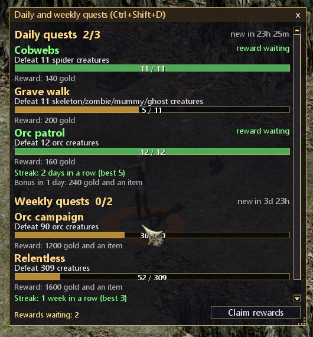

# Bounty board


Bounties to hunt: what to kill, how far you are, how much time is left and what you get. Works **on its own in single
player** and shows the server's board in network games. A small tracker at the top right keeps your open bounties in view
while you play. The same mod also has **daily and weekly quests** with a streak bonus, see [below](#daily-and-weekly-quests).

## What you need

Sacred Gear and the mod itself in your `mods` folder (see [Install](../Install.md)). Nothing else for single player.

In a network game the mod shows the board of the server. That needs a SacredEngineRemake game server (`Sacred.GameServer`)
running the script `bounty_board.lua`; on any other server the mod says it has no bounty board.

## How to use it

Press **Ctrl+J** to open the bounty board. The tracker at the top right shows your open bounties; switch it off in the
settings if you do not want it. Move the panel, the tracker and the messages with the [layout editor](layout.md) (hold **Alt**). With a
controller, **LT + LB** opens the mod menu, where *Open the bounty board* is a button.

### Single player

The board belongs to your hero: three bounties at a time ("Defeat 32 orc creatures"), drawn from orcs, undead, spiders,
thieves and pirates, wolves/bears/boars, trolls and ogres, demons and golems, and dragons. The strong ones only come up
once your hero has the level for them.

- **Counting:** a monster that dies after you hit one of its kind counts. Monsters only a pet or a trap killed, and
  monsters you never hit, do not.
- **Time:** a bounty runs for about three hours of play. The time only runs while you play (not in the menu, not while the
  game is closed). When it ends, a new one is posted; a finished one stays on the board, marked done, until its time is up.
- **Reward:** gold goes straight into your purse; some bounties add an item that drops at your feet. The game's own loot
  roll makes it, from a horse that appears next to you for a moment as the "creature" it drops from and is removed again
  (`creature:remove()`, needs a Sacred Gear with it). Gold grows with your hero's level.
- **Saved per savegame:** the board is kept with the savegame being played (`board.json` in `saves/GAME05/` of the mod's folder), so it is there after loading that savegame and another character has its own. A board from before (`board_<hero>.json`) goes to the first savegame loaded with that hero.
  It is not tamper-proof: single player, your game.
- **Network games** use the server's board. The own board is for single player only.

### Your own bounties (the editor)

Press **Ctrl+Shift+J** or the *Editor...* button of the board to open the bounty editor. Make challenges of your own, for
example for a stream:


- **New bounty:** a title, the creatures, how many, a time limit (0: none), a minimum level and the reward.
- **Creatures:** no names to know or type. *Add a creature...* is a dropdown (it scrolls; the arrow keys and D-pad work)
  with groups (Orcs, Undead, Dragons...) first and then every creature the game has, read from its own data; the *Filter*
  box beside it shortens the list. A chosen creature is a button: click it to remove it. No creature means any monster. The
  trigger has the same picker.
- **Search is forgiving:** both lookups use Sacred Gear's `gear.lookup` (kinds `creature` and `item`): several words in any order,
  case and accents ignored (`flugel` finds Flügel), one typo forgiven (`scwert` finds Schwert), best matches first. *Find an
  item...* opens its picker window (type, then click, or Up/Down and Enter; it stays open so you can add several, *Done* closes).
- **Rewards:** gold, and one item: a *random item*, a *random item for your class* (the game rolls until your class can use
  it), or *chosen items*: search an item by its name **in your game's language** (the name the tooltip shows; the internal name matches too), press *Add*, and one of the chosen types drops.
  Random items have a quality tier (Good, Rare, Best).
- **Start and Stop:** the list shows every bounty with its state. *Start* puts it on your board (next to the others);
  *Stop* takes it off. A finished one can be started again.
- **Start automatically:** tick *Start automatically after kills*, pick the creatures, how many kills start it ("10 orcs
  start Orc slayer") and a cooldown in minutes. It does not start while it is running, and not again before the cooldown is
  over (play time).
- **Only your own:** switch off the setting *Pool bounties* to get only the bounties you made.
- The bounties are kept in `custom.json` in the mod's folder, the same for all heroes; you can edit the file and press
  *Reload file*. Typing needs the keyboard; with a controller start and stop bounties from the editor's buttons.

## Daily and weekly quests



New quests every real-world day (at local midnight) and every week (at midnight before Monday), with a streak bonus for finishing
them day after day. Press **Ctrl+Shift+D** (rebindable) for the panel. With a controller, **LT + LB** opens the mod menu, where
*Daily and weekly quests* is a button.

### Single player

- **The rotation:** three daily and two weekly quests ("Defeat 11 spider creatures"), drawn from a pool with a seed made of the date,
  so the same date always gives the same quests and nothing depends on when you start the game. The strong ones (trolls, demons,
  dragons) only come up once your hero has the level; the quests of a day are drawn with the level your hero has when the day's
  quests are first made, and stay.
- **Counting:** the same kill watcher as the bounty board counts them (a monster that dies after you hit one of its kind).
  A "Monster hunt" quest counts any monster.
- **Rewards:** each finished quest pays gold (scaled by your level) and sometimes an item at your feet, through the same path as
  the bounty board. By default at once; with the setting *Pay quest rewards at once* off, rewards wait and the panel's
  **Claim rewards** button pays them. A reward that could not be paid (a loading screen, no room to roll an item) stays in the
  waiting list and is retried, it is not lost, not even when a day passes.
- **Streak:** finishing **all** quests of a day is one step of the *daily streak*, finishing all of a week one step of the *weekly
  streak*. The daily streak pays a **bonus every 3 days** in a row (600 gold, 200 more for each bonus after the first, and an
  item), the weekly streak every 2 weeks (3000 gold, 1000 more each time, and a better item). A missed day (or week) breaks the
  streak (the best streak is kept). Quests unfinished when the time is up are simply gone (`quest.failed`).
- **Saved per savegame:** the progress, both streaks, the waiting rewards and the totals are in `quest_progress.json` of the
  savegame's data (`saves/GAME05/` of the mod's folder, see *Saved per savegame* above), so each character has its own streak
  and loading an older save brings back its progress. Quests carry on from the real date after a load: a savegame loaded after
  a few days starts a new day. It is not tamper-proof (single player, your game, your clock; the date never goes back).
- **Your own pool:** `quests.json` in the mod's folder (the same for all savegames; the mod does not create it, make it with a text
  editor and restart the game) replaces what the quests are drawn from. Every part is optional; a bad entry is dropped, a missing
  list keeps the default:

```json
{
  "v": 1,
  "seed": "my-stream",
  "daily": {"slots": 3, "pool": [
    {"id": "orcs", "title": "Orc patrol", "names": ["orc"], "target": [8, 16], "gold": 400},
    {"id": "dragons", "title": "Dragon scare", "names": ["dragon"], "target": 1, "gold": 2000, "min_level": 20, "item": 2},
    {"id": "any", "title": "Monster hunt", "names": [], "target": [30, 60], "gold": 600}
  ]},
  "weekly": {"slots": 2},
  "streak": {
    "daily": {"every": 3, "gold": 600, "gold_step": 200, "max_steps": 10, "item": 1},
    "weekly": {"every": 2, "gold": 3000, "gold_step": 1000, "item": false}
  }
}
```

  `names` are words of the creature's type name (no names: any monster), `target` is a number or `[min, max]` (drawn by the seed),
  `gold` is for a level 10 hero, `item` a tier 1 to 3 (or an item spec as in `custom.json`; `false` for no item in a streak
  bonus), `every` the number of days (weeks) in a row between bonuses (`"off": true` for none).

### Network games

The quests are the **server's**: a SacredEngineRemake game server running `daily_quests.lua` (in this repository:
`server-scripts/daily_quests.lua`, copy it into the server's `scripts` folder) draws the quests of the day and the week, counts
every hero's kills, pays the rewards and keeps each hero's streak. The mod only shows them (channel `bounty:quests`, same
panel) and publishes the same `quest.*` events. A server without the script never answers and the panel says so. The own
rotation is single player only: in a network game the kills are the server's, so this mod does not count them itself.

Server side, on the script's chat and web pages: `!quests` lists the quests and your streaks, `/mods/daily_quests/` is the public
dashboard (best streaks, recent completed sets), `/mods/daily_quests/state` its JSON, `/mods/daily_quests/config` shows the
configuration in force. **Configuration** is data in the script's storage (`script-data/daily_quests.json`, key `config`), edited
live by an admin with `POST /api/mod-store {"mod":"daily_quests","set":{"config":{...}}}` (applied in 2 seconds, no reload, a
field that does not validate is ignored with a log line): `daily_slots`, `weekly_slots`, `daily_pool`, `weekly_pool`,
`daily_streak`, `weekly_streak` (`every`, `gold`, `gold_step`, `max_steps`, `item`, `off`), `seed`, `announce`,
`utc_offset_minutes` (the reset happens at midnight of the server clock moved by this), `history`, `max_players`. A change of
the pool or the slot counts takes effect with the next day's (week's) quests, as the bounty board's pool does.

### Settings and keys

| Setting | What it does |
|---|---|
| Daily and weekly quests | Off: no quests (neither local nor the server's). |
| Pay quest rewards at once | Off: rewards wait for the *Claim rewards* button. |
| Quest tracker | A few lines with the open quests (D daily, W weekly) at the top right, below the bounty tracker (off by default). |

| Key | What it does |
|---|---|
| **Ctrl+Shift+D** | Open or close the quest panel. |

The tracker and the panel are placed with the [layout editor](layout.md) (hold **Alt**).

## Keys

| Key | What it does |
|---|---|
| **Ctrl+J** | Open or close the bounty board. |
| **Ctrl+Shift+J** | Open or close the bounty editor (single player). |

You can change every key in the Mods screen (**F11**, then the mod's *Keys* page).

## Settings

Open the Mods screen with **F11** and pick the mod.

| Setting | What it does |
|---|---|
| Own board in single player | On: the mod posts, counts and pays the bounties itself. Off: no board without a server. |
| Pool bounties | On: the board also draws bounties from the built-in list. Off: only your own bounties. |
| Tracker | Shows or hides the small progress list at the top right. |

## Events for other mods

The mod publishes `bounty.*` events (started, progress, completed; claimed, failed) and `quest.*` events (the daily and weekly quests and their streaks) with `gear.emit`; see [Mod events](../ModEvents.md#bounty).

## Development

- **Files:** `src/bounty/mod.lua` (manifest, tracker position, refresh time), `main.lua` (panel, tracker, toasts, the
  server board, the glue), `localboard.lua` (single player board: pool, posting, progress, expiry, saving; pure Lua, no
  `gear` calls), `localgame.lua` (kills and rewards: the parts that touch the game), `customs.lua` (the player's bounties in `custom.json`), `editor.lua` (the editor panel with the creature picker) and `creatures.lua` (the creature dropdown: groups and Gear's creature lookup; the words of every monster type name of `gear.data.object_types`, plus groups).
- **Daily and weekly quests:** `quests.lua` (pure Lua like `localboard.lua`: the calendar by day number (`days_from_civil`, weeks from Monday), the seeded draw (`Q.rng`, Park-Miller, exact in doubles), `roll` (a new day or week: failed events, a broken streak, the new quests), `kill`, the streak (`complete_set`, `bonus_for`), `take_pending` / `put_back` for the reward list, `payload`, `sanitize` / `clean_config`); `questsmain.lua` (the glue: `gear.store.game('quest_progress.json')`, a kill listener on `localgame.on_kill`, paying with `localgame.gold` / `drop_item`, events and toasts, the server channel `bounty:quests`, panel and tracker); `hooks.lua` also turns server payloads into `quest.*` events (`diff` with `prefix = 'quest'`, `diff_streak`). Unit test `tests/quests_test.lua`, in-game test `src/quests_selftest` (see below).
- **Two sources, one panel:** `main.lua` shows a payload of the form `{ v = 1, bounties = {{ id, title, text, target, n,
  done, left, reward, claims, level }} }`. In a network game it comes from the server's `bounty:state` channel
  (`gear.net`), otherwise from `localboard.Board:payload()` (`gear.mp.active()` decides, checked once a second).
- **The pool** is `M.POOL` in `localboard.lua`: `names` are words of the creature's type name (`ORC_WARRIOR.GRN` has `orc`
  and `warrior`; whole words, so `SORCERESS` is no orc), `target = {min, max}`, `gold` for a level 10 hero (see `gold_for`),
  `min_level`, `item` (a tier 1 to 3 that sets the rarity bonus). Only monsters count (object kind 3).
- **Kills:** the `kill` event does not fire in single player, so `localgame.lua` watches the monsters around the hero
  (`gear.world.creatures_near` every 0.25 s) and counts one that vanished or is dead when the `damage` event saw a hit of
  the hero's creature type on its type within 8 s, or when `drops.roll` named the hero (object id 1) as the killer.
- **Rewards:** `creature:add_gold` for gold. An item: `gear.world.spawn('HORSE.GRN', ...)` at the hero's feet (a horse, because a
  chicken only drops gold and potions) and `gear.drops.simulate` on it, one roll at a time, up to 120, with the `drops.roll`
  bonus and the `drops.select` level set to the hero's. Only equipment counts (gold, potions and the like are destroyed again
  with `gear.inv.destroy`); *class loot* also needs `gear.world.usable_by`; *chosen items* roll the type as an authored drop
  (the `forced` argument). The client cannot drop a gold pile of a given size. The horse is removed with `creature:remove()`
  as soon as the roll is over.
- **Custom bounties and triggers:** `localboard.clean_def` checks a definition; `Board:start/stop/active` put it on the board
  (marked `custom`, `endless` without a time limit); `Board:trigger_kill` counts kills per definition and starts it at the
  count unless active or cooling down (`Board:tick` runs the cooldown). Trigger counters and cooldowns are saved with the
  hero's board.
- **Time and saving:** `Board:tick(dt)` runs once a second with the game's time, so a bounty's `left` only counts play
  time. The board is written with `gear.save` when it changes (at most every 20 s, after a kill at most every 5 s), and when
  the mod is switched off or the game ends.
- **Server side:** `scripts-examples/bounty_board.lua`. The server also pushes every change, `config.refresh` (60 s) is
  only the fallback.
- **Test the quests:** `src/quests_selftest` (automation, single player, run with `-gear-mods=bounty,quests_selftest`): the test hook `bounty.test` of the mod has the ops `q_offset` (seconds added to the clock, so a day or week rollover needs no waiting), `q_kill`, `q_tick`, `q_reset`, `q_save`, `q_pay`, `q_auto`, `q_open`, `q_conf`, `q_server`. It checks the stable draw, the rewards, the rollover, a streak of 3 with its bonus, a missed day, weeks, the waiting list and the per-savegame data (save into a slot, load another, load it again). The config `phase = 'shots'` takes the panel picture.
- **Test it:** `src/bounty_selftest` (automation, single player) sets known bounties, spawns zombies, fights, and checks
  the count, the gold and the item. Run it in a **copy** of the game with
  `-gear-auto -gear-instance=bounty -gear-load=1 -gear-mods=bounty,bounty_selftest -gear-timeout=240`; the result is
  `GearAutomation\bounty\bounty_selftest.txt`. The phases `custom` (own bounty, class and chosen item, trigger and cooldown),
  `shots` (the panel picture), `editor` and `toasts` (pictures) are set with a `config.lua` such as `return {phase = 'custom'}`. For the server side run a local server with the script, then the game; the protocol is in
  [GearServerMods](https://github.com/kirides/sacred-bild/blob/main/docs/GearServerMods.md).
