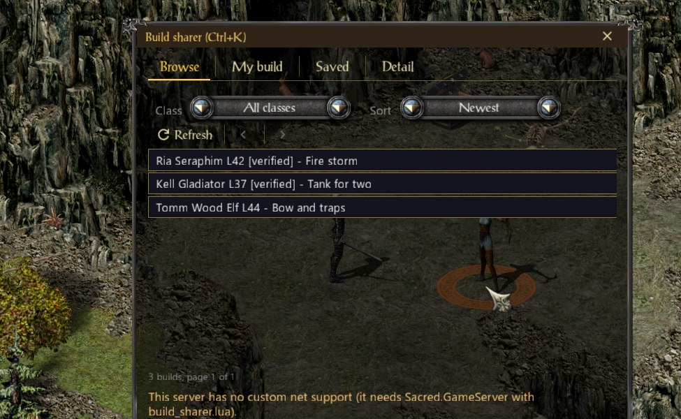

# Build sharer

Publish your hero's build and browse the builds other players have shared. The server reads your class, level, skills and equipment itself; you only add a title, a note and tags.

## What you need

Sacred Gear and the mod itself in your `mods` folder (see [Install](../Install.md)). It also needs a SacredEngineRemake game server (`Sacred.GameServer`) running the script `build_sharer.lua`. On any other server the mod just shows that the server has nothing for it.

## How to use it

Fill in "My build" (title, note, tags) in the Mods screen, then press **Ctrl+K** and choose *Publish*. Use the list to look at other builds. Builds you published are also remembered in `saved_builds.json`.

## Keys

| Key | What it does |
|---|---|
| **Ctrl+K** | Open or close the build sharer. |

You can change every key in the Mods screen (**F11**, then the mod's *Keys* page).

## Settings

Open the Mods screen with **F11** and pick the mod.

| Setting | What it does |
|---|---|
| Build title | A short name shown in the list (40 letters). |
| Note | One line about how the build plays (120 letters). |
| Tags | Up to 5 words, separated by commas (pvp, bow, tank). |
| Share carried items | Also sends the names of the best items in your backpack (up to 12). The server marks them as "reported". |

## Development

- **Files:** `src/buildsharer/mod.lua`, `main.lua` (about 320 lines: list, detail view, publish form, saved builds).
- **Depends on:** `gear.net` channel `buildsharer` (requests `list`, `get`, `mine`, `publish`), `gear.world.hero`, `gear.ui`, `gear.save` / `gear.read` for `saved_builds.json`.
- **Server side:** `scripts-examples/build_sharer.lua`. All server texts are length-limited before they are drawn.
- **Test it without the game:** `tests/modmock` has a strict mock of the Gear API and `build_scenario.lua` ([how to run](../../tests/modmock/README.md)).
