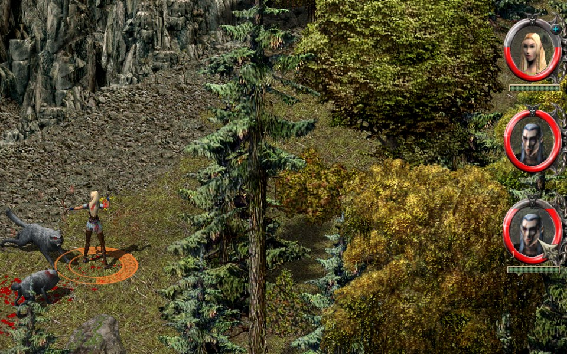
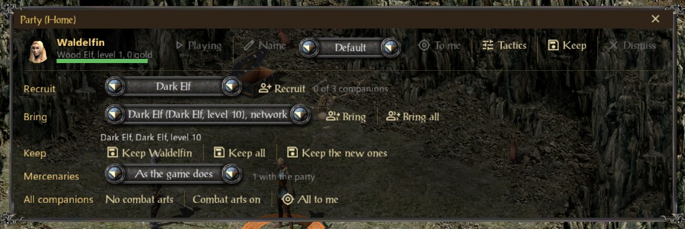

# Companions

A party of heroes in single player, the way Dragon Age does it. Recruit companions of any class: each is a real hero
with their own backpack, equipment, attributes, skills, combat arts, spells and experience, saved with your
savegame. Play any of them: click their portrait under the game's own (top right), press **PageDown**, or use the controller's
mod menu. The heroes you do not play follow you and fight on their own, with their weapons, combat arts, spells and
combos.

## What you need

Sacred Gear (with `gear.party`) and the mod. Single player only: in a network game the mod does nothing (there the
hero slots belong to the players).

## How to use it

1. Press **Home** (or *Party window* in the controller's mod menu, **LT + LB**) and pick a class next to *Recruit*.
   The new hero joins where you stand, with the experience of the hero you play (setting), so they have skill points
   to spend: switch to them and spend the points like for your own hero. They come without items: give them equipment from your
   stash or what you find.
2. Play another hero: click their portrait, press **PageDown** / **PageUp**, use *Play* in the party window, or the mod menu.
   The camera, the HUD, the inventory, skills and combat arts windows, the mouse, the keys and the controller then serve
   that hero. The gold goes with you (the party shares one purse, unless you turn on *Separate purses*, see below) and mercenaries follow the hero you play.
3. **Heroes from other savegames:** in the party window, *Keep <name> for other savegames* writes the hero you play
   to a hero file (in `mods\companions\heroes`). In another savegame, pick them under *Bring* and press *Bring*: a copy
   of that hero joins with their level, attributes, skills, combat arts, combos, equipment and backpack. Your network
   characters (`Save\HeroNN.pax`) are listed there too. The chosen hero is shown with the portrait of their class, their name and level (needs a Sacred Gear with `gear.party.class_portrait`). A hero file whose class and name match a hero of the party (you may have brought them already) is marked in amber, like a key conflict in the mod manager: `!` in the list, the Bring button and a note; Bring still works. The hero in the other savegame stays as they are.
4. **Separate purses** (setting, off by default): every hero keeps their own gold. The hero you play holds theirs in the game as
   always; the gold of the others is kept by the mod (per savegame) and is theirs again when you play them. The party window
   then has a *Purses* section: pick an amount and press *Give* (from the hero you play to another hero) or *Take* (from
   another hero to the hero you play). Turning the setting off gives all the gold to the hero you play (the party's purse goes with
   control, so it is with the main hero when you play them); none is lost. The same happens when a companion is dismissed or lost for
   good, and when a savegame is loaded with the setting off.
5. In the party window each hero has a **behaviour** for the time you play someone else (*Aggressive*: fights what
   comes near; *Defensive*: protects the hero you play; *Passive*: only follows; *Wait here*: stays at the spot where they stand, fights what comes near and walks back to the spot afterwards), a **name**, and **tactics**: how they fight
   (weapon and combat arts; combat arts only, keeping back in between, for a battle mage; weapon first; or
   ranged weapon: they take up the bow, crossbow or musket of their weapon slots when a fight starts) and the
   combat arts, spells and combos they may use on their own. *Dismiss* sends a companion away for good (empty their backpack first:
   what they wear is lost). A companion who is hit fights back at whoever hit them, also when you (or the hero you play) are far
   away, instead of running back to you in the middle of the fight.

**The game's own mercenaries** follow the hero you play. Under *Mercenaries* in the party window you choose what they
do: *As the game does* (default, nothing changes), *Assist* (they attack the enemy the party fights when they stand
idle) or *Passive* (they stay with you). Their own combat AI, their quests and escort scripts stay the game's; the mod
never teleports them or changes what they are.

**Tactics in the party window** (*Tactics* on a hero's row; the window then shows only the heroes and the tactics): *Fights with*
(weapon and combat arts, combat arts only, weapon first, ranged, protector); *Run away* (the arrows set a share of health, 5 to 60 %:
below it the hero runs to your side and stays out of the fight until they have 60 % again; *Never* by default); *Move to another
spot when shots miss* (ranged weapon: a target that has not lost health for 3 s makes the hero walk to another spot around it, a
spot not reached in 4 s counts as blocked for a while); *All off* / *All on* / *Reset priority* for the combat arts; and the list of
combat arts, spells and combos: the **up and down arrows** move one in the priority (the top one that is ready is used first; without
changes the higher level goes first) and the box switches it off. Other buttons: *To me* on a hero's row (a stuck companion joins you),
*All companions*: *No combat arts*, *Combat arts on*, *All to me*.

**Keeping heroes between savegames:** *Keep* on a hero's row (amber while the hero is *not kept yet*, *Kept* once written, *Keep again*
after a level up) writes that hero to a hero file together with their tactics (behaviour, fighting style, run away, priorities,
switched-off arts); *Keep all* / *Keep the new ones* do it for the whole party (each hero is played for a moment, you get control back).
*Bring all* brings every kept hero that is not in the party yet, as far as there is room; a hero brought from a file gets their tactics back.
With *Separate purses* each hero row shows the hero's gold (*Purses* gives and takes, *All* sends everything).

What the companions do on their own: they keep up with you (a companion left far behind or on another level joins
you), pick the enemy nearest to you, attack it with their weapon, and use their abilities like a player would: combos
and attack arts and spells on the target as soon as they have regenerated, auras and buffs (Steinhaut, Ehrfurcht ...)
once a fight starts, healing spells when someone in the party is low on health (setting): first on the hero you play, then on
themselves (or the lowest, setting). The game casts these spells (Genesung, Spirituelle Heilkraft) only on the caster,
its own AI too: for you, the companion casts the spell and you get the health it gives (what it healed the companion
last time, until then a third of your health). Buffs and auras (Steinhaut, Wieselflink ...) are cast in fights and
again when they run out, or whenever they are ready (setting). The ones the game meant for companions too (Steinhaut,
Glaubensstärke, Katarakt der Wendigkeit, Reiki) reach the other heroes near the caster through Gear's buffs: at half
strength by default (a setting per buff, 0: off), with the game's look (Steinhaut's stone), for as long as the
caster's own lasts. A Vampiress changes into her vampire form
(Vampirform) when a fight starts and back after it, or when she is low on health (in daylight the form costs health).
Other shape changes (Ritterform ...), teleports and tricks are left to you.

Experience: what one party hero earns from kills and quests also goes to the others nearby (setting). If the hero you
play falls, you play a living companion (setting).

**Hardcore companions** (setting, off by default): a companion who falls is gone for good, with what they carry. This
belongs to the savegame: a savegame written before the fall still has them, one written after it does not.

## Keys

| Key | What it does |
|---|---|
| **PageDown** | Play the next hero of the party. |
| **PageUp** | Play the previous hero. |
| **Home** | The party window: recruit, names, behaviour, tactics, dismiss. |

You can change every key in the Mods screen (**F11**, then the mod's *Keys* page). With a controller: **LT + LB**
opens the mod menu with *Party window*, *Play the next hero* and *Play the previous hero*; the companions' portraits
are D-pad stops like the game's buttons (**A** plays that hero). For one-press switching, SacredBild's Options
(Controller page) have the actions *Next party hero* and *Previous party hero*: give them a button.

## Settings

Open the Mods screen with **F11** and pick the mod.

| Setting | What it does |
|---|---|
| Companions at most | How many companions the party window lets you recruit (1 to 14, default 3). |
| A new companion starts | With the experience of the hero you play, with half of it, or at level 1. |
| Shared experience (%) | Experience a party hero gains also goes to the others nearby, times this (0: off). |
| Shared within (tiles) | How near they must be (0: anywhere). |
| Fallen companions get up after the fight | At your side with a quarter of their health, once no enemy is near. |
| Hardcore companions: the fallen stay gone | Off (default). On: a companion who falls is gone for good (see above). |
| Play a living companion when your hero falls | Switch to a companion when the hero you play dies. |
| Companion portraits | The portraits under the game's own, in the game's portrait ring and with its health bar. |
| Portraits under the game's own | On (default): they continue the game's column of portraits at the right edge. Off: the layout editor (hold Alt) moves them. |
| Portrait size (%) | Smaller portraits (30 to 100 %). |
| Portraits per row (placed by hand) | With the portraits not under the game's own: this many side by side, then the next row (14: one row, e.g. along the top of the screen; the layout editor, hold Alt, moves them). |
| Companions act on their own | Off: the companions stand where they are. |
| Default behaviour | Aggressive, defensive or passive, for companions without their own. |
| Use combat arts and spells | Off: companions fight with their weapons only. |
| Healing spells first for | The hero you play, then themselves (default); whoever has the least health; or themselves first. |
| Heal a hero below (% health) | Default 60. |
| Buffs and auras | In fights and again when they run out (default), or whenever they are ready. |
| Steinhaut / Glaubensstärke / Katarakt der Wendigkeit / Reiki on the others (%) | How strong the other heroes get it (default 50, 0: off). |
| Follow distance / Fight enemies within | In tiles. |
| Formation | Loose behind you (default), a line (melee in front, ranged and combat arts behind) or a square (combat arts in the middle); their combat style decides their place, facing your nearest enemy. |
| Spread between companions (tiles) | How far apart they stand as they follow. |
| Focus the enemy you fight | The most wounded enemy near you first. |
| One enemy each | A companion leaves an enemy another one already fights while there is another one. |

## Limits

- Single player only. In a network game the hero ids 1 to 16 are the players' and each computer runs only what it
  owns: companions there would need the server's cooperation (not done).
- The game names companions "playernameN"; the mod gives them their names again after every load.
- Loading a savegame gives control back to your main hero.
- Companions start without items (as a new hero would) and with the class's first combat art.
- A fallen companion gets up after the fight (unless *Hardcore companions* is on); left down, the game removes them
  after about 25 s, with what they carry.
- A hero brought from a file is a copy: the items they bring exist twice (in their own savegame and in this one).
- Mercenaries keep the game's limited combat AI (its packages use only a few combat arts); *Assist* only chooses their
  target. Making them heroes would break the quests that track them, so the mod does not.
- Combos: a companion uses the combo slots they have (the combo master's); the party window lists them under tactics.

## Development

- **Files:** `src/companions/mod.lua` (manifest), `main.lua` (switching, names, recruiting, shared
  experience), `window.lua` (the portraits and the party window: drawing only, actions come from main.lua), `ai.lua` (what a companion does each think, four times a second).
- **Depends on:** `gear.party` (sacred-bild: recruit, control, orders, abilities, combos, shared experience),
  `gear.world`, `gear.data.abilities` (how the game aims an ability), `gear.ui`, `gear.store`.
- **Self test:** `src/companions_selftest` (`Sacred.exe -gear-auto -gear-load=N -gear-mods=companions,companions_selftest
  -gear-instance=companions`, a single player savegame with enemies nearby, in a copy of the game folder): recruits
  through the party window, checks the name, following, fighting with a combat art, the portrait click, PageDown, the D-pad
  stops and the mod menu.
