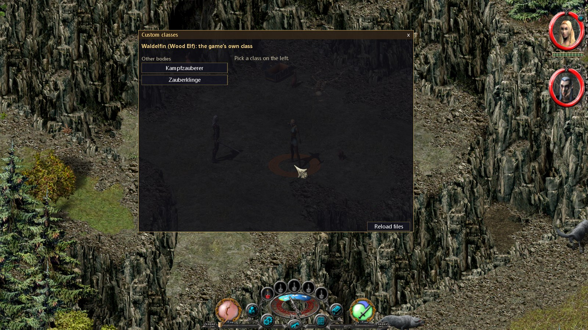
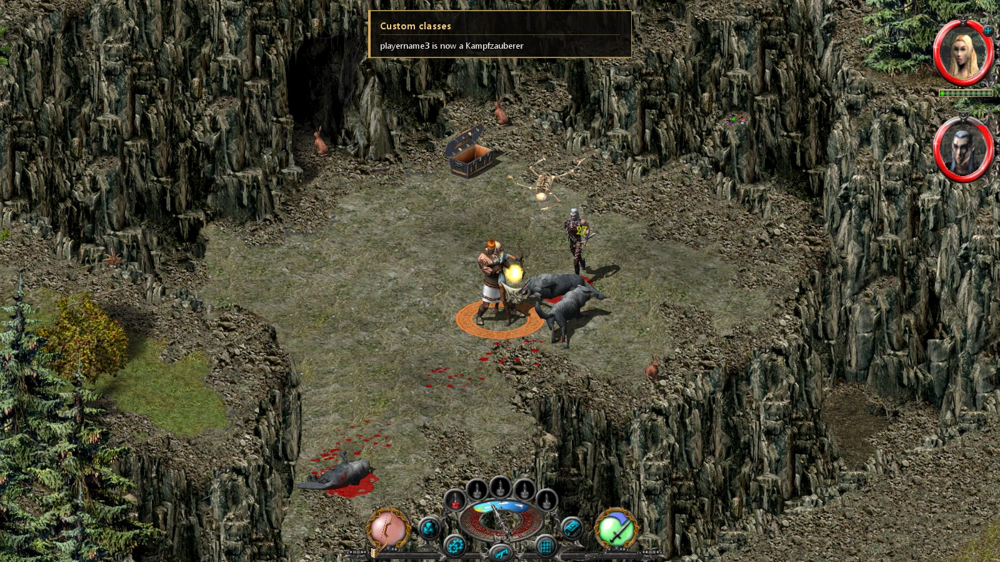
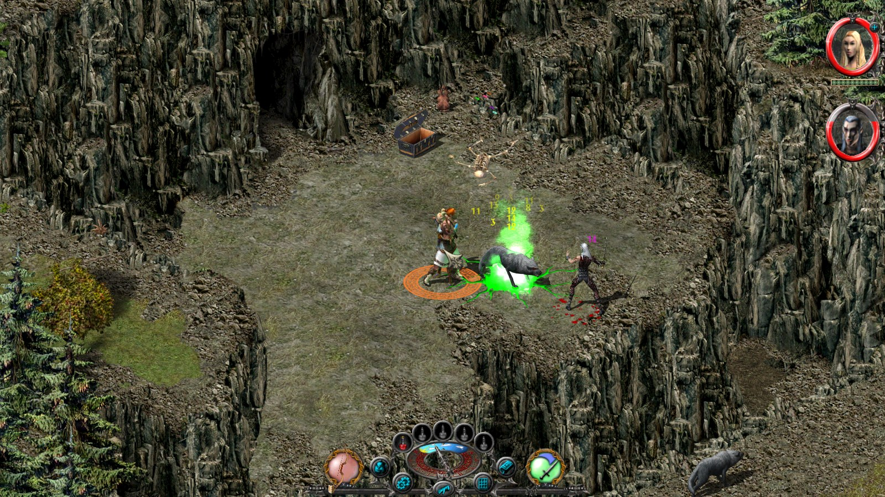
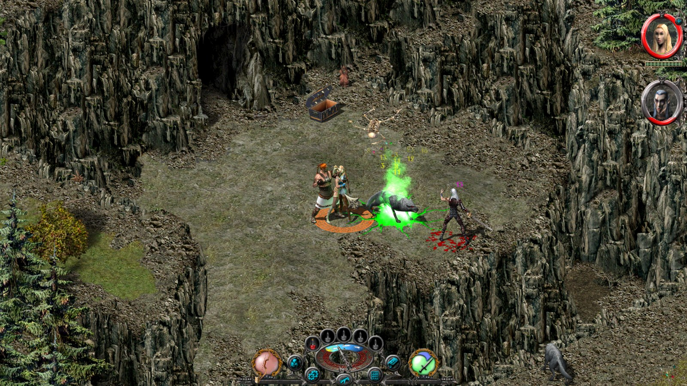

# Custom classes



Give a hero a class of your own: a Seraphim body that throws Battle Mage fire, a Gladiator that casts. A class is a
**profile on one of the eight hero bodies**: its skills, the combat arts and spells it may learn (from any class), and what
comes from the start and with a level. Your savegame stays a normal hero of that body, so it still opens in a game without
the mod (it keeps the arts it learned; the moves of other classes may just do nothing there).

Classes are small JSON files. The **Sacred Class Editor** writes them; you can also write them by hand (format below).
Two classes come with the mod: *Spellblade* (a Seraphim with Battle Mage skills, fireball and the Gladiator's heavy blow)
and *Battle Caster* (a Gladiator who casts).

## What you need

Sacred Gear and the mod. In a LAN game **every computer needs the mod and the same class files** (see Limits).

## How to use it

1. Press **Ctrl+Shift+C** (or *Class window* in the controller's mod menu, **LT + LB**). A hero at level 1 without a class gets the
   window by itself when the game starts (setting *Offer a class to a new hero*).
2. Pick a class on the left (those for your hero's body first, the others under *Other bodies*), read what it gives, press
   **Take this class**. The hero gets the class's starting arts at once, and the arts that come with a level as soon as they reach it.
   The window's buttons are normal window widgets: the controller's D-pad reaches them.
3. **Skills:** the skill window shows the class's skills while you play that hero.
4. **Runes:** every art of the class can be read from its rune; runes of arts the class does not list cannot be read.
   Monster spells have no rune: give them to the class as *start* or *level* arts.
5. **Back to the game's class** takes the profile away. The arts the hero learned stay.

Using the arts: an art of another class is run with *that* class's own code (a Seraphim uses the Gladiator's heavy blow
the way a Gladiator does), and where the hero's body has no animation for it the mod plays one of the body's own (or the one
the class names in `motion_remap`).



### What works on which body

Arts fall into tiers (the editor shows them per body): **spells** work on every body; **combat arts of another class** work
with the routing described above (*needs routing*); arts tied to class state (the Vampiress's forms, the Daemon's forms,
the Dwarf's firearms) stay with their class; monster-only actions cannot be moved. The measured list:
[CustomClasses.md](https://github.com/kirides/sacred-bild/blob/main/docs/CustomClasses.md) in sacred-bild. Arts that need a weapon
need an eligible weapon in the hero's hand.

## Class files

A class is a file `classes/<name>.json` in this mod's folder (or in the folder of any installed mod: an exported mod of the
editor). Files that are not valid are listed in the log and skipped.

```json
{
  "format": 1,
  "id": "spellblade",
  "name": { "en": "Spellblade", "de": "Zauberklinge" },
  "description": { "en": "A Seraphim body that throws fire." },
  "body": "seraphim",
  "skills": { "start": [14, 12], "available": [14, 12, 2, 25, 1, 3, 4, 10, 9, 22, 6, 11, 7, 8, 21, 15] },
  "arts": [
    { "id": 5,    "learn": "start", "level": 1 },
    { "id": 34,   "learn": "level", "level": 5 },
    { "id": 1059, "learn": "rune" }
  ],
  "motion_remap": { "202": 211 }
}
```

| Field | Meaning |
|---|---|
| `id` | Letters, digits, `_`, `-`; unique. |
| `name`, `description` | A text, or `{"en": ..., "de": ..., "ru": ...}` (the game's language, else `en`). |
| `body` | `seraphim`, `gladiator`, `battlemage`, `darkelf`, `woodelf`, `vampiress`, `dwarf` or `daemon`. |
| `skills` | Optional. Two start skills and up to 16 available skills, by the game's skill ids (the body's own when missing). |
| `arts` | The combat arts (ids from 1000), spells (below 1000), art copies and chains (their `art_id`, see below) of the class. `learn`: `start` (known at once, at `level`), `level` (granted when the hero reaches `level`), `rune` (only readable). |
| `motion_remap` | Optional. For a slot the body has no clip for: the slot to play instead (otherwise the mod picks the nearest slot the body has). |

The ids are the game's own (skill ids, art ids, motion slots); the mod checks them when it loads.

## Art copies and chains

Files `arts/<name>.json` (this mod's folder or any installed mod's) make new combat arts from existing ones.

**A copy** is the same art with its own id, name, description and numbers: a stronger "Venom Strike" next to the original.
The copy runs the original's code (so it works wherever the original does); the hero's art list, the tooltip, runes and
savegames use the copy's own id and texts.

```json
{ "format": 1, "id": "venom-strike", "kind": "copy", "art_id": 2001, "base": 1059,
  "name": { "en": "Venom Strike" }, "description": { "en": "..." },
  "values": { "effect_base": 40, "effect_per_level": 6, "regen_base": 8 } }
```

`art_id` is 2000 to 4999 (the game refuses art ids above 5000), `base` a combat art (1000 to 1999; spells cannot be copied:
the game does not run a spell under an id of its own). `values` are the fields of `gear.data.abilities` (the
[GearApi](https://github.com/kirides/sacred-bild/blob/main/docs/GearApi.md) lists them: `effect_base`, `effect_per_level`,
`regen_base`, `regen_per_level`, `target_mode`, and the `unk_` fields). The editor shows the game's ranges.



**A chain** is a named art that uses 2 to 8 arts or spells one after the other. It must start with a combat art.

```json
{ "format": 1, "id": "double-strike", "kind": "chain", "art_id": 2100, "steps": [1058, 1059], "delay": 0.1,
  "name": { "en": "Double Strike" }, "description": { "en": "A heavy blow, then an attack." } }
```

The chain is a copy of its first step (so the game starts it like any art), and when that step is done the mod orders the next
ones on the enemy nearest to the hero; a step still regenerating is waited for. The chain's regeneration is the sum of the steps'
(base and per level), so it is never cheaper than using the parts. The steps are learned with the chain. If the enemy dies
the chain ends. (The game's own combos hold four arts at most and cannot have a name, so chains do not use them.)



## Settings and keys

| Setting | What it does |
|---|---|
| Offer a class to a new hero | A level 1 hero without a class gets the class window when the game starts (once per savegame). |
| Play another clip where the body has none | On (default): a body without a clip for an art or spell plays one of its own. Off: the art does nothing visible. |
| Log the decisions | Routing and clip choices in the log. |

Key: *Class window* (Ctrl+Shift+C), changeable on the mod's *Keys* page (**F11**).

## Limits

- **The new-hero choice is a window,** not a button on the game's character screen: it opens when a level 1 hero starts, and
  any time with the key. (The character screen's dialog is not changeable by mods yet.)
- The skill lists are the body's record in the game, so they change when you switch heroes (companions of the same body see
  the class's skills while that hero is played).
- Which hero has which class is kept per savegame (in the mod's own folder), not inside the savegame.
- **LAN:** each computer runs the heroes it owns and shows the others' as it receives them. Every player needs the mod and
  the same class files; a class art that a vanilla computer does not know may look odd there. Heroes uploaded to a Closed
  Net server with arts of other classes may be refused by the server's checks (use Open Net or a server that allows them).
  Not tested with more than one computer yet.
- The rune rule (only runes of the class's arts can be read) is a hook on the game's class check; it is installed and unit tested,
  but reading a rune with a class has not been run in the game by an automation yet.
- The class's attribute bonuses are not part of format 1.

## Development

- **Files:** `src/custom-classes/mod.lua` (manifest), `main.lua` (assignments per savegame, taking a class, the engine
  questions), `profiles.lua` (reading and checking the files), `arts.lua` (art copies and chains), `window.lua` (the class
  window: drawing only), `classes/*.json` (the two example classes), `arts/*.json` (a copy and two chains).
- **Depends on:** `gear.classes` (tiers, hero skills, ability copies), `gear.models` (motion slots), the events `ability.route`,
  `motion.select` and `rune.usable`, `creature:learn`, `gear.mods.read` / `files`, `gear.store.game`
  ([GearApi](https://github.com/kirides/sacred-bild/blob/main/docs/GearApi.md), engine facts in
  [CustomClasses.md](https://github.com/kirides/sacred-bild/blob/main/docs/CustomClasses.md)).
- **Events for other mods and tests:** `custom-classes.take` `(hero id, profile id)`, `custom-classes.leave` `(hero id)`,
  `custom-classes.window` `(open)`.
- **Self test:** `src/custom-classes_selftest` (`Sacred.exe -gear-auto -gear-load=N -gear-mods=custom-classes,custom-classes_selftest
  -gear-instance=NAME`, a single player savegame with enemies nearby, in a copy of the game folder): profiles load, a Seraphim
  takes *Spellblade* (granted arts, the class skills while played, a spell cast, a routed Gladiator art), a Gladiator takes
  *Battle Caster* (casts although the body has no cast clip, uses a copied art, a chain of two arts and a chain that ends in a spell).
