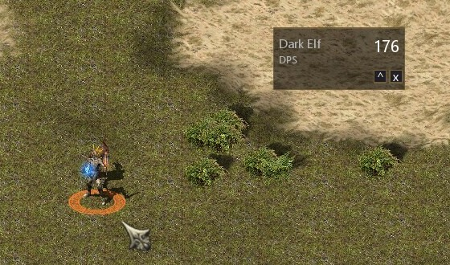

# Damage meter

Shows how much damage you deal and take, and your damage per second (DPS). The small default view lists each character with its DPS; in a network game it lists the whole party. Larger views add damage taken, biggest hit, damage by monster type and more.

## What you need

Sacred Gear and the mod. No server is needed. In a network game every player needs the mod to be listed in the party view.

## How to use it

Press **F7** to show or hide the meter. Use the small buttons on the panel, the *View* key or the *View* setting to switch between compact, extended and detailed. A fight ends after a few seconds without damage; the meter starts fresh with the next fight.

## Keys

| Key | What it does |
|---|---|
| **F7** | Show or hide the meter. |
| **(unbound)** | Next view; reset the meter. Set them in the Keys page if you want them. |

You can change every key in the Mods screen (**F11**, then the mod's *Keys* page).

## Settings

Open the Mods screen with **F11** and pick the mod.

| Setting | What it does |
|---|---|
| A fight ends after | Seconds without damage before the fight counts as over (2 to 30). |
| View | Compact (name and DPS), extended (DPS, taken, dealt) or detailed (everything). |
| Share my DPS with the other players | In a network game, sends your numbers so the others see you. Off: nobody sees you. |
| Rolling DPS window | The length of the "last seconds" row (3 to 30 s). |

## Development

- **Files:** `src/damagemeter/mod.lua` (manifest) and `main.lua` (about 700 lines: damage tracking, the three views, party sharing).
- **Depends on:** the `damage` event of Gear (the engine's final damage per hit), `gear.world`, `gear.mp` / the mod channel for the party view (once a second), `gear.ui`, `gear.save` / `gear.read` for the view state.
- **Test it without the game:** `tests/session_mods_test.lua` (needs LuaJIT, run from the repository root; sacred-bild is not needed).
- **Known clash:** F7 is shared with the server mods ([Hotkeys](../Hotkeys.md)). More about the session mods: [Session mods](../SessionMods.md).
