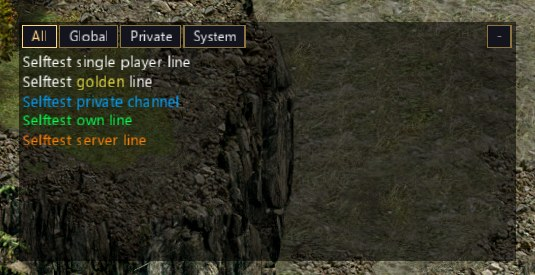

# Enhanced Chat

A chat window in place of the lines at the top of the screen that fade after a few seconds and are gone. It keeps the
last lines of the session, scrolls, sorts them into tabs and shows item names in their rarity colour.

## Use

After [installing](../Install.md) (`src\enhanced-chat` to `mods\enhanced-chat`) the window sits bottom left. Everything the
game used to show at the top of the screen goes there instead: chat from other players, the server's messages, the
game's own notes and your own lines. Chat is still typed with the game's own chat line (Enter).

- **Tabs**: *All*, *Global* (chat to everyone and to the team, and your own lines), *Private* (private messages) and
  *System* (the game's and the server's lines, and drops). A tab that got a line while another one is open shows a dot.
- **Player filter** (network games): the dropdown beside the tabs narrows every tab to one player's lines.
- **Scrolling**: the mouse wheel, the scrollbar, Up / Down / Page Up / Page Down, the D-pad or the right stick. While you
  read older lines the window stays put; a *new* button at the bottom jumps back to the newest line.
- **Colours**: the colours the game gives its lines stay (private light blue, team yellow, the server's red, your own
  green), as do colour codes inside a line. **Drops** near your hero get a line (*Dropped: name*) with the name in the
  item's label colour: white, blue (magic), yellow (rare), gold (unique), green (set). Rest the cursor on such a line to
  see the item's tooltip while the item still lies there.
- **-** beside the tabs folds the window to its tab row; **+** opens it again.
- **Move** it with the layout editor (hold **Alt**, *Edit layout*): drag it. Its size is set in the mod's settings (*Window
  width*, *Window height*). It scales with the game's UI like every window.

By default the window shows in network games only: in single player (*Hide in Singleplayer*, on by default) the game
keeps its own lines at the top. When the window is hidden (in single player, setting *Show the chat window* off, or the
*Show / hide* key) or the mod is switched off, the game shows its own lines at the top again. Lines that came before the mod was switched on are in the window too (the
session's last 200).

## Settings (F11, Enhanced Chat, *Settings*)

| Setting | Default | |
|---|---|---|
| Show the chat window | on | off: the game's own lines at the top of the screen |
| Hide in Singleplayer | on | no window in a single player game; network games are unaffected |
| Hide the game's own chat lines | on | off: both the window and the game's lines |
| Lines kept | 200 | 50 to 500 |
| Text size | 13 | 10 to 20 |
| Background opacity | 140 | 0 (none) to 255 |
| Show the time of each line | off | |
| Drops near the hero | Rare and better | Off, Magic and better, Rare and better, Set and unique, Unique only |
| Drops: radius (tiles) | 25 | |

## Keys

*Show / hide the chat window* and *Next chat tab* have no key by default (bind them on the *Keys* page; the game's own
hotkeys, F7, F8 and F9 included, are better left alone). With a controller both are in the mod menu (**LT + LB**); the
tabs, the buttons and the line area are D-pad stops. See [Controller](../Controller.md).

## How it works

Sacred Gear (`gear.chat`, from sacred-bild) catches every line the game adds to its message list, tells the kinds apart
and, for chat from other players, knows the sender (from the network message the line was made of). While the window
shows, Gear keeps the lines off the game's own list; it gives them back by itself half a second after the mod stops
asking. Drops are found as the loot log finds them: twice a second it looks at the items around the hero. Needs a
Sacred Gear with `gear.chat`; an older one leaves the mod idle.

## Development

- **Files:** `src/enhanced-chat/mod.lua` (manifest) and `main.lua` (about 370 lines). Nothing is written to disk.
- **Depends on:** `gear.chat` (the lines, `replace_overlay`, `segments`), `gear.world.items_near` and `item_color`
  (drops), `gear.mp` (the player filter), `gear.ui` (an RmlUi document with the game theme, `element:scroll`, `item_tooltip`).
- **Other mods:** `gear.emit('enhanced-chat.query', out)` fills `out` with the window's state (for the self test).
- **Self test:** `src/enhanced-chat_selftest` (with `-gear-auto`, in a copy of the game folder):

    Sacred.exe -gear-auto -gear-instance=chat -gear-mods=enhanced-chat,enhanced-chat_selftest

It loads savegame 1, adds lines as the game does and checks their kinds and colours, the history, the tabs (clicked),
scrolling and the *new* button, that the game's own lines are hidden and come back when the window is hidden, and the
item colours, and that the window stays hidden in single player by default (33 checks). With `config.lua` `return {mode = 'lan'}` it hosts a LAN game instead (the game's own
gameserver on its usual ports: not next to a real game) and also sends itself a private message through the server,
which must come back with its sender, and checks the player filter.

`mode = 'server'` tests two players: two instances of the copy join a LAN game of the remake's `SacredGameServer` on
test ports (the instances end the game's own `GameServer.exe` whenever one opens the Multiplayer menu, so it cannot be
used). The instance named `...send...` sends global, team and private chat; the other checks that the lines arrive with
the right kind and sender, that the game did not show them itself, the player filter and the tabs. The setup is at the
top of the mode in `main.lua`. Team chat only reaches the sender's party, so it is noted, not checked.
