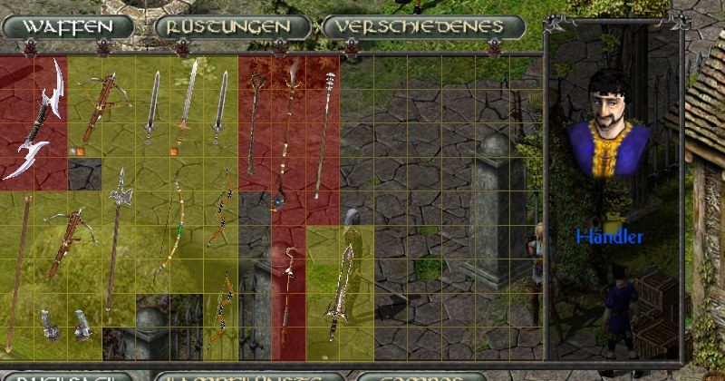

# Improved shops

Merchants that sell gear sometimes stock a few better pieces: magic and rare items made for your hero's level, the kind you would otherwise only find as drops. The extras come on top of what the game stocks and look like any other ware (the same tooltip, the same price rules, buy and sell as usual).

## What you need

Sacred Gear with `gear.shop` and the `shop.stock` event (0.13.0 or later) and the mod in your `mods` folder (see [Install](../Install.md)). It works in single player and in network games (the shop is on your PC).

## How it works

A merchant's wares sit on three pages (the tabs *Waffen*, *Rüstungen*, *Verschiedenes*). The game stocks them when you open a merchant other than the one you saw last, and when you come back to the same one it only swaps a few wares, often none. The mod waits for the game to stock a page (`shop.stock`). Then, once per merchant, it rolls its chance; if it hits, it picks one to *Most finds per shop* extra pieces from the categories that page really sells (a weapon merchant gets weapons, an armour merchant shields and helmets, a potion seller nothing) and has the game make them through its own stocking code.

Nothing happens when you merely open the shop window again: no new roll, so the stock stays as it is until the game resets it. Leave the merchant for another one and come back and the game stocks (and the mod rolls) anew, as for any new merchant.

## Settings

| Setting | What it does |
|---|---|
| Chance a shop has finds (%) | Each time the game stocks a new merchant this is the chance that he also gets better pieces. Default 60, 0 turns the mod off. |
| Chance after a restock (%) | The game often swaps a few wares when you come back to the same merchant. This is the chance that such a swap brings finds too. Default 0: the stock of a merchant you come back to is left to the game. |
| Most finds per shop | A shop with finds gets one to this many extra pieces, spread over its pages. Default 2. |
| Lowest / highest quality | The game's quality tier a find is made with: 0 plain, 5 to 11 magic, 12 to 14 rare. Finds are drawn between the two, lower ones more often. Default 7 to 14. |
| Level against your hero | 0 makes the finds items of your hero's level, 3 three levels above it. Default 0. |

## For modders

The mod is a few lines on top of `gear.shop` (see the *Shops* chapter of the [Gear API](https://github.com/kirides/sacred-bild/blob/main/docs/GearApi.md#shops-gearshop)): `gear.on('shop.stock', ...)` and `gear.shop.add{container = e.container, category = ..., quality = ..., level = ...}`. `src/improved-shops_selftest` opens a merchant in a loaded savegame and checks the mod's wares and that a reopened shop keeps its stock.
