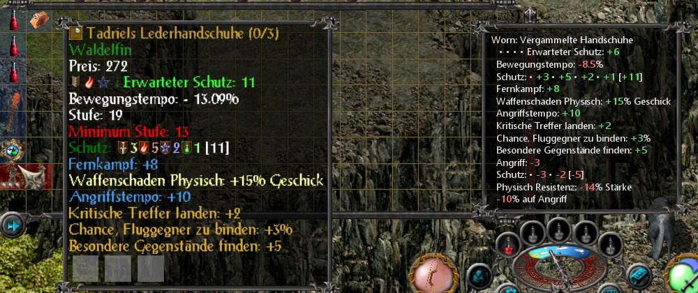

# Item comparison

Hover an item and see what it would change. A panel beside the game's own tooltip lists the differences to the item your hero wears in that slot, **green** where the new item is better and **red** where it is worse. It works wherever the game shows an item tooltip (backpack, chest, shops, the equipment window) and with the controller's cursor: nothing to press.

## What you need

Sacred Gear and the mod. No server is needed. For the party view you need the [Companions](companions.md) mod (or any other use of `gear.party`).

## How to use it

Rest the cursor on an item you could wear. If your hero wears something in that slot, the panel appears next to the tooltip:

- **Worn: item name** is what you would replace.
- Each line is a stat of the two items, with the difference in the line's own shape: `Physical resistance: +4%`, `Movement speed: -8.5%`. A stat only one of the items has counts as 0 for the other one. Damage ranges are compared by their middle. Lines that do not differ are left out.
- The first line of an armour or weapon is the game's own *expected protection / damage* for your hero.
- Rings and amulets have several slots: the two weakest worn ones are compared.
- Two-handed weapons and shields: a weapon is compared with the worn weapon only, a shield with the worn shield.
- With companions, the item is also compared for every other hero of the party that can wear it (their name is in front of the worn item; a hero with nothing in that slot is listed too). The expected damage and protection of the game are the controlled hero's, so they are left out for the others.

When you hover an item you already wear, only the companions' gear is compared.

## Keys

| Key | What it does |
|---|---|
| **(unbound)** | Switch the comparison on or off. |

## Settings

Open the Mods screen with **F11** and pick the mod.

| Setting | What it does |
|---|---|
| Compare items | The comparison on or off. |
| Also compare with party members | Single player with companions: also show the other heroes that can wear the item. |
| Place the panel | *Beside the tooltip* (default), or *at a fixed place*: hold **Alt**, use the layout editor and drag the panel *Item comparison*. |
| Most items compared at once | 1 to 6 comparisons in the panel (every party member and every ring is one). |

## How it works

The numbers come from the tooltip text the player sees: the mod asks the game for the tooltip of both items (`gear.ui.item_tooltip_text`), splits each line into its words and numbers and subtracts the numbers of lines with the same words. That includes the bonuses of set and unique items and of socketed runes, and works in every game language (only the words are compared with each other; the lines for the price, the level and the requirements are recognised by the game's own text ids). The hovered item is read from the game through `gear.ui.hovered_item()`, the slot through `creature:equip_slot(item)`.

Limits: the game does not say whether an item can be used with your attributes and level (the requirement lines are not compared); two-handed weapons are not recognised as such (a bow is compared with the worn weapon and the shield stays); with two weapon slots only the main hand is compared.

## Development

- **Files:** `src/item-compare/mod.lua` (manifest) and `main.lua`; the self test is `src/item-compare_selftest` (`Sacred.exe -gear-auto -gear-load=N -gear-mods=item-compare,item-compare_selftest`, needs a savegame whose hero wears gloves and a weapon; set `config.party` for the companion checks).
- **Depends on:** `gear.ui.hovered_item`, `creature:equip_slot`, `gear.ui.item_tooltip_text`, `gear.party`, `gear.text`.
- **Event:** `itemcompare.compared` `(item id, number of blocks, blocks)` after a comparison is made.
