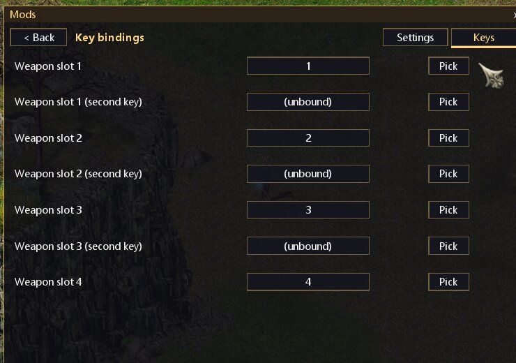

# Key bindings

Choose the keys and mouse buttons of the game's own actions, and cast a combat art with one press. Works in ordinary
Sacred Gold; no other mod is needed.

## Use

After [installing](../Install.md) (`src\key-bindings` to `mods\key-bindings`) press **F11**, pick *Key bindings* and open
its *Keys* page. Every action of the game has a row with **two keys**; a row may also be left unbound. Click a key, then press
the new one (a key, `Ctrl+`/`Shift+`/`Alt+` with a key, or a mouse button); **Esc** cancels, **Backspace** unbinds, *Default*
brings the game's own key back. With a controller, *Pick* lists the keys. A key that two rows (or another mod) use is
marked.

What you can bind:

- Weapon slots 1 to 5 and combat art slots 1 to 5, each on its own.
- The potions: healing (red), undead death (dark), mentor (blue), antidote (green), concentration (yellow); heal companions.
- The windows: inventory, combat arts, combos, log book, world map, save / load menu, help, options, multiplayer info.
- Pause and *collect all loot*.
- **Quick cast** rows for combat art 1 to 5 (below).

**The defaults are the game's own keys** (1 to 5, 6 to 0, Space Q W E R, B, I F C L M A S H O P N); the second keys and
the quick cast rows are unbound, so nothing changes until you choose. Moving an action to another key turns its old key
off: with *Combat art 1* on `1` and *Weapon slot 1* unbound, `1` selects the art and nothing switches the weapon. Keys
and buttons: any key, `F13` to `F24`, `Ctrl+`, `Shift+` and `Alt+` combinations (exactly those held), and the mouse's
middle button and two side buttons (*Mouse3* to *Mouse5*; mice with more buttons usually send them as keys such as
F13 to F24 - set them up in the mouse's own software, then bind the key). The left and right mouse buttons and Esc cannot be bound.

The bindings apply while you play: not in the menus, not with the escape menu, a message box, the savegame, options or
character screen open, and not while the chat line is open, so typing is never touched.

## Quick cast

*Combat art 1, quick cast* (and 2 to 5) selects the combat art slot **and casts it once at the cursor**, like the right
click after selecting it. Bind them to what you like, for example 1 to 5 with the weapon slots unbound: point at the
target, press 1. The cooldown, cost and aim are the game's, since it is the game's own select and click. It does not
cast if the slot could not be selected (an empty slot), a held key casts once, and nothing is cast while the cursor is
over an open window or a mod panel (setting *Quick cast over windows* allows it). The setting *Quick cast* switches the
casting off without losing the keys (they then only select). Binding keys works the same with quick cast off.

## Settings (F11, Key bindings, *Settings*)

| Setting | Default | |
|---|---|---|
| Quick cast | on | off: the quick cast keys only select the art |
| Quick cast over windows | off | on: cast although the cursor is over an inventory or similar window |

## How it works

Sacred Gear's `gear.input` turns the key or button you chose into the game's own key for the action before the game
reads it, and swallows the original of an action you moved; the mod only turns your rows into those rules and sends one
click after a quick cast key (`gear.game.cursor_click`) once the game reported that it selected the slot
(`skillslot.select`). The rows are the mod's declared keys, so the Mods screen's key capture, controller picker, conflict
marks and *Default* buttons apply, and bindings are kept with the other mod settings.

## Development

- **Files:** `src/key-bindings/mod.lua` (manifest: the rows), `actions.lua` (the same list for the code), `main.lua`.
- **Self test:** `src/key-bindings_selftest` presses keys and mouse buttons in a game copy
  (`Sacred.exe -gear-auto -gear-instance=keys -gear-mods=key-bindings,key-bindings_selftest`).
- **Not covered:** the chat line (only a network game opens it; the layer is switched off while the console window shows,
  as the game routes typing by that); *Heal companions* and *Multiplayer info* need a party / network game to see an effect.
