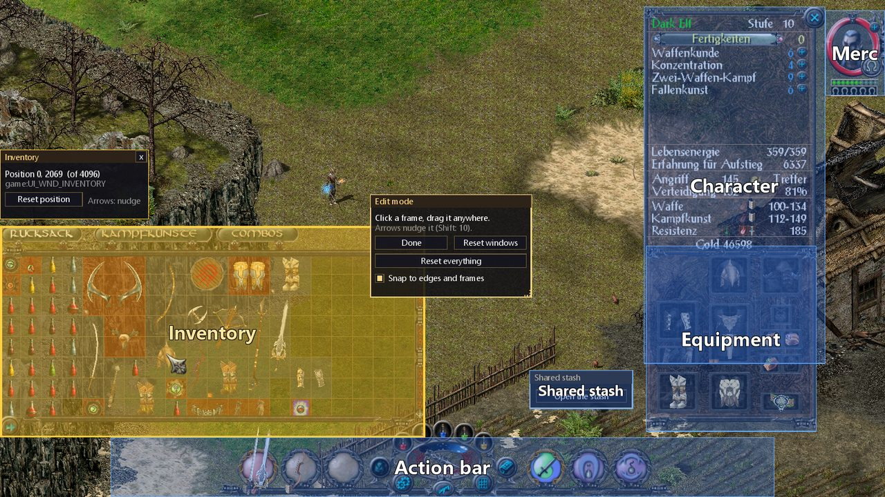

# Layout editor

Move the game's windows and the panels of your mods wherever you want them, like the edit mode of an online game. Everything you move stays where you put it.

## What you need

Sacred Gear and the mod itself in your `mods` folder (see [Install](../Install.md)).

## How to use it

Hold **Alt**: an *Edit layout* button shows at the top left. Press it. Frames show on every window and panel; drag them. By default they snap to the screen edges and to each other. Hold **Shift** while dragging to move freely. Press the button again to leave the edit mode.

## Settings

Open the Mods screen with **F11** and pick the mod.

| Setting | What it does |
|---|---|
| Snap to edges and frames | On by default. Hold Shift while dragging to move freely. |

## Development

- **Files:** `src/layout/mod.lua` (manifest; `priority = 100` so it loads last and its handles lie over the other panels) and `main.lua` (about 650 lines). Self test: it only runs with `-gear-auto`.
- **Depends on:** the edit-mode functions of `gear.ui` (`edit_mode()`, `set_edit_mode()`, panel registration, moving the game's own windows). The positions are saved by Gear (see [Gear](https://github.com/kirides/sacred-bild/blob/main/docs/Gear.md)). Other mods only need to register their panels with Gear to be movable; they do not need to know this mod.
- **Test it:** `gear-auto` run with the self test, see the automation chapter of [Gear](https://github.com/kirides/sacred-bild/blob/main/docs/Gear.md).
