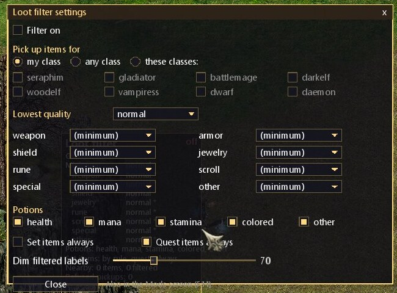

# Loot filter

Your hero only picks up the items you want. Filter by class, quality and kind of item; everything else is dimmed on the ground so the good items stand out.

## What you need

Sacred Gear and the mod itself in your `mods` folder (see [Install](../Install.md)).

## How to use it

Press **F5** to open the filter. Pick which classes' items to collect (your own by default), the lowest quality, a different quality for weapons, armour, jewelry and the rest, and which potions to take. Quest items are always taken; set items can be, too. Items the filter skips are drawn dimmed and clicking them does nothing. Switch the filter off to pick up everything again.

## Keys

| Key | What it does |
|---|---|
| **F5** | Open the loot filter panel. |

You can change every key in the Mods screen (**F11**, then the mod's *Keys* page).

## Settings

Open the Mods screen with **F11** and pick the mod.

| Setting | What it does |
|---|---|
| Filter on | Off: the hero picks up everything. |
| Show overlay | The filter's small status panel on screen. |
| Look around the hero (tiles) | How far from the hero items are checked (5 to 100). |
| Dim filtered labels | How faint skipped items look (0 to 255). |
| Quest items always / Set items always | Never filter these. |
| Pick up items for | My class, any class, or the classes you tick. |
| Lowest quality | Normal, magic, rare, unique. |
| Weapon, Armor, Shield, Jewelry, Rune, Scroll, Special, Other | A different lowest quality per kind of item. |
| Potions | Health, mana, stamina, colored, other: tick the ones to take. |

## Development

- **Files:** `src/lootfilter/mod.lua` (manifest with all the settings), `config.lua` (defaults) and `main.lua` (about 650 lines: the rules, the overlay panel, the settings page).
- **Depends on:** `gear.world.items_near` (the items around the hero, polled several times a second), `gear.world.pickup_rules` (the block list and dim list; pickups are refused natively), `gear.data.object_types`, `gear.ui` and Gear's saved settings. Rules are saved in `lootfilter.json`.
- **Limits:** pickup rules hold in single player and for the host's own hero; a network client's pickups go through the host and are not filtered ([Gear](https://github.com/kirides/sacred-bild/blob/main/docs/Gear.md)).
- **Test it:** `gear-auto` self test (see the automation chapter of Gear) or by playing.
