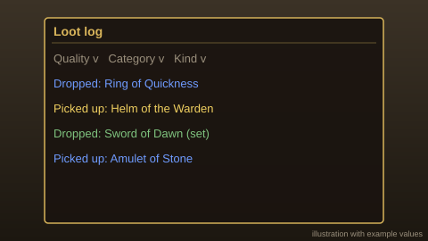

# Loot log

*Illustration with example values.*

A list of the items that dropped near your hero and the items that ended up in your backpack. Filter it by quality, category and kind. It is kept between sessions, and equipment names are shown in the game's language.

## What you need

Sacred Gear and the mod. No server is needed.

## How to use it

Press **F3** to show or hide the log. Use the three drop-down lists at the top to show only the lowest quality, the category and the kind (dropped or picked up) you care about; *Clear* empties the log. By default plain items and gold are not logged; switch them on in the settings.

## Keys

| Key | What it does |
|---|---|
| **F3** | Show or hide the loot log. |

You can change every key in the Mods screen (**F11**, then the mod's *Keys* page).

## Settings

Open the Mods screen with **F11** and pick the mod.

| Setting | What it does |
|---|---|
| Watch the ground within (tiles) | Items appearing closer than this to the hero count as drops (5 to 60). |
| Entries kept | How many lines are remembered (50 to 2000). |
| Log plain items | Also log normal-quality items. |
| Log gold piles | Also log gold. |

## Development

- **Files:** `src/lootlog/mod.lua` (manifest) and `main.lua` (about 350 lines). The log is kept in `lootlog.json`.
- **Depends on:** `gear.world.items_near` (drops), `gear.inv.container` (what reaches the backpack), `gear.ui`, `gear.save` / `gear.read`.
- **Test it without the game:** `tests/session_mods_test.lua` (LuaJIT, from the repository root).
- More about the session mods: [Session mods](../SessionMods.md).
