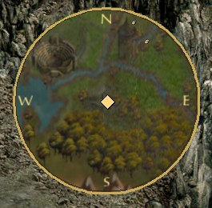

# Minimap

The game's own world map as a small overlay that follows the hero: the same map pictures the world map window shows,
cut to a rectangle or a circle, with a gold frame, compass letters and the trader symbols of the map.

- **Centred on the hero** at every zoom level. **Eight zoom levels** (1 is the widest): the keys *Minimap: zoom in / out*
  (unbound by default, set them in the Mods screen), the **+ / -** buttons that appear while the mouse is over the map,
  the setting *Zoom level*, and the controller's mod menu (**LT + LB**, then *Minimap: zoom in* / *zoom out* / *show / hide*).
- **Map:** *High-Res* (default) is the whole world drawn from the game's data, with terrain, water, trees and buildings but no creatures, where the world has no data the game's own map fills in, matched to the render's colours; *World Map* is the game's painted map; *Game* is the picture of the game's own TAB overlay: the sector pictures `MINIMAP<x><y>.TGA` of Texture.pak (256 x 256 per sector, in the game's isometric view, so no north-up compass), read straight from the game, nothing extra to install.
- **Shape and size:** *Circle* or *Rectangle*, width and height, opacity, compass letters, trader symbols (merchant,
  blacksmith, combo master, horse trader; needs a SacredBild with `gear.game.map_markers`).
- **Position:** the layout editor (ALT) moves it like any other mod panel.
- Outdoors only. In dungeons the panel is hidden.

## How it works

The *Game* map is the 6046 sector pictures of Texture.pak in the game's isometric view (`projection.lua`: `game_tiles`; `sectors.lua` says which sectors have a picture; a sector without one stays black). The other maps: the map is the 8 x 11 tiles `UI_WORLDMAP*.TGA` (Underworld above Ancaria), drawn through `gear:texture/`. The hero's tile
position goes to the picture with the engine's own world-to-map transform. An element cannot be cut round, so the circle is
stacked from thin clipping rows. The geometry is in `src/minimap/projection.lua` (`luajit tests/minimap_test.lua`).

Tested in the game at 1600x900 (self test `src/minimap_selftest`, `-gear-auto`): the hero lands on the map where the villages and trader symbols line up with the map. The first line of the log
(`minimap: hero at world ...`) shows where the mod puts the hero on the map.

## Development

- **Files:** `src/minimap/mod.lua` (manifest, settings, keys), `projection.lua` (world position to map picture, zoom and clipping rows: logic without the game), `main.lua` (the panel, markers, zoom buttons, controller menu entries) and `ui/` (the RmlUi document).
- **Depends on:** Sacred Gear (`gear:texture/` for the map tiles, `gear.game.map_markers` for the trader symbols), `gear.settings`; the layout editor moves the panel.
- **Test it:** `luajit tests/minimap_test.lua` checks the projection and the clipping. `src/minimap_selftest` (`Sacred.exe -gear-auto -gear-instance=minimap -gear-load=10 -gear-mods=sacred-theme,minimap,minimap_selftest`, in a copy of the game folder) takes pictures at every zoom level, of the rectangle and of the view without markers. `gear.emit('minimap.set', id, value)` changes a setting from another mod or a test.
