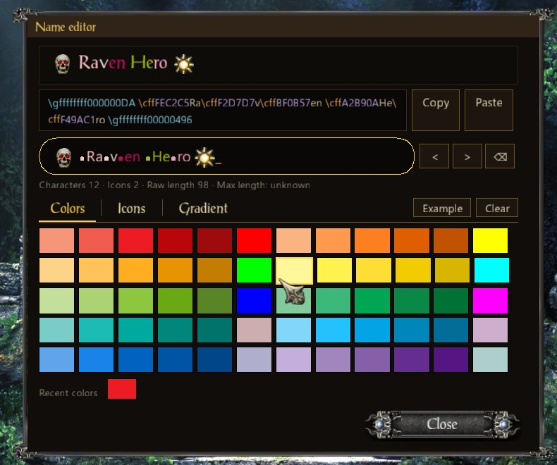
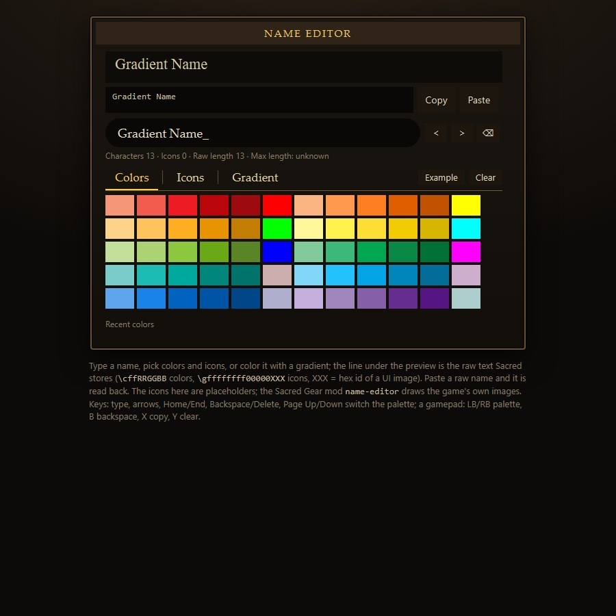
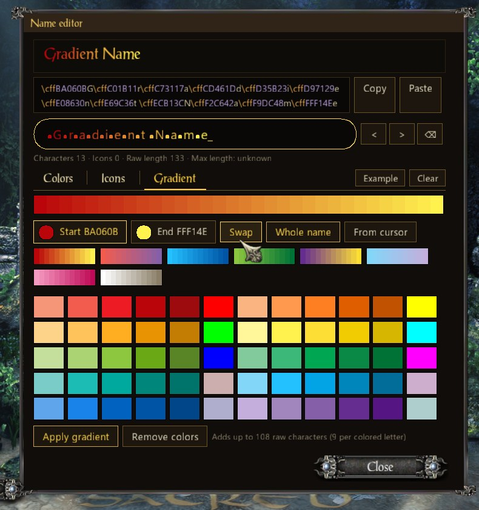
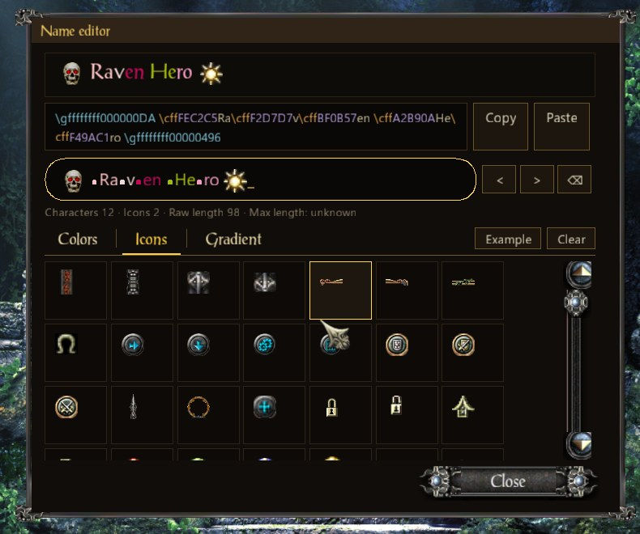

# Name editor

Build a character name with the game's colors and little pictures. You type the name, pick colors and icons from palettes, or color the whole name with a gradient, and the editor shows the result as the game draws it. The line under the preview is the raw text Sacred stores, ready to copy.

The same editor also runs as a web page, [`docs/name-editor/index.html`](../name-editor/index.html) (one file, no server needed; its icons are placeholders).

## What you need

Sacred Gear 0.4.1 or newer and the mod. The [Sacred theme](../../src/sacred-theme/README.md) mod gives the window the look of the game. No server is needed.

## How to use it

Press **Ctrl+Shift+N** (or pick *Name editor* in the controller's mod menu). The cursor is the game's blinking underscore in the name field and everything you type goes there.

- **Colors**: a color code is put in front of the letters you type next, as a small dot in the name field. *Recent colors* keeps the last ten.
- **Icons**: the game's own pictures; the icon goes in at the cursor. Hover one to see its code and image number.
- **Gradient**: pick the *Start* and *End* color (a click on a slot, then a color; a preset sets both), then *Apply gradient*: each letter gets its own color, spaces are skipped. *Whole name* or *From cursor*; *Swap* turns it around; *Remove colors* takes every color code out.
- **Copy** puts the raw text on the clipboard. **Paste** reads a raw name from the clipboard (it replaces the name); Ctrl+V adds it at the cursor. Raw names from the wiki are read back into icons and colors.

## The raw format

| Code | Meaning |
|---|---|
| `\cffRRGGBB` | the letters after it have this color (it stays until the next code) |
| `\gffffffff00000XXX` | a UI image; `XXX` is its id in hex (`0DA` is image 218, a skull). The game draws it in the line like a letter |

A gradient costs 9 raw characters per colored letter. How long a name may be in the game is not verified yet; the editor shows the raw length.

## Keys

| Key | What it does |
|---|---|
| **Ctrl+Shift+N** | Open or close the editor. |
| letters, **Left**, **Right**, **Home**, **End**, **Backspace**, **Delete** | Edit the name. |
| **Ctrl+V** / **Ctrl+C** | Paste at the cursor / copy the raw text. |
| **Page Up** / **Page Down** | Previous / next palette tab. |
| **Esc**, controller **B** | Close. |

With a controller every button, color, icon and tab is a D-pad stop and **A** presses it; the *&lt; &gt; &#9003;* buttons next to the name move the cursor and delete. A controller cannot type letters yet (there is no on-screen keyboard in this mod) and a mod cannot read **LB** / **RB** in game, so the tabs are D-pad stops there; on the web page **LB** / **RB** switch the tabs.

## Development

- **Files:** `src/name-editor/` (`mod.lua`, `main.lua`, `data.json` = palette, icon ids and presets, `ui/editor.rml`, `ui/fragment.rcss`, `ui/window.rcss`) and the self test `src/name-editor_selftest`.
- **One fragment, two runtimes:** the part of `ui/editor.rml` between `<!--fragment-->` markers and `ui/fragment.rcss` are shared. The game fills it from `main.lua` (Lua, RmlUi, real UI images `gear:image/<decimal id>`); `tools/make_name_editor_web.py` turns the same markup and stylesheet (dp becomes px) plus `tools/name-editor-web/editor.js` into `docs/name-editor/index.html`. `main.lua` and `editor.js` keep the same ids, token model and markup builders. Run `python tools/make_name_editor_web.py` after a change (`--check` for CI).
- **Self test:** `Sacred.exe -gear-auto -gear-instance=name-editor -gear-mods=name-editor,name-editor_selftest,sacred-theme` in a copy of the game folder (start menu, no savegame); results in `GearAutomation\name-editor\name_editor_selftest.txt`, pictures beside it.
- **Hooks for tests and other mods:** `gear.emit('name-editor.query', out)`, `'name-editor.set'` (`{shown, raw, caret, tab}`), `'name-editor.press'` (`{id}`).
