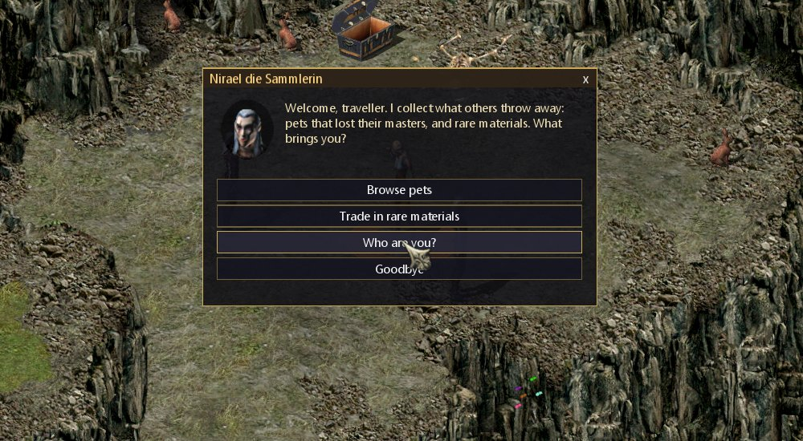

# NPC example

A small mod that is meant to be read and copied: one custom NPC made with `gear.npc`, Sacred Gear's infrastructure for NPCs of your own. **Nirael the Collector** stands near your hero in single player. She uses the model of a creature the game already has (a dark elf woman), shows her own name over her head, and opens a dialog when you click her: the hero walks up to her first when you are too far away.

## What you need

Sacred Gear 0.14.0 or later (`gear.npc`, `creature:set_name_text`, `gear.world.clock`) and the mod in your `mods` folder (see [Install](../Install.md)). Single player only.

## How to use it

Click Nirael. Her dialog has four buttons: *Browse pets* and *Trade in rare materials* call code of the mod, which opens a window of its own (the example only says what a real shop would do there), *Who are you?* goes to a second page of the dialog, *Goodbye* closes it. **Ctrl+Shift+M** (rebindable in the Mod manager) calls her to your hero; with *Place Nirael in a new game* switched off she only comes when called.

She walks between two places by the game's clock: from 06:00 she stands where she was placed, from 18:00 250 world units to the east. When your hero is near, she walks there (and is put there if something blocks her); when you are far away she is put there at once.

## For modders

`src/npc-example/main.lua` is the whole mod. The parts:

- `gear.npc.define(id, {...})` names an object type of the game for the model, a name (a string or `{en = ..., de = ...}`), the dialog pages and the routine. The id is yours alone: the name text id comes from it, and the savegame keeps that id with the creature, so keep it stable.
- `gear.npc.spawn(kind, x, y, opts)` makes the creature (friendly, with the hero's faction); the mod's per-savegame data lists it, so it is found again after a load (`gear.npc.list`).
- A dialog page is `{text = string or function(e), options = {...}}`; an option has a `label`, `go = 'page'` or `close = true`, and an `on(e)` handler. A handler can open a window of the mod (`e.close()` ends the dialog first), and every button also reaches the handlers of `gear.npc.on('button', fn)`.
- `routine = {{time = '06:00', x =, y =}, ...}` on the kind, or per NPC in `spawn` (`gear.npc.routine(creature, points)` changes it later).
- `tint` (`creature:set_tint`) colours the model, whole or per mesh (needs SacredBild); the example leaves it out.

The Gear API reference has the details ([Custom NPCs](https://github.com/kirides/sacred-bild/blob/main/docs/GearApi.md#custom-npcs-gearnpc)). `src/npc-example_selftest` places Nirael in a loaded savegame, opens her dialog and presses a button (`Sacred.exe -gear-auto -gear-load=10 -gear-mods=npc-example,npc-example_selftest`, in a copy of the game folder).
