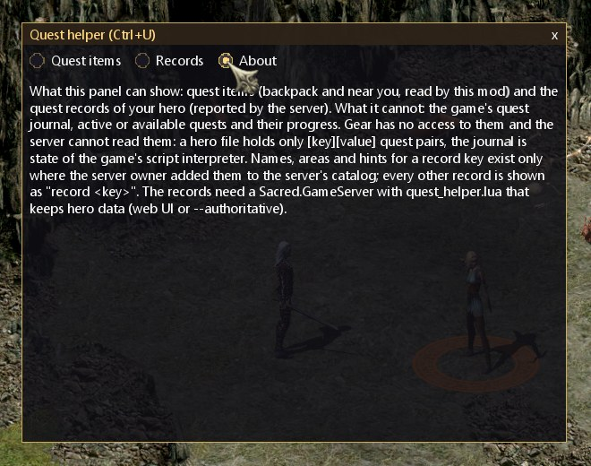

# Quest helper

A panel with the quest items in your backpack and near you, and, from a server that knows your hero, the quest records with hints.

## What you need

Sacred Gear and the mod itself in your `mods` folder (see [Install](../Install.md)). It also needs a SacredEngineRemake game server (`Sacred.GameServer`) running the script `quest_helper.lua`. On any other server the mod just shows that the server has nothing for it. The quest items list works without a server. Neither Gear nor the server can read the game's own quest journal.

## How to use it

Press **Ctrl+U** to open the panel. While it is open it refreshes from the server every few seconds. A short line appears on screen when the server reports a new or changed quest record.

## Keys

| Key | What it does |
|---|---|
| **Ctrl+U** | Open or close the quest helper. |

You can change every key in the Mods screen (**F11**, then the mod's *Keys* page).

## Settings

Open the Mods screen with **F11** and pick the mod.

| Setting | What it does |
|---|---|
| Show change notices | A line on screen when a quest record changes. |
| Refresh while open (seconds) | How often the panel asks the server (5 to 120). |

## Development

- **Files:** `src/questhelper/mod.lua`, `main.lua` (about 230 lines).
- **Depends on:** `gear.world.items_near` and `gear.world.hero` for the quest items, `gear.net` channel `questhelper` (`state {watch}` / `unwatch` to the server, `state` / `error` back), `gear.ui`.
- **Server side:** `scripts-examples/quest_helper.lua` with hero data (web UI or `--authoritative`).
- **Test it without the game:** `tests/modmock` with `quest_scenario.lua` ([how to run](../../tests/modmock/README.md)).
