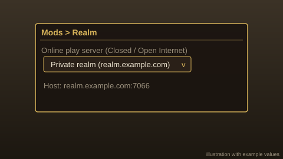

# Realm picker

*Illustration with example values.*

Choose which online play server ("realm") the game uses for Closed Internet and Open Internet. LAN is not affected.

## What you need

Sacred Gear and the mod itself in your `mods` folder (see [Install](../Install.md)).

## How to use it

Press **F11**, open the *Realm* mod and its *More* page. Pick a realm from the drop-down list; the choice applies at once. The next time you open Closed or Open Internet in the multiplayer menu, register and login go to that realm. A realm gets your password, so only use realms you trust.

Realms are listed in `mods\gear_realms.json`; a realm can also be added by another mod.

## Development

- **Files:** `src/realms/mod.lua` and `main.lua` (about 45 lines). The realm list is stored by Gear in `mods\gear_realms.json`: `{"version": 1, "realms": [{"id", "name", "host", "port"}], "active": ...}`.
- **Depends on:** `gear.realm` (`list`, `current`, `use`, `add`) and `gear.mods.page` (a page in the Mods screen). It binds no key and uses only Gear widgets, so mouse and gamepad both work.
- **Test it:** the sacred-bild example `realmtest` checks that the saved realm is applied (see [Gear](https://github.com/kirides/sacred-bild/blob/main/docs/Gear.md)).
