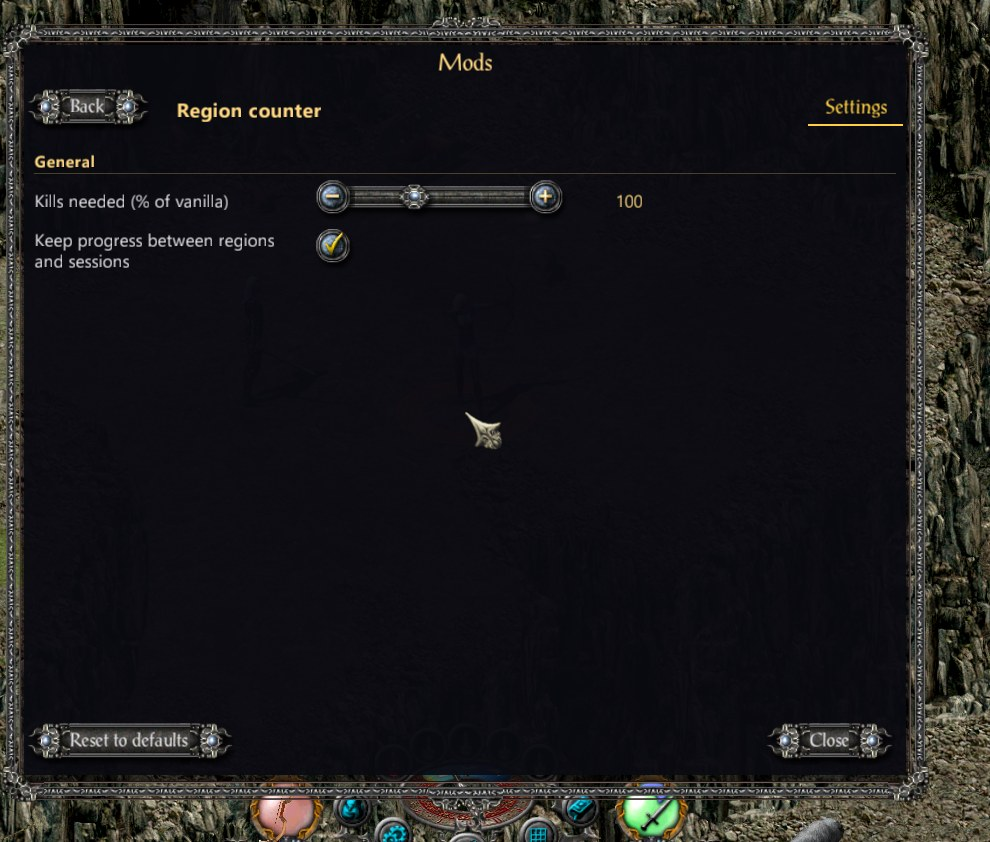

# Region counter

In Sacred Gold a region sends you its Region Boss quest after a number of kills. The game keeps that countdown in
memory only: it starts over when you leave the region and is never saved. This mod fixes both.

- **Kills needed (% of vanilla):** 100 is the game's number. 50 halves it, 200 doubles it. Changing it keeps your share
  of the progress.
- **Keep progress:** the kills done in every region are kept per savegame (`region_kills.json` in that savegame's data, see [Per savegame data](../SessionMods.md#per-savegame-data); per hero name inside) and put
  back when the game starts a region over. Switched off, the game's own reset applies.
- The progress pill on the screen comes from the World events mod, so it stacks with its other pills; this mod only configures the regions.

## How it works

The mod reads and writes the game's region table through `gear.data.regions` (needs SacredBild with Gear that has it).
Every half second it compares the game's "kills left" with what it wrote last: lower means kills, higher means the
game started the region over (the saved progress is written back). After the boss quest comes, the next cycle starts
from 0.

Not tested in the game yet: the table layout is taken from the game's code and from the Persistent Region Counter mod.

## Development

- **Files:** `src/region-counter/mod.lua` (manifest, settings) and `main.lua` (the half-second comparison, the per savegame store).
- **Depends on:** `gear.data.regions` and the savegame store (`gear.store.game`); the progress pill comes from World events.
- **Test it:** `luajit tests/region_counter_test.lua` runs the logic outside the game. Pictures: [Screenshots](../Screenshots.md).
