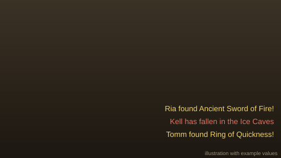

# Server feed

*Illustration with example values.*

Shows announcements of the server on screen: when somebody finds a rare or unique item and when a hero dies. A list keeps the latest of both.

## What you need

Sacred Gear and the mod itself in your `mods` folder (see [Install](../Install.md)). It needs a SacredEngineRemake game server (`Sacred.GameServer`) running `rare_drops.lua` and/or `graveyard.lua`. Without them it does nothing.

## How to use it

Just play; lines appear at the right edge of the screen. Press **F7** to see the latest drops and deaths.

## Keys

| Key | What it does |
|---|---|
| **F7** | Show the latest drops and deaths. |

You can change every key in the Mods screen (**F11**, then the mod's *Keys* page).

## Settings

Open the Mods screen with **F11** and pick the mod.

| Setting | What it does |
|---|---|
| Rare drops | Lines for rare and unique finds. |
| Hero deaths | Lines for deaths. |
| Seconds on screen | How long a line stays (3 to 30). |
| Position: right edge / top | Where the lines are drawn (also movable with the layout editor). |

## Development

- **Files:** `src/serverfeed/mod.lua`, `main.lua` (about 130 lines).
- **Depends on:** `gear.net` (it listens on both server channels with `gear.net.channel(name):on`), `gear.ui`, `gear.keys`, `gear.settings`.
- **Server side:** `scripts-examples/rare_drops.lua`, `graveyard.lua`. Protocol: [GearServerMods](https://github.com/kirides/sacred-bild/blob/main/docs/GearServerMods.md).
- **Known clash:** F7 is shared with damagemeter, achievements and buildsharer ([Hotkeys](../Hotkeys.md)).
