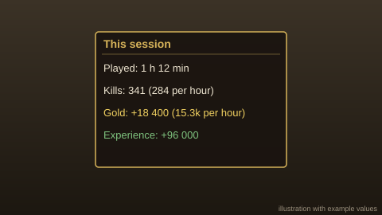

# Session tracker

*Illustration with example values.*

How long you have played, how many monsters you killed and how much gold and experience you gained this session, with rates per hour. It also keeps your lifetime totals and your last sessions.

## What you need

Sacred Gear and the mod. No server is needed.

## How to use it

Press **F2** to show or hide the panel. Rates show as "-" for the first half minute because a very short session would give wild numbers.

## Keys

| Key | What it does |
|---|---|
| **F2** | Show or hide the session panel. |

You can change every key in the Mods screen (**F11**, then the mod's *Keys* page).

## Settings

Open the Mods screen with **F11** and pick the mod.

| Setting | What it does |
|---|---|
| Show per-hour rates after | Seconds of play before rates are shown (5 to 600). |
| Save totals every | How often the totals file is written (15 to 600 s). |

## Development

- **Files:** `src/sessiontracker/mod.lua`, `main.lua` (about 290 lines). Totals are saved in `session_totals.json`.
- **Depends on:** Gear events (`session.start`, `frame`, kills), the hero's gold and experience from `gear.world`, `gear.ui`, `gear.save` / `gear.read`.
- **Test it without the game:** `tests/session_mods_test.lua` (LuaJIT, from the repository root).
- More about the session mods: [Session mods](../SessionMods.md).
