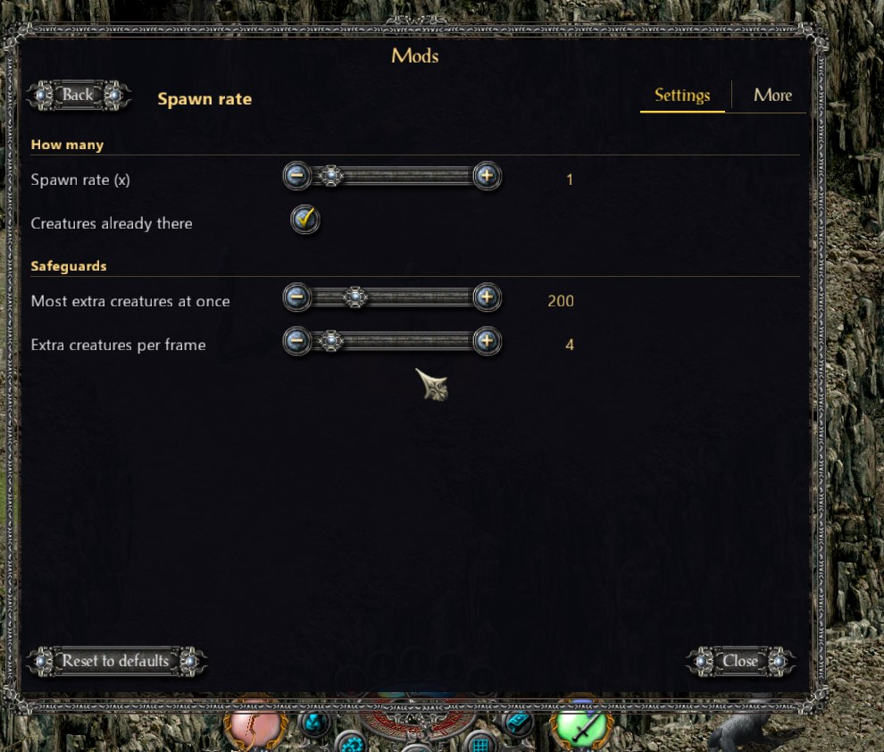

# Spawn rate

Makes the world busier: every creature the game spawns brings extra ones of its kind, from **1x** (the game as it is) up to **100x**.

## What you need

Sacred Gear with the `creature.created` event, `gear.world.spawn` with `like` (allegiance, level, stats), `creature:copy_allegiance`, `creature:copy_stats` and `creature:order_attack` on any creature (SacredBild from the build that added them) and the mod in your `mods` folder (see [Install](../Install.md)). Single player only: in a network game the mod does nothing.

## How to use it

Open the Mods screen (**F11**), pick *Spawn rate* and set the rate with the slider. It takes effect at once.

At 10x, nine more creatures appear around each hostile creature. That covers two kinds:

- **Creatures the game spawns while you play:** sectors that fill when you arrive, scripted waves. Sacred Gear tells the mod about each one (`creature.created`).
- **Creatures that are already there:** the game does not "spawn" these, it *reads* them: when a savegame loads, every creature of the sectors around you comes back from the file, and a sector you visited before is restored the same way. The game does nothing at all on load, so without this the rate would only act in sectors you enter for the first time. The mod therefore looks around the hero every 1.5 seconds (3500 world units, nearest first) and multiplies each hostile creature it has not seen yet. Each creature is multiplied **once**; the mod keeps its marks in the savegame (`multiplied.json`, per slot), so loading the same game later does not multiply it again, and the extras themselves are never multiplied. Switch *Creatures already there* off to get only the first kind.

Only creatures hostile to your hero are multiplied: merchants, villagers, companions and harmless animals (rabbits, doves, birds, deer, farm animals and the like) are not.

**The extras are as hostile as their originals.** Two things matter, and a plain `gear.world.spawn` gets neither right:

- *Faction.* The engine decides who fights whom from a faction index at creature +0x1F0 (a 16x16 table). A plain create gives a creature the faction of its *type*; the game's sector fill and scripts set it per creature. A soldier the game placed can be hostile to your hero (faction 2) while a plain-created soldier of the same type is neutral (faction 7): measured on 4 of 68 extras. The mod therefore spawns every extra with `like = original`, which copies the faction and the aggression flag from the original.
- *Noticing you.* A created creature also stands still: a natural monster charges from 450 to 850 units away, the same type made by a plain create 420 units from the hero stood for 14 seconds. The mod gives the extras within 700 units of your hero the attack order a script would give (`creature:order_attack`, every 0.5 s, again after 4 s while they are near).

**The extras have their original's level and health.** A plain `gear.world.spawn` makes a level 1 creature with 100 health whatever its type (a level 10 orc has 312). Every extra is therefore spawned with `like = original`, which also gives it the original's level through the game's own level function (the one the sector fill uses: the experience the level starts at, the derived stats and the health come from the type and the level), the original's maximum health (the game's strong variants, such as level 12 goblins with 467 or 583 health where the level alone gives 233, keep theirs), the original's share of it as current health, and the creature's table of skill values. Not copied: equipment and its bonuses (an orc carries none), and the small per-creature random differences natural creatures have in their damage values.

The extras come nearest first and fairly: all waiting originals take turns, one extra each per round, the ones next to you first, so a crowd far away never starves the creatures around you, and no single creature uses up the whole limit. Originals that are more than 7000 units away (or on another level) when their turn comes are given up and seen again when you return.

Fighting 100 times as many creatures costs frame rate. The safeguards keep the game playable:

| Setting | What it does |
|---|---|
| Spawn rate (x) | 1 to 100. 1 is the game as it is. |
| Creatures already there | On (default): creatures a savegame or an already visited sector placed are multiplied too, once each. Off: only what the game spawns while you play. |
| Most extra creatures at once | The extras alive at the same time never exceed this (default 200, 0 = no limit). Extras that die or vanish make room for new ones. |
| Extra creatures per frame | How many extras are made in one frame at most (default 4). The rest waits in a queue, so entering a crowded sector does not freeze the game. When the frame rate drops below 30 fps the mod makes only one per frame, below 15 fps none. |

The *More* page shows how the mod works in the game's language (English or German) and counters: extras alive, waiting, made, multiplied from what was already there and from new spawns, not queued, given up and not made.

Notes:

- The extras are plain creatures of the same type placed around the original. A creature whose level the game sets after creating it (scaled to your hero) may have its type's own level as an extra.
- Quest creatures and bosses that the game spawns are creatures like the others and are multiplied too. Use a lower rate while you hunt for a unique one, or switch the mod off in the Mods screen.
- Experience and drops of the extras are the game's own; combine with [Drop tuning](../DropTuning.md) to taste.

## Development

- **Files:** `src/spawn-rate/mod.lua` (manifest, settings), `core.lua` (the logic without the game: how many extras, the per-frame allowance, the fair nearest-first queue, the placement ring, the wildlife list) and `main.lua` (the event, the look around the hero, the per-savegame marks, the frame loop, the More page).
- **Depends on:** the Gear API: the `creature.created` event (Sacred Gear hooks the engine's object create, `cObjectManager::create` 0x005FBA40; creations by Gear itself, by a savegame or network read and heroes send no event), `gear.world.spawn`, `gear.settings`, `gear.ui.table`.
- **Test it:** `luajit tests/spawn_rate_test.lua` runs the logic outside the game. `src/spawn-rate_selftest` is the in-game test (`Sacred.exe -gear-auto -gear-instance=spawnrate -gear-load=1 -gear-mods=spawn-rate,spawn-rate_selftest`, in a copy of the game folder): it measures at 100x with the sliders at their maxima how many extras the creatures of a loaded savegame bring, that a reload does not multiply again, and the event path, the caps, the frame time and the wildlife filter in fresh sectors.
