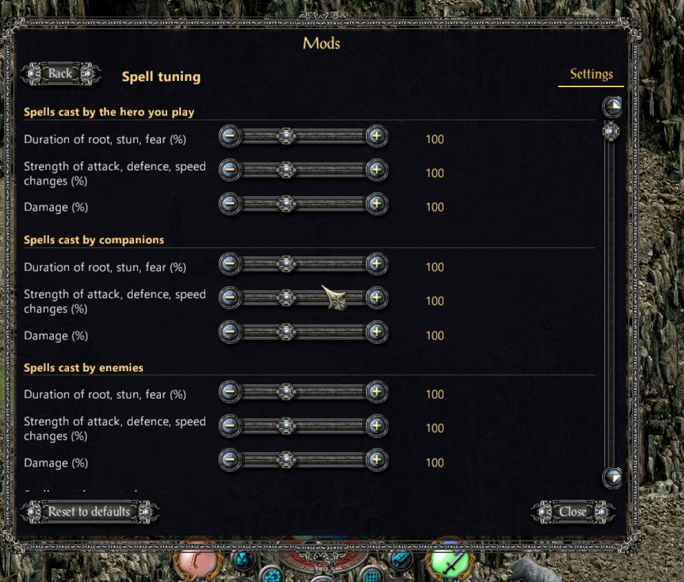

# Spell tuning

Changes what spells do, depending on **who casts them**: the hero you play, a companion, an enemy, a neutral creature or a trap. Typical use: shorten the root (Pflanzenkäfig) and the stun (Fleisch zu Stein) enemies put on you, without touching what your own spells do to them.

## What you need

Sacred Gear with `Creature:casting` (SacredBild from the build that added it) and the mod in your `mods` folder (see [Install](../Install.md)). Single player only.

## How to use it

Open the Mods screen (**F11**), pick *Spell tuning*. Each caster has its own section with three percentages (100 = the game as it is):

| Setting | What it does |
|---|---|
| Duration of root, stun, fear | How long the effect lasts on its victim: Pflanzenkäfig (root), Fleisch zu Stein (stun), Irritation, Bekehrung, Bannkreis der Angst, Höllenfurcht. 50 = half as long, 0 = no effect time (never below 1 second while above 0). |
| Strength of attack, defence, speed changes | The attack, defence and speed numbers of every spell. |
| Damage | The damage numbers of every spell. |

Example: *Spells cast by enemies* → Duration 40 %: a root of 20 seconds holds you for 8.

## How it works and its limits

The game keeps one record per spell for every caster. The mod looks about 20 times a second at the creatures around the hero (3500 units), sees which spell each has in flight, and writes that spell's numbers for the caster's role just before the effect reads them.

What is proven in the game (self test): when the hero casts the root (Pflanzenkäfig) the record holds the numbers for *the hero you play*, when a companion casts it the record holds the numbers for *companions*, each with its own percentage. What is **not** solidly proven: that the shorter number shortens the root on the victim. In some runs a root on a foe lasted 1 s with parameter 0 set to 1 and 7 s with 7, but repeated runs with the self test gave erratic times (1 to 21 seconds at the same setting), so check it in a real fight.

- Two casters of **different roles** casting the same spell within a fraction of a second get the numbers of the one seen last.
- A caster counts as an *enemy* if it is hostile to the hero you play, as a *trap* if its type name says so (trap, falle, spike, turret), otherwise *neutral*.
- Duration works for the listed crowd control spells; whether the other spells measure their effect time in parameter 0 is not checked, so the mod leaves those alone. Strength and damage change the spell record's numbers as the game reads them: some spells use them differently, so try the numbers in a fight.
- Not tested in game yet: casts by enemies, neutral creatures and traps. Spawned or teleported monsters stand still and never cast, so the test could only use the hero and a companion; `Creature:casting` does read a natural monster's casts (a dark elf NPC showed its arts).

## Development

- **Files:** `src/spell-tuning/mod.lua` (manifest, settings), `core.lua` (roles, the percentages applied to a record, without the game) and `main.lua` (the polling, the record writes, restoring them on unload).
- **Depends on:** `Creature:casting()` (the art or spell in flight, the creature word at +0x120) and `gear.data.abilities` (T2 spell records are writable).
- **Test it:** `luajit tests/spell_tuning_test.lua` runs the logic outside the game. `src/spell-tuning_selftest` is the in-game test (`Sacred.exe -gear-auto -gear-load=10 -gear-mods=spell-tuning,spell-tuning_selftest`, in a copy of the game folder): the hero casts the root spell at 100 % and at 50 % and the root must last clearly shorter.
