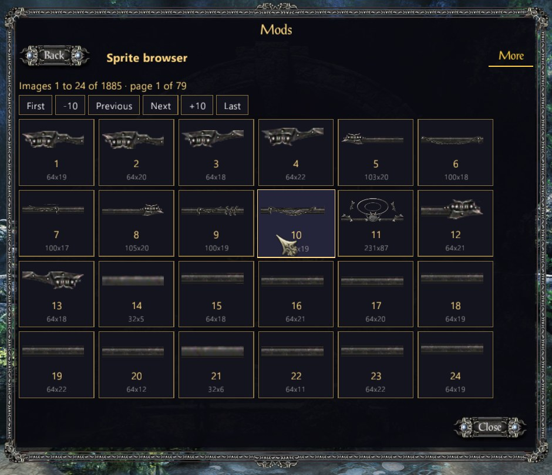

# Sprite browser

All 1885 UI images of the game in a grid, each with its number and size. The number is the `N` of:

- the **`.sprite-N` classes** of the [Sacred theme](../../src/sacred-theme/README.md): `` draws image 218 (the skull) at its natural size in any RmlUi document of a mod, with no image path to look up;
- `gear:image/N` in RCSS (`decorator: image(gear:image/218?dp contain)`) and ``;
- the icon codes of names and chat lines: `\gffffffff00000XXX`, where `XXX` is `N` in hex (218 is `0DA`).

## How to use it

Open the Mods screen (**F11**), pick *Sprite browser* and its page. *Next*, *Previous*, *+10*, *-10*, *First* and *Last* turn the pages (24 pictures each; every button is a controller stop). The pictures are scaled to fit the cell (the size under the number is the natural one). Click a picture to copy its class name (`sprite-218`) to the clipboard; hover it for the class, size, sheet and hex code.

## Development

- **Files:** `src/sprite-browser/` (`mod.lua`, `main.lua` with `gear.mods.page_rml`, `ui/page.rml`, `ui/page.rcss`). It needs the Sacred theme mod to run next to it: the classes live in `src/sacred-theme/theme.rcss` (and the generated `theme-dp.rcss`), between the `SPRITES BEGIN` and `SPRITES END` lines.
- **The classes are generated:** `python tools/make_sprites_rcss.py` writes them from `tools/sprite-sizes.json` (`[[id, width, height, sheet], ...]`, dumped from the game with `gear.ui.images()`) and then regenerates `theme-dp.rcss`; `--check` fails when `theme.rcss` is out of date. Dump the sizes again when the image set changes.
