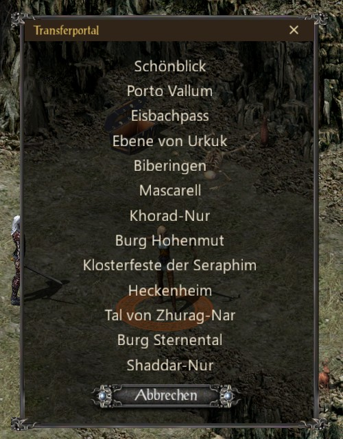
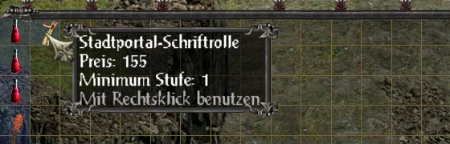
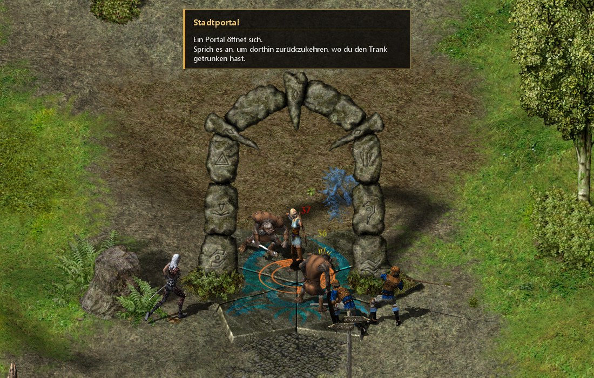
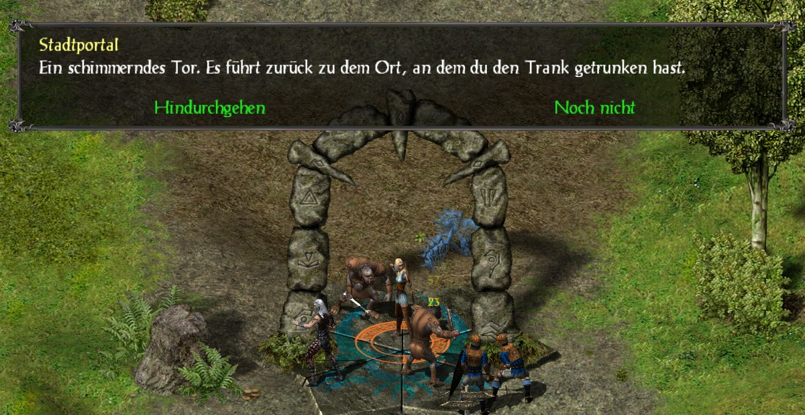

# Town Portal

The **Town Portal Potion** is an item of its own. Drinking it saves the spot where you stand and opens the game's list of teleport portals (the ones you have found), made again as a window that works with the mouse, the keys and the controller. You arrive at the portal you pick, a **portal of the mod** opens next to you, and stepping through it takes you back to the spot you left and closes it.

The list has the lines of the game's own "Transferportal" window, in its order; portals you have not found are dimmed and cannot be picked. A close button in the title bar, Cancel and the controller's B close it without using the potion up.

## What you need

Sacred Gear 0.16.0 or later (`gear.inv.define_type`) and the mod in your `mods` folder (see [Install](../Install.md)); `sacred-theme` gives the window the look of the game. Single player only.

## How to use it

- **Get one.** Merchants that sell potions (the *Miscellaneous* tab) may stock it when the game fills their wares; the Mods screen sets the chance and how many.
- **Drink it** with a right click in the backpack, or press **Ctrl+Shift+T** (rebindable in the Mod manager) to drink one from the backpack without opening it. The potion stays in the pack until you pick a portal.
- **Pick a portal.** The hero is moved there at once, the potion is used up and the spot you left is saved.

- **The portal.** A shimmering spirit stands near your arrival. Click it: *Step through* takes you back to the saved spot and removes it; *Not yet* leaves it open.

While a portal is open another potion does nothing (the toast says so), and while the engine says enemies are near the potion does nothing either (*Not while enemies are about*, on by default). The saved spot and the portal belong to the savegame: save and load keep them, a game without a portal starts clean.

The game's own scrolls are logbook entries and cannot be used up, so the item is a potion (a copy of one of the game's bottles with a name of its own); its type id is 6150, in the range Sacred Gear gives mods (`gear.inv.TYPE_FIRST` to `TYPE_LAST`). In a game without Sacred Gear a savegame that holds one shows an unknown item.

## Your own points

Below the game's portals the list shows points of your own, always bright and not tied to the portals you have found:

- **Add or remove in the window.** Press **Ctrl+Shift+P** (rebindable; the controller's mod menu offers it) to open the list for editing without a potion. Type a name (the on-screen keyboard button helps on a controller) and press **+** to add the spot where your hero stands; the bin button beside a point removes it. Up to 40 points, kept in `custom_points.json` in the mod's folder and shared by all your games.
- **Or a file.** Copy `custom_teleports.lua.example` to `custom_teleports.lua` in the mod's folder; it returns a list of `{name = 'My tower', x = 150000, y = 120000, layer = 0}` (a name may be `{en = ..., de = ...}`). It is optional: without it nothing changes; it is read when the mod starts. These points cannot be removed in the window.

## For modders

`src/town-portal/main.lua` is the mod:

- `gear.inv.define_type(type, base, name_text)` makes an item type of your own from a copy of a game item type; `gear.text.key` gives it a name that is the same in every session. Define it each time the mod starts.
- `gear.on('item.use', fn)` hears the potion drunk; `'keep'` leaves it in the pack (the mod removes it with `gear.inv.remove` when the trip happens).
- `gear.world.portals()` is the hero's word of found portals, one bit per line of the game's list (`spots.lua` has the 13 positions the game teleports to).
- The portal is a `gear.npc` kind; the saved spot is in `gear.store.game`.
- `src/town-portal_selftest` drinks the potion with a real right click, picks a portal, checks the portal, saves, loads and steps back (`Sacred.exe -gear-auto -gear-load=10 -gear-mods=town-portal,sacred-theme,town-portal_selftest`, in a copy of the game folder).
