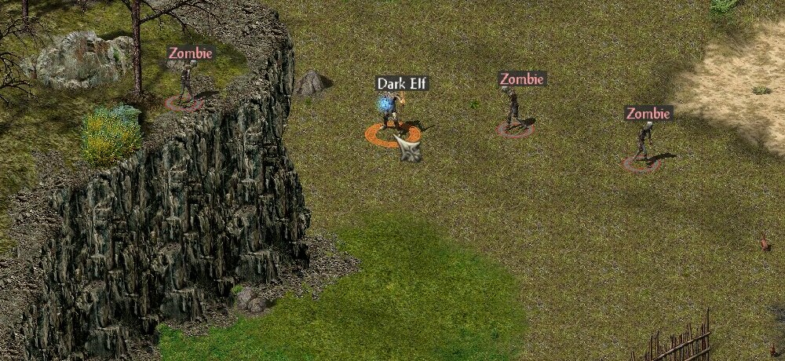

# Twitch Integration: actions

Lets your Twitch viewers play with your game: they can spawn monsters near your hero, give or take gold, heal or hurt the hero (also for a few seconds only) or teleport it.

## What you need

The Twitch connector program, the base mod [Twitch Integration](twitch_integration.md) (it is switched on automatically with this one) and this mod.

## How to use it

Set up which reward, bit amount or chat text does what in the base mod (see its page). Monsters appear just out of sight and carry the viewer's name, for example "Viewer42's Wolf". Actions wait while you are in a menu and run when you are back in a game.

## Settings

Open the Mods screen with **F11** and pick the mod.

| Setting | What it does |
|---|---|
| Spawn at least this far away | Closest distance of a spawned monster (0 to 2000). |
| Spawn at most this far away | Farthest distance (0 to 2000). |

## Development

- **Files:** `src/twi_sacred/mod.lua` (manifest, `requires = {'twitch_integration'}`, monster list in `config.monsters`) and `main.lua` (about 150 lines).
- **Depends on:** the `twitch.command` event emitted by `twitch_integration`; `gear.world` (creating creatures, hero hit points, teleport), `gear.data.object_types` for the monster names.
- **Add your own action:** handle `twitch.command` in another mod, act on the commands you know and defer others. The command names (`TWI_SpawnRandomMonster`, `TWI_Money`, `TWI_SetHP`, `TWI_RandomTeleport` ...) are mapped in `twitch_integration/custom.lua`.
