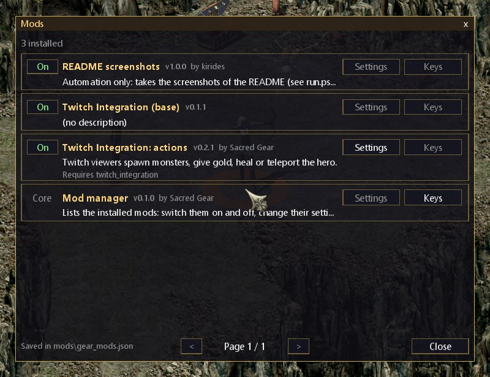

# Twitch Integration (base)

The link between your Twitch channel and the game: channel point rewards, bits and chat texts are turned into actions. On its own it does nothing visible; the action mods (like [Twitch Integration: actions](twi_sacred.md)) make things happen.

## What you need

The Twitch connector program (it hosts a pipe the game connects to) and an action mod.

## How to use it

Edit `mods\twitch_integration\custom.lua` to say what each reward, perk, bit amount and chat text does. Every entry is a list of actions like `TWI_Money 500`; an entry can also have a `cooldown_s` so the same chat text is ignored for a while. Actions are offered to the action mods one at a time (at most one every half second). An event that waited more than five minutes outside a game is dropped.

## Development

- **Files:** `src/twitch_integration/mod.lua` (declares the pipe `__TwitchIntegration_Kirides_Conn` and the timing in `config`), `custom.lua` (the mapping, edited by the streamer) and `main.lua` (about 220 lines).
- **Depends on:** `gear.pipe.open` (the connector is the pipe server, the game is the client), `gear.json.decode`, `gear.emit` of the `twitch.command` event, `gear.world.can_change` to decide when an action may run.
- **Config:** `interval_s` (0.5), `max_age_s` (300), `defer_s` (120), `max_deferred` (40).
- **Write an action mod:** listen for `twitch.command`; see `twi_sacred` for a complete one.
