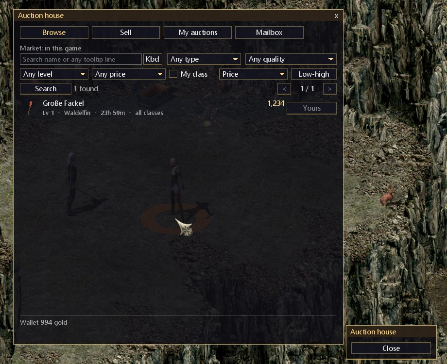

# Auction house

A [Sacred Gear](https://github.com/kirides/sacred-bild/blob/main/docs/Gear.md) mod: the players of a game put items
up for sale for gold; the others browse, filter, sort and buy them. The design, the research on other games' auction
houses and the reasons behind the rules are in [DESIGN.md](DESIGN.md).

## Use

Copy this folder to `mods\auction-house` in the game folder. **Every player of a network game needs it** (and a Sacred
Gear with the mod channel, `gear.mp.send`). Use a chest: an **Auction house** button appears next to the shared
stash's button (move it in the layout editor: hold Alt, *Edit layout*). The market is only open while the chest window
is open and closes with it. No hotkey; everything is a button, a list or a field, so the controller reaches it (text
fields have a **Kbd** button for an on-screen keyboard).

- **Browse:** search text (the name and every line of the item's tooltip, words in any order), type, quality, level
  range, price range, "My class"; sort by price, price per level, time left, newest, name, level or quality, either
  way. Each row: the item's icon, its name in its quality colour, level, the seller's name, time left, price and the
  median of recent sales of that kind. Point at a row for the game's own tooltip. **Buy** takes the price from your
  wallet (and what the wallet lacks from the gold you carry); the item goes to your mailbox.
- **Sell:** pick an item of your backpack or chest, set the price (the median of recent sales is filled in when there
  is one) and the duration, see the fee and what you get after the cut, **Put up for sale**. The item leaves your
  inventory at once.
- **My auctions:** your listings, **Cancel** (the item goes to your mailbox; the fee is kept).
- **Mailbox:** items you bought, items that did not sell or that you cancelled, and the wallet: **Deposit** /
  **Withdraw** gold. Sales are paid into the wallet. **Save the game after collecting.**

## Where the market lives

On our C# GameServer with the script `auction_house.lua` (SacredEngineRemake `Sacred.GameServer/scripts-examples`), the
**server** keeps the market: it is open whenever the server runs, the server names the players, and in Closed Net with
`--authoritative` every transfer is checked in the server's own hero state and saved there first (DESIGN.md, section 4).
The panel says where the market is. **Closed Net never uses the host's market or a local one:** only the game server's
market; a Closed Net server without it shows the market as closed (the mode comes from `gear.mp.mode()`, or from the server's
`info` saying `closed`). Otherwise (the stock GameServer.exe):
Single player: in your own game (`market.json` in this folder). A network game: in the **host's** game, in the host's
`mods\auction-house\market.json`; when the host is not in the game the market is closed (nothing is lost). Your own
computer keeps `journal.json`: the transfers on their way and a secret that ties your hero's name to you on each
market (so another player cannot use a hero of the same name to empty your wallet). Do not delete either file.

## Your own setting (Mods screen, F11)

| Setting | Default | |
|---|---|---|
| Hide in Singleplayer | off | Hides the "Auction house" button and the panel in a single player game (the layout editor still shows the button); network games are unaffected |

## Rules (the host's Mods screen, F11)

| Setting | Default | |
|---|---|---|
| Listing durations | 1, 3 or 7 days | Real time; unsold items return to the seller's mailbox |
| Listing fee | 0.5 % of the price a day (at least 1 gold) | Paid when listing, not returned |
| Cut of a sale | 5 % | |
| Listings per player | 20 | 400 in all |
| Also sell special items | off | Gold and quest items never sell |

## Safety

Every change on the market is written (temporary file, then rename; the previous file stays as `market.bak.json`)
before it is answered, every request has an id so a repeated one changes nothing, and items and gold move in an
order that never makes two of anything. If the game ends before it saved after a sale or a deposit, the savegame
still holds the item or the gold: at the next load the mod finds it there and takes the listing (or the deposit) off
the market again. Details: [DESIGN.md](DESIGN.md), section 4.

## Tests

`luajit tests/core_test.lua` (the market's rules) and `luajit tests/sim_test.lua` (the whole mod against a fake game,
including a restart with an unsaved sale and a market on the game server, LAN and Closed Net), from this folder. After a
change of `core.lua`: `luajit tools/inline_core.lua core.lua <SacredEngineRemake>/Sacred.GameServer/scripts-examples/auction_house.lua`.

## Development

- **Files:** `mod.lua`; `core.lua` (rules and bookkeeping, pure Lua); `client.lua` (the player's side, journal in `journal.json`); `kind.lua` (kind of game); `ui.lua` (the window); `main.lua` (wiring, `market.json`, messages through `gear.mp.send`); `selftest.lua` (needs the real game: Closed Net modes). Design notes: `DESIGN.md`. About 3 000 lines.
- **Depends on:** `gear.mp` (kind of game, sending messages, `force_network` for tests), `gear.inv`, `gear.save` / `gear.read`, `gear.settings`, `gear.ui`, `gear.wait` / `wait_until`.
- **Tests:** `tests/core_test.lua` and `tests/sim_test.lua` need no game (LuaJIT, see Tests above); `tools/` holds a helper that inlines the core for the self test.
