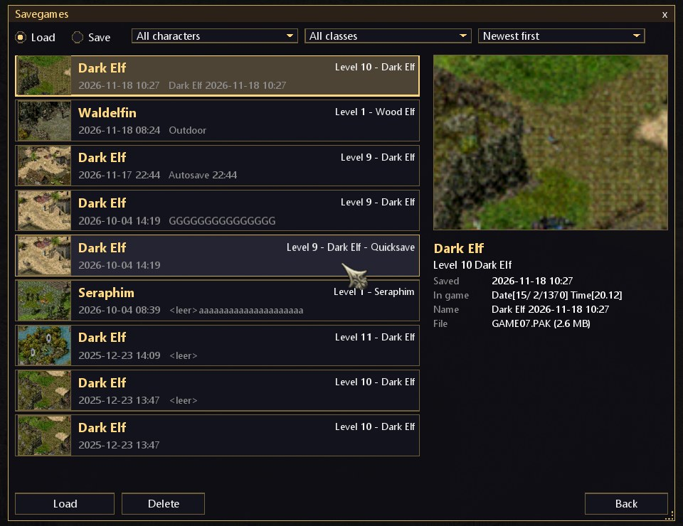

# Better SaveLoad

A new savegame screen for Sacred Gold. It replaces the game's savegame window in game (S, the escape menu) and the
start menu's *Load game* screen:

- every savegame with its **picture** (shown at its 4:3 size), the **hero's name, class and level**, when it was saved
  and its name;
- **filters** by character and by class, and a **search** (words in the hero, class, name, date, number; all must match);
- **order**: newest or oldest first, by character, highest level first, by number, or by file name as the game lists them;
- **any number of savegames**: the game's own screen stops at about a hundred; this one lists thousands (only the rows in
  view are drawn), numbered up to 32766 (`GAME32766.PAK`). *New savegame* takes the first free number (not one the autosave
  mod keeps for itself). **Top / Page up / Page down / End** buttons and the Home, End, Page up and Page down keys jump
  through a long list, so the controller reaches every savegame too;
- **Load**, **Save** (a new savegame or overwriting one), **Delete**, each with a question first where something would
  be lost; a **double click** on a savegame loads it (Load tab) or saves over it (Save tab), as its button does;
- **your own savegame names**: type the name while the Save tab is open (umlauts work), or use the on-screen keyboard
  (*Keyboard*, for the controller). It starts as the overwritten savegame's name, or the *Name of new savegames*
  setting.



Mouse, keyboard (typing the name or the search, Backspace, Up / Down, Page up / down, Home / End, Enter, Delete, Esc: the first clears the search) and controller (D-pad, A, B) all work. The screen is a panel like the
other mods' panels: move and resize it with the layout editor (Alt + *Edit layout* in game), and it scales with the UI.

## Settings (Mods screen, F11)

| Setting | |
|---|---|
| Replace the savegame window in game | Off: the game's own window |
| Replace the Load game screen of the start menu | Off: the game's own screen |
| Order | Newest first, oldest first, by character, highest level first, by number, by file name |
| In game, show the current hero's savegames first | The character filter starts on the hero you play |
| Ask before loading in game | What was not saved is lost |
| Name of new savegames | `%hero%`, `%level%` and `os.date` codes (`%Y-%m-%d %H:%M`) |

## How it works

It is built on Sacred Gear's replaced windows (`gear.ui.replace_window`, needs a Sacred Gear with that API): the
game's own window still opens and closes as always, it is only not drawn and gets no input while this mod draws its
screen. If the mod is off, removed or fails, the game's window shows again by itself. Loading, saving and deleting go
the game's own ways (`gear.game.load`, `gear.game.save` with `window = true`, `gear.game.delete_save`).

## Self test

`src/better-saveload_manysaves_selftest` is a second test for a long list (`tools/make_test_saves.py` fills a copy's Save folder with hundreds of savegames; it checks numbers up to 32766, the search, the orders, the jumps, loading and saving beyond 509). `src/better-saveload_selftest` (on a **copy** of the game folder: it saves and deletes a savegame):

```
Sacred.exe -gear-auto -gear-instance=saveload -gear-mods=better-saveload,better-saveload_selftest
```

It opens the start menu's Load game screen (the 5th entry), checks the list, filters, order, keyboard and controller,
that the game's screen comes back when the mod stops drawing, loads a savegame, then in game types a name (and the on-screen keyboard), saves a new savegame with an umlaut name, deletes
it and closes the screen with Back, Esc and B. Results: `GearAutomation\saveload\saveload.json`.

## Development

- **Files:** `mod.lua` (settings) and `main.lua` (about 900 lines: the savegame list, the Save and Load tabs, delete). Self test: `src/better-saveload_selftest` (see above).
- **Depends on:** `gear.ui.replace_window` (replaces the game's own savegame window), `gear.game.saves`, `gear.game.save`, `gear.game.load` (savegame list, metadata, save, load, delete), `gear.world.hero`, `gear.settings`. These came with the "replaced windows" feature of Sacred Gear ([Gear](https://github.com/kirides/sacred-bild/blob/main/docs/Gear.md)).
