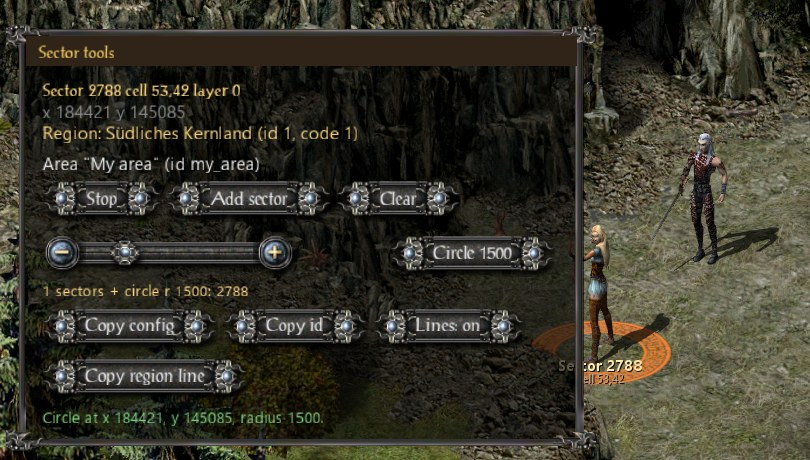

# Sector tools

A [Sacred Gear](https://github.com/kirides/sacred-bild/blob/main/docs/Gear.md) mod for **server admins** who tie world events (or
anything else) to places: it shows the sector you stand in, draws sector boundaries on the ground, records the sectors you walk
through into a named area, and copies a ready-to-paste line for the game server's `world_events.lua`. It works in single player,
LAN games and on the remake server; it does not need the server and does not talk to it.



## Game regions

The panel shows the **game region** the hero stands in (`gear.data.regions:of_sector`, newer Gear versions): `Region: Desert (id 4, code 9)`. **Copy region line** puts
`regions = { 4 },  -- Desert` on the clipboard, to paste into an area or an event of `world_events.lua` (the server reads the same regions from the game files, so a world
event can be bound to a region). The query event `sector-tools.query` has `region` and `region_code`.

## What it shows

**Sector ids are not coordinates.** The game numbers its sectors by the slot in a table (`3451`, `3452`, ...), and neighbours in
the world are not neighbours in the numbers. The world is a 128 x 128 grid of **cells**, each 64 x 64 tiles (3434.6 world units, about
6.4 screens wide); the mod shows both: the **id** the server's scripts use (`player.sector`) and the **grid cell** (`37,52`).

* **The panel** (draggable, remembered in the layout): `Sector 3451   cell 37,52   layer 0`, the hero's position, the area being
  recorded, and the buttons below. It shows while **Alt** is held (the game's "show text", with a moment of grace so a click lands) or
  when **pinned** from the controller's mod menu (*Sector tools: show / hide*). The mod binds no key.
* **Ground lines:** dotted lines where the sector grid has a boundary near the hero, with the sector on each side (`3451 | 3452`:
  the id when the mod knows it, else `?`, and the grid cell under it), and the hero's own sector under its feet. The ids of the
  neighbours are learned from the creatures around you (every creature knows its sector) and from where you have been; they are kept in
  `cells.json` in the mod's folder, so the picture fills in as you play. The lines are drawn as the game draws its ground (an isometric
  tile is 96 x 48 pixels); Sacred Gear has no world-to-screen call, so this is an **approximation**: if the lines do not match
  the ground, shift them in the settings (*Ground labels: move right / down*).

## Recording an area

1. Set the name in the mod's settings (*Area name*, e.g. `Silver Creek`; the id `silver_creek` is made from it).
2. **Start area**: the sector you stand in is added, and every sector you walk into from now on. **Add sector** adds the current
   one by hand, **Clear** forgets it all, **Stop** ends the recording. The list shows live, runs of three or more ids as ranges.
3. Optional **Circle 1500**: a circle around where you stand with the radius of the slider (world units: a tile is 54, a sector 3435), for a
   village inside a big sector. *Plus neighbours within* (settings) asks the server to add the sectors around the recorded ones.
4. **Copy config** puts the line on the Windows clipboard:

```lua
silver_creek = { name = "Silver Creek", sectors = {3451, {3453, 3456}}, circle = { x = 129498, y = 179915, r = 1500 } },
```

   Paste it into the `AREAS` table of `world_events.lua` (see the comments at its top), or into the area editor page of the server's
   web UI. **Copy id** copies just the sector number. The recording survives a restart (`state.json`).

Every button is an ordinary widget, so the controller's D-pad reaches them; the mod menu also has *ground lines on / off* and
*copy the area config*.

## Settings

*Area name*, *Circle radius*, *Plus neighbours within* (recording); *Sector boundaries on the ground* and the two shifts (overlay).

## Needs

A Sacred Gear with `creature:sector()` and `gear.clipboard` (added together with this mod). Without them the mod loads but the panel
stays empty and copying fails with a message.

## Tests

No game needed (LuaJIT, from this folder):

```
luajit tests/core_test.lua     the grid, the projection, range compaction, name escaping, the config line (the same text the server's !area show prints)
luajit tests/main_test.lua     main.lua against a fake gear: when it shows, recording by walking, the buttons, the clipboard, the controller menu
```

`src/sector-tools_selftest` runs in the real game (`-gear-auto`, a copy of the game folder): the hero's sector and cell, the panel with Alt and
pinned, walking over a sector boundary and recording both sectors, the circle, **Copy config / Copy id read back from the Windows
clipboard**, and the layout editor; screenshots `st-*.bmp`.

## Development

- **Files:** `mod.lua`; `core.lua` (the grid, the projection, range compaction, the config line; pure Lua, no `gear`); `main.lua` (the panel, recording, the clipboard); `tests/` (see Tests above). Self test: `src/sector-tools_selftest`.
- **Depends on:** `creature:sector()` and `gear.clipboard` of Sacred Gear, `gear.world.hero` / `creatures_near`, `gear.save` / `gear.read` (`state.json`, `cells.json`), `gear.ui`. The text it copies is the config line of the server's `world_events.lua`.
