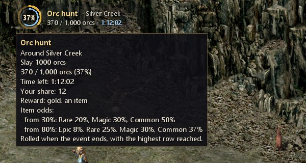
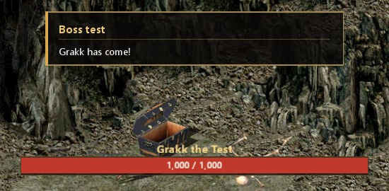

# World events

A [Sacred Gear](https://github.com/kirides/sacred-bild/blob/main/docs/Gear.md) mod that shows the **world event** of a game
server as a small movable indicator: a realm-wide goal such as *"slay 1000 orcs in 2 hours"*. Everybody who takes part shares the
reward when the realm makes it; the server announces the start, 25 / 50 / 75 % and the result in chat.



## What you need

* The mod: copy this folder to `mods\world-events` in the game folder and switch it on in the mod manager (**F11**).
* A game server with Sacred Gear's custom net messages and the script `world_events.lua`: the remake's
  `Sacred.GameServer` (`scripts-examples/world_events.lua` in the SacredEngineRemake repository; copy it to the server's
  `scripts` folder). **The original `GameServer.exe` cannot run scripts and does not carry the messages, so there is nothing for this mod
  to show there** and no fallback: the mod stays silent (the server's own chat lines do not exist either). In single player or
  a LAN game without that server the mod does nothing.

Players need no other setup: the server pushes the state when you join, when you enter another sector, when the progress
changes and every few seconds while an event runs. Names on the server's public dashboard page are character names only.

## The pill

A small, dark, rounded pill (about a third opaque, no frame, no title bar) with a **double ring**: the gold ring is the
realm's progress, the thin blue ring inside it drains with the time left (it turns orange in the last minute), and the
percentage is in the middle. To the right: the event's name, then `370 / 1,000 orcs · 1:12:04` (the timer in blue).

* **Details:** hover the pill with the cursor, or hold **Alt** (the game's "show text"), and a small tooltip lists the goal,
  the progress (`370 / 1,000 orcs (37%)`), the time left, **your share** (`Your share: 12 (10 needed for the reward)` until you
  reached the minimum), the reward, the **item odds** (see below) and, for an event tied to an area, Around Silver Creek; the area name also follows the title in the pill. The controller's mod menu (LT + LB by default) has **World events: pin / unpin the
  details**.
* **Pulse:** the pill glows for a moment when the realm passes 25, 50 or 75 % (a setting).
* **Result:** when an event ends, the pill shows one short line, **Completed!** or **Failed**, in a green or red ring, and fades
  out over its last seconds (the time is the server's `result_hold`, 2 minutes by default).
* **Move it:** hold **Alt** and press *Edit layout* (the layout editor from Sacred Gear's examples), drag it, resize it by its
  corner (the text and rings scale with its height). While you edit it shows a sample if no event runs, so you can place it
  any time. The place is kept in `mods\gear_layout.json`; a bigger size an older version of this mod kept (the old bar was
  300 x 86) is brought back to the new default (220 x 46).
* **Settings** (*Mods* screen, **F11**, or the *Mods* button under the escape menu; all reachable with the controller):
  * *Show the bar*: **always while an event runs** (default) or **only while Alt is held**. The controller's mod menu has an entry
    **World events: always / only with Alt** that switches it.
  * *Where*: **where the event counts** (default) or **everywhere**. An event that counts only in some sectors shows its pill
    while you stand in one of them; an event without sectors shows everywhere.
  * *Pulse at 25, 50 and 75 %* and *Show the result for a while*: on / off.
* **No key** is bound and there are no buttons: the pill takes no clicks (the mouse goes on to the game), so it never gets in
  the way.

The pill is a **bare panel** (`gear.ui.panel` with `bare = true`, added to Sacred Gear for it: no window chrome, but still a layout
panel). It needs a SacredGear.dll that has the option; an older one draws a plain panel with its title bar instead.

## Several pills in one group, and the region boss pill

All pills live in **one** movable panel (`world-events:bar`), one below the other, the first staying where the panel is. The panel's **width** sets
their size (resize it in the layout editor: the pills scale with it); its height is made from that and the number of pills, so it grows and
shrinks by itself. Order: the world events first (least time left first, results after the running ones), then the region boss pill. At most four
pills; more are a line **+N more**.

* **Several events at once:** the server may push `{v = 1, list = {state, state, ...}}` (at most 8 states, each in the format above, each checked) instead
  of one state; one state still works. The remake server runs one event at a time and pushes one state today; the client is ready for more.
* **The region boss pill (setting *Show the region boss progress*, on by default; the controller's mod menu has **World events: region boss pill on / off**):**
  while the hero stands in a region that counts kills towards its Region Boss (`gear.data.regions:of_creature(hero)`), a slim **teal** pill (not the events' gold)
  shows the region's name (the game's own text in the install's language: the record holds a text key such as `UI_REGION_SOUTHKERN`, which is looked up with `gear.text.get(hash(key) + 2^31)`, the game's own hash; without a text the key is shown readable, e.g. "Southkern", never the raw key), `kills / needed kills` and the percent; the tooltip adds the kills left until the boss, and the other regions that
  have progress this session. It reads the game's own count (`kills_needed` / `kills_left`), so it works in single player and online, needs no server, and
  shows a custom "kills needed" of the **Region counter** mod (which writes its numbers into the same records) without any link to it. A Gear without
  `gear.data.regions` shows no region pill. In the layout editor a sample region pill is shown so the group can be placed.
* **Region counter:** that mod only **configures** the regions now (kills needed in percent, progress kept per hero); it draws no pill of its own.

## Reward odds

The server can make the item reward better the further the realm gets (rows like *from 10 %: Magic 25 %, Common 75 %*). The tooltip lists the odds of the row the realm has reached and of the next one, as the server sends them, with the rule: the item is rolled once when the event ends, with the highest row reached. The server's dashboard, !event rewards and the milestone announcements show the same odds; nothing is hidden or added by this mod.

## How it talks to the server

Channel `worldevents:state` of `gear.net` (custom opcodes). The mod says `{hello = 1}` to the server when the messages become
available, when a game starts and every 30 seconds; the server answers with the state for this player:

```lua
{ v = 1, st = 'active', n = <event number>, title, text, unit = 'orcs', area = 'Silver Creek', count, target, left = <seconds>, dur, here = <counts where you are>,
  mine = <your share>, need = <minimum for the reward>, people, reward,
  odds = <current odds text>, odds_at = <percent>, odds_next = <next odds text>, odds_next_at = <percent> }
{ v = 1, st = 'won' | 'failed', n, title, text, count, target, hold = <seconds to keep showing>, here, people }
{ v = 1, st = 'idle', next_in = <seconds> }
```

Only messages from the server (slot 0) are accepted; everything is type-checked and clipped (`core.lua`) before it reaches a
draw call, and a state not refreshed for 2 minutes is dropped. Other mods can show something in the bar with
`gear.emit('world-events.state', {st = 'active', ...})`.

## Hooks: waves, items, gold and messages

An event can have **hooks**: a trigger (at a percent of the goal, after some minutes, when the event starts / succeeds / fails, or when
N creatures of one kind were defeated) and a list of actions (a *wave of creatures*, an *item*, *gold*, a *message*) for a target hero
(the killer, the host, a random hero, the area's owner, everybody in the area, everybody). The server's `world_events.lua` documents
the format and runs them; this mod's part:

* **A spawn wave (online):** the server only chooses the target heroes and sends each one the message `worldevents:spawn`
  (`{v = 1, id = '<event>:<hook>:<action>:<hero>', event, n, radius, kinds = {{type = 'Orc Warrior', weight = 3}, ...}, text}`). **The target's own
  game spawns the creatures around its own hero** (so exactly one client spawns a wave; the wave id drops a resend; only messages
  from the server are accepted; the count, radius and kinds are checked and capped). Creatures are chosen by weight; `type` is a type
  number or the game's name (`ORC_WARRIOR.GRN`, or words: `Orc Warrior`); an unknown name is logged and skipped. **Gear can only create creatures in a game of
  its own (single player): in a network game `gear.world.spawn` refuses, so a joining player's client cannot spawn a wave yet
  (logged, nothing breaks).** Items and gold by rarity are dropped by the server itself.
* **The tooltip** shows the next hook that has not fired ("Next: At 30% of the goal: 12 of Orc Warrior appear around you").
* **Single player / LAN without a server:** when no server pushed a state for 15 seconds the mod runs the events itself
  (`Without a server` in its settings, on by default). It reads **`events.json`** in the mod folder (a first run writes a small one to edit;
  a server's export, `/mods/world_events/export`, is the same format), counts your kills (a monster near you that was hit by you and died; the game's
  `kill` event in network games), fires the hooks for you (every target is you), shows the same bar and keeps the event across sessions
  (`local_events_state.json`). Time counts while the game runs. The world-event rewards by contribution are server business and are not paid locally; the hooks are the rewards.
  An item hook with a type name puts that item at your feet, one with a rarity / category rolls the game's own loot with a raised bonus (the
  same way the Bounty mod does it); a wave needs a SacredGear.dll with `gear.world.spawn`. Without `gear.store` (older DLLs) the files are read and written with `gear.read` / `gear.save`.

```json
{"v": 1, "config": {"first_delay": 60, "cooldown": 900, "result_hold": 120, "order": "sequence"},
 "events": [{"id": "orc-hunt", "title": "Orc hunt", "goal": "kill", "target": 100, "duration": 1800, "names": ["orc"], "unit": "orcs",
   "hooks": [{"at": 50, "actions": [{"action": "spawn", "n": 6, "radius": 500, "kinds": [{"type": "Orc Warrior", "weight": 3}, {"type": "Orc Shaman"}]}]},
             {"on": "success", "actions": [{"action": "gold", "amount": 5000}]}]}]}
```

## World bosses

A hook action **`boss`** turns a creature into a *world boss*: much more health, damage dealt multiplied, a share of the damage it takes
deflected or reflected, optional regeneration, a **name** and a **health bar** on the screen, an announcement and a **reward** when it falls.



```json
{"at": 50, "actions": [{"action": "boss", "name": "Grakk the Ravager", "kinds": [{"type": "Orc Warrior"}], "radius": 500,
   "health": 20, "damage": 3, "taken": 0.5, "reflect": 0.15, "deflect": 0.1, "regen": 0.005,
   "reward": {"gold": 5000, "item": {"quality": 9, "category": "weapon"}, "text": "Grakk drops his axe."},
   "text": "Grakk the Ravager has come for you!"}]}
```

* **Which creature:** `kinds` (a weighted list like a `spawn` wave: one is created around the hero, `radius` away) or `near` (`"near": "Orc"`: the
  **nearest hostile creature** whose type name has those words within about twice the radius **becomes the boss**; `"*"` any monster;
  `kinds` is the fallback when none is near). Spawned creatures are real monsters of the game's own type. Some animals the game spawns passive
  (a spawned wolf did not move); use fighters like orcs or goblins, or `near` on creatures the map already placed.
* **What it gets** (all optional): `health` x10 (1 to 1000, a multiple of the creature's own), `damage` x2 (0 to 50), `taken` x1 (0.05 to 10: 0.5 takes half),
  `deflect` (0 to 0.9: the chance a hit does nothing), `reflect` (0 to 1: the share of the damage taken that the attacker takes back; it never kills), `regen`
  (0 to 0.2: health per second as a share of the maximum). Level and size are not modifiable (see Gear's *Creature modifiers*); the numbers are clamped.
* **The bar:** a name over a red bar with `1,000 / 1,000` inside, in a **movable panel** `world-events:boss` (hold **Alt** and press *Edit layout*, like the
  pill; a sample shows while you edit), at most 3 bosses at once (+N more). It **takes no clicks** (the mouse goes on to the game); hover it or hold Alt for the details
  (the event, the health, the announcement, the reward). A defeated boss shows *Defeated* for a few seconds. Setting *Show the boss health bar*; the controller's mod menu has
  **World events: boss health bar on / off**.
* **Reward:** when the boss falls, `reward.gold` is added to your gold and `reward.item` (a type name, or a quality / category / level rolled like an item hook) drops at your feet;
  `reward.text` is shown as a message. A boss that leaves the world without dying (the creature is removed, you left the area for good) is reported `gone`, no reward.
* **Events** for other mods: `worldevent.boss.spawned` and `worldevent.boss.defeated` (see [Mod events](../../docs/ModEvents.md)). Another mod (or a test) can make a boss with
  `gear.emit('world-events.boss', {name = 'Grakk', near = 'Orc', health = 20, damage = 2, reward = {gold = 1000}})`.
* **Savegames:** a boss lives in the running game (Gear's modifiers are not saved). The mod keeps its list in `local_bosses.json` **per savegame**
  (`gear.store.game`, see the Gear docs): when you load a game that was saved while a boss was alive, the creature is in the world with the boosted health the save
  wrote, and the mod puts the boss back (the bar returns, `worldevent.boss.spawned` fires with `initial = true`) a few seconds after the load. A boss that died
  or is gone in that savegame is not brought back. Without Gear's creature modifiers (an older SacredGear.dll) a `boss` action is skipped with a log line.
* **Online and the server:** Gear can only create creatures and change them in a game of its own (single player, a LAN game you host). In a
  **dedicated-server game nothing can make the boss**: the server's `world_events.lua` (`boss` action, see the GameServer README) **announces** it on the channel
  `worldevents:boss` and the bar shows its name (no health numbers: the server has no creature), the server calls it defeated when a hero kills a creature
  of its kind, pays the reward and tells everybody. The same action also sends the target hero's game a `worldevents:spawn` message with the boss, which a game that can
  create creatures will use.

*Region boss / kill counters:* a hook's `kills` trigger counts creatures by name or type; a goal kind for the region boss kills can feed the
same `Runner:kill` (`hooks.lua`) with the boss as the creature. Nothing in this mod depends on that mod.

## Tests

No game needed (LuaJIT, from this folder):

```
luajit tests/core_test.lua     the state, percent / time / count formats, area, results, stale states
luajit tests/main_test.lua     main.lua against a fake gear: who may push, hello, what is drawn when, details, pulse, the controller entries
luajit tests/regions_test.lua  the region pill's view, the stack order and cap, lists of events in the core
luajit tests/hooks_test.lua    hook checking, the engine (thresholds, catch-up, once, kills, time), spawn message parsing, weighted kinds, dedupe, the local mode
luajit tests/local_test.lua    main.lua + localgame.lua with a fake world: the server's wave, a network game, kills in, hooks out, the server taking over
```

`src/world-events_selftest` runs in the real game (`-gear-auto`, a copy of the game folder, see its header): the pill as a bare layout panel,
hidden with "only while Alt" and outside the event's sector, a sample in the layout editor, an old kept size brought back, the result line, a move; a **spawn wave** (three orcs around the hero, once per wave id); screenshots `pill-*.bmp`, `wave.bmp`.

The server half has its own tests in the remake repository (`WorldEventsScriptTests`).

## Events for other mods

The mod publishes `worldevent.*` events (started, progress, completed; failed, and `worldevent.hook` when a trigger fires) with `gear.emit`; see [Mod events](../../docs/ModEvents.md#world-events).

## Development

- **Files:** `mod.lua`; `core.lua` (progress and reward odds, pure Lua); `hooks.lua` (hook checking, the engine, waves; pure); `localevents.lua` (the single player events; pure); `localgame.lua` (kills, spawning, items, gold); `regions.lua` (the region boss pill and the stack order; pure); `bosses.lua` (the world boss list; pure); `events.lua` (the hooks for other mods); `draw.lua` (drawing the pills and the boss bar); `main.lua` (the server messages, the single player mode, the boss manager, what is shown when). `tests/` needs no game. Self test: `src/world-events_selftest`.
- **Depends on:** `gear.net` (the channel of the server's `world_events.lua`, see the section above), `gear.ui` (a bar that the layout editor can move), `gear.settings`, `gear.emit`.
